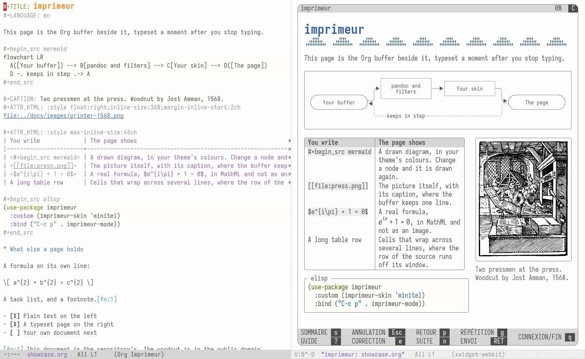
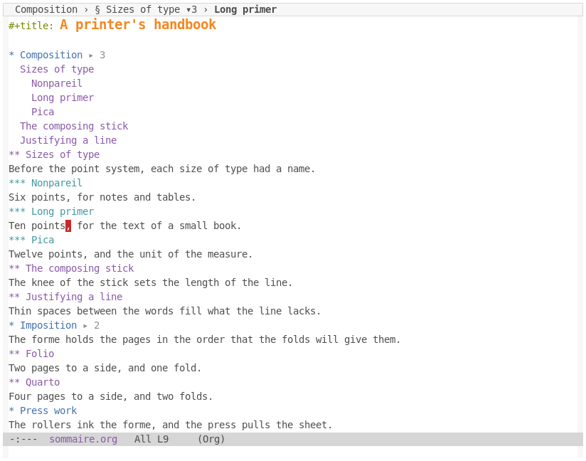

# imprimeur

[](#licence)
[](https://github.com/piotr-yuxuan/imprimeur/issues)


imprimeur shows the Org or Markdown buffer you are editing as a typeset
page, within one Emacs frame: one Emacs window shows the source and the
other the page. The page follows every change a moment after you stop
typing, saved or not, and replaces only the blocks you touched. Each of the
two follows the other's scrolling, and a double-click on the page puts point
on that place in the source. It shows your pictures, tables, code, maths,
Mermaid diagrams and videos, in the colours of your Emacs theme, and follows
a switch of theme without reloading. No document runs code in it, and an
untrusted one makes it fetch nothing from the network. Install it with
straight.el, then type `M-x imprimeur-mode` in the buffer. An Emacs without
xwidgets, or on a text terminal, shows the page in a desktop window of
Chromium instead.

<picture>
  <source media="(prefers-color-scheme: dark)" srcset="docs/images/emacs-view-dark.png">
  
</picture>

It is pre-release, in the one skin it has so far (see [Status](#status)).
Xwidgets, which put the page in an Emacs window, are experimental in Emacs:
[try them first](#try-xwidgets-first). So far the Emacs window has run on a
virtual X display alone: a real Wayland session has not been tried.

The repository holds a second package, [sommaire](#sommaire), which shows
where you are in a long Org or Markdown buffer and works without imprimeur.

## Install

You need Emacs 31.1 or later, [pandoc](https://pandoc.org/) 3 (tested with
3.7.0.2), and something to show the page in:

- for an Emacs window, an Emacs built with xwidgets (`--with-xwidgets`), on
  which `(featurep 'xwidget-internal)` is `t`. Tried with Emacs 31.1 built
  for PGTK and WebKitGTK 2.54.1, and with nothing else;
- for a desktop window, Chromium, or a browser that takes Chromium's options.

For Markdown, `markdown-mode`. For Mermaid diagrams,
[mermaid-cli](https://github.com/mermaid-js/mermaid-cli) (tested with
12.0.0), whose copy of Mermaid the page uses, or a Mermaid script of your
own.

With [straight.el](https://github.com/radian-software/straight.el) and
`use-package`:

```elisp
(use-package imprimeur
  :straight (imprimeur :type git :host github :repo "piotr-yuxuan/imprimeur"
                       ;; The repository holds two packages: take this one's
                       ;; Lisp files and the page's assets, which it finds
                       ;; beside them.
                       :files ("imprimeur/*.el" "imprimeur/assets")))
```

To work from a clone, add `:local-repo "<clone>"` to the recipe.

### Try xwidgets first

Xwidgets are experimental in Emacs: its own `etc/NEWS.29` says so of a video
in an xwidget, and that this is known to crash Emacs on some systems. A crash
takes your unsaved text with it. So try them in a separate Emacs before you
rely on them, from a clone:

```sh
nix develop --command make smoke-xwidget
```

This runs a separate `emacs -Q`, in a scratch home, on your display, for about
half a minute. It opens real pages in a desktop window of its own and prints
`PASS` or `FAIL` for each thing it checks: where the page opens, that the two
follow each other, `M-g v` both ways, a double-click on folded text, a palette,
a hostile document, a WebKit process that dies, once, again and again, or beside
a browser, and what killing either buffer asks. It also prints `REPORT` lines, such as what WebKit makes of a video.
Outside `nix develop`, name your Emacs with `EMACS=` and have pandoc and ffmpeg
on your path. If it fails, or you would rather not,
`(setq imprimeur-target 'browser)` keeps xwidgets out of it.

## Configure

Nothing is required. The package binds no key and changes nothing until
you turn the mode on, which adds `M-g v` where the mode is on. An example
with every option at its default value:

```elisp
(use-package imprimeur
  :straight (imprimeur :type git :host github :repo "piotr-yuxuan/imprimeur"
                       :files ("imprimeur/*.el" "imprimeur/assets"))
  ;; A key of your own: `imprimeur-mode' toggles the page of this buffer.
  :bind ("C-c i" . imprimeur-mode)
  :custom
  ;; Where the page opens: `auto', in an Emacs window when the selected Emacs
  ;; frame is graphic and this Emacs has xwidgets, and otherwise in a desktop
  ;; window of the browser; `xwidget', in an Emacs window, refusing where that
  ;; cannot run; `browser', in a desktop window of the browser.
  (imprimeur-target 'auto)
  ;; How `display-buffer' shows the page in an Emacs window: on the right of
  ;; the Emacs frame, over half its width, in an Emacs window that shows nothing
  ;; else; the source stays selected.  '((display-buffer-same-window)) takes
  ;; the source's Emacs window instead, and quitting brings the source back.
  (imprimeur-display-buffer-action
   '((display-buffer-reuse-window display-buffer-in-direction)
     (direction . right)
     (window . root)
     (window-width . 0.5)
     (dedicated . t)
     (reusable-frames . visible)))
  ;; Which way the page and the source follow each other's scrolling: `both';
  ;; `to-preview', the page follows the source alone; nil, neither, until you
  ;; turn `imprimeur-follow-mode' on by hand, when each follows the other.
  (imprimeur-scroll-sync 'both)
  ;; The browser that shows the page in a desktop window, with a profile of
  ;; its own.  Browsers built on Chromium take the same options, such as
  ;; "google-chrome-stable" or "brave"; only Chromium is tested.
  (imprimeur-browser-program "chromium")
  ;; pandoc 3.  A wrapper that adds options of its own is fine, as long as
  ;; the output stays a bare fragment: neither standalone nor with text
  ;; included before the body.
  (imprimeur-pandoc-program "pandoc")
  ;; Seconds after which a render is abandoned, and its error shown.
  (imprimeur-render-timeout 20)
  ;; Render 0.3 s after you stop typing, and every 2 s at least while you
  ;; type without a pause.
  (imprimeur-render-delay 0.3)
  (imprimeur-render-max-delay 2.0)
  ;; Load remote images (badges, pictures on the web) only for documents
  ;; that `trusted-content' accepts; nil never, t always.  Elsewhere each
  ;; one is a link that names its host, and nothing is fetched.
  (imprimeur-remote-images 'trusted)
  ;; Whether the page is light or dark: `auto' follows the background mode
  ;; of the Emacs frame that gives it its colours; `light' and `dark' force
  ;; one.  Emacs's colours stay: this chooses what stands in where a face
  ;; gives none.
  (imprimeur-appearance 'auto)
  ;; The Mermaid script with which the page draws diagrams: nil finds the
  ;; copy beside the program mmdc, from mermaid-cli; a file name uses that
  ;; file, a classic script that sets the global mermaid, which runs in the
  ;; page.  Without a script a diagram stays as code: the page never fetches
  ;; one from the network.
  (imprimeur-mermaid-script nil)
  :config
  ;; Markdown files without markdown-mode: choose the reader by file name.
  ;; Each entry is a major mode or a file-name pattern, and a pandoc reader.
  (add-to-list 'imprimeur-reader-alist '("\\.md\\'" . "gfm+sourcepos") t))

;; Documents you trust, such as your own notes, may load remote images and
;; include other files with #+INCLUDE: pandoc then runs without its sandbox.
;; This is Emacs's own option, shared with other packages, some of which
;; then run code from those files: list only what you wrote.
(setq trusted-content '("~/notes/"))
```

## Use

In an Org or Markdown buffer, `M-x imprimeur-mode` opens the page in an Emacs
window on the right of the Emacs frame, and the source stays selected. Then
type: the page shows the buffer's text a moment after each change, and what
you did not touch stays as it is. Pictures and videos under the document's
directory, or under its git repository, show in the page.

| Command                     | What it does                                                                                                                        |
|-----------------------------|-------------------------------------------------------------------------------------------------------------------------------------|
| `imprimeur-mode`            | Opens the page of this buffer, or closes it.                                                                                        |
| `imprimeur-show`            | Shows the page where `imprimeur-target` says, after you quit its Emacs window or killed its buffer.                                 |
| `imprimeur-jump`, `M-g v`   | From the source, brings point's block to the top of the page; from the page's Emacs window, goes back to the source.                |
| `imprimeur-follow-mode`     | Turns the following of each other's scrolling off or on, in this buffer.                                                            |
| `imprimeur-browse`          | Opens the page in a desktop window of the browser, whatever `imprimeur-target` says, or again after you closed it.                  |
| `imprimeur-copy-url`        | Copies the page's address, to open it in another browser. Anyone on this machine who has it can read the page while the mode is on. |
| `imprimeur-refresh-palette` | Gives the page the current colours and fonts, after a change that no switch of theme made, such as a new `imprimeur-appearance`.    |
| `imprimeur-stop-all`        | Closes every page; so do killing the buffer and leaving Emacs.                                                                      |

Links in the page go through Emacs: web addresses open with `browse-url`,
and documents or media under the document's root with
`find-file-other-window`; for any other link, Emacs says that it leads
nowhere. If pandoc fails, the page keeps the last good version and shows
pandoc's message above it.

**The page's Emacs window.** It shows the buffer `*imprimeur: NAME*`, whose
scrolling keys scroll the page: `SPC`, `S-SPC`, `DEL`, `C-v`, `M-v`, `C-n`,
`C-p`, `M-<` and `M->`. `q` takes the Emacs window away and leaves the page
live, so that `imprimeur-show` or `M-g v` brings it back. Killing that buffer
keeps the mode on, and `imprimeur-show` makes it anew. Killing the source kills
it too, and neither asks anything.

A page whose WebKit process dies loads again by itself. One that dies twice, each
time within a minute of showing your text, is left blank: the mode line says "not
answering" and a message offers `imprimeur-browse`. Killing that buffer and
`imprimeur-show` then try again. While a desktop window of the browser is open on
the same buffer, Emacs cannot tell that a WebKit process has died: the page stays
blank until you close that desktop window, and then it loads again.

A second buffer's page opens on the right of the Emacs frame too, over half its
width, so each one squeezes the Emacs windows already there;
`imprimeur-display-buffer-action` can put it elsewhere.

**Following.** The source and the page follow each other's scrolling, aligned
from the moment the page opens. That is `imprimeur-follow-mode`, local to the
buffer, which comes on with the page. Turn it off and neither moves for the
other, while the page goes on showing your text; turn it on and the page goes
at once to where the source is. `imprimeur-scroll-sync` says the directions, and
nil leaves the mode off in a new session. It goes by the blocks' lines in Org
and Markdown, as nearly as they allow, and by proportion in the other formats.

**A double-click on the page** puts point on the nearest line it knows, shows
the source if it is hidden, opens the fold around that line and flashes it. A
double-click on a link, a video, a sound or the `summary` of some details asks
for nothing, as a click already serves them, and neither does one on the banner,
which has no line. It works with the following off.

**`M-g v`** goes the other way. In the source it brings the block of point's
line to the top of the page and marks it for a moment, without motion if your
system asks for none; the window start stays where it is, and a hidden page is
shown. In the page's Emacs window, the same key selects the source, with point
on the line of the page's top block. The key exists only where the mode is on,
under Emacs's prefix for going somewhere; `imprimeur-jump` can be bound to any
other.

**Folded text is yours.** Scrolling the page across a fold leaves it closed:
the source's window start rests on its heading, and the page stays where you
put it. Only a jump opens a fold: a double-click, or `M-g v` from the page's
Emacs window.

**In a browser.** With `imprimeur-target` at `browser`, or at `auto` where Emacs
has no xwidgets or the Emacs frame is not graphic, the page opens in a desktop
window of Chromium, in its app mode; `imprimeur-browse` opens it there at any
time. Following, the double-click and `M-g v` hold there too, with one
difference: Emacs does not bring its own Emacs frame forward, which Wayland
would not let it do, so after a double-click in the browser's desktop window
point has moved in the source and the focus stays in the browser.

<picture>
  <source media="(prefers-color-scheme: dark)" srcset="docs/images/emacs-and-page-dark.png">
  
</picture>

**Colours.** The page takes its colours and fonts from the faces of the
Emacs frame that shows the buffer, and its own light and dark colours only
where a face gives none. A switch of theme, by hand or by a package such as
auto-dark, recolours the page at once, and nothing reloads.

**Diagrams.** A Mermaid block, `#+begin_src mermaid` or a fence named
`mermaid`, is drawn in those colours when the page has a Mermaid script: the
copy that mermaid-cli installs beside its program `mmdc`, or the file that
`imprimeur-mermaid-script` names. Without one, the block stays as code. A
source that does not parse keeps its last drawing, with the message beneath.

**Videos.** In Chromium, a video plays and seeks, and keeps playing while you
type elsewhere. One that the page cannot play gets a link, "Open externally":
Emacs visits the file, and a media package such as ready-player can play it.

In an Emacs window, WebKit plays video through GStreamer, whose plugins must be
in the environment of the Emacs that runs it: those your system installs, or
those that `GST_PLUGIN_SYSTEM_PATH_1_0` names. Without them, a video stays on a
still picture with a play disc that does nothing. So far it has done no more
with them, on a virtual display, where WebKit says that it can play the clip and
then asks for none of it; whether one plays in a real Emacs frame is not known
yet, and `make smoke-xwidget` reports it, with plugins and without. Either way
the page offers the same link, and `imprimeur-browse` shows the page where
videos play.

**Tables and maths.** A table too wide for the page scrolls by itself, and
long addresses in a cell break. LaTeX maths in Org and Markdown shows as
MathML, in a maths font if you have one, such as Libertinus Math or DejaVu
Math TeX Gyre; [how it works](docs/how-it-works.md#tables-and-maths) lists
the forms that each format reads.

The formats are those of `imprimeur-reader-alist`: Org, Markdown (GitHub's
dialect), reStructuredText, MediaWiki, Textile, Creole, POD, Jupyter
notebooks, CSV and TSV.


## How it works

<picture>
  <source media="(prefers-color-scheme: dark)" srcset="docs/images/architecture-dark.svg">
  
</picture>

A moment after you stop typing, Emacs sends the whole buffer to pandoc,
which returns HTML. A small HTTP server inside Emacs, on 127.0.0.1 only,
tells the page that a new version exists; the page fetches it, sanitises
it and replaces only the blocks that changed. [How imprimeur
works](docs/how-it-works.md) follows one edit to the page, explains the
scheduling, the page's Emacs window, scroll sync, the colours, the diagrams
and the videos, and lists every defence against a hostile document.

## Security

A document you open may come from anyone. imprimeur treats it as untrusted
unless Emacs's `trusted-content` says otherwise:

- pandoc runs with `--sandbox`, so a document cannot include other files;
- the page runs no script from the document: each version is sanitised
  with DOMPurify, and every response carries a strict Content Security
  Policy;
- a diagram is drawn by Mermaid in its strict mode, under settings that no
  document can change, and what it draws is sanitised again; the script
  comes from your disk, never from the network;
- the page navigates nowhere by itself: Emacs decides where each link may
  lead, and in an Emacs window it can save no file, open no other xwidget and
  stay on no other site;
- what the page tells Emacs of scrolling and double-clicks holds integers
  alone;
- remote images load only for trusted documents;
- the server listens on 127.0.0.1 only, under a random token per page,
  and checks the `Host` of each request and the `Origin` of each message
  from the page, against other web pages and other users of the machine;
- the browser's desktop window has a profile of its own, deleted
  afterwards, and the token appears in no process's command line.

The tests check each of these against hostile documents and diagrams in a
headless Chromium. WebKit, which those tests do not reach, gets one hostile
document from `make smoke-xwidget`.

## Status

Pre-release, built one plan at a time. Done: the page in an Emacs window beside
the one showing the source buffer, within one Emacs frame, or else in Chromium's
desktop window, live, safe, in the core of the Minitel skin; the Emacs theme's
colours, which follow auto-dark without a reload; Mermaid diagrams; videos that
seek, in Chromium; an update that replaces only the blocks you touched; scroll
sync both ways, a double-click to the source and `M-g v` to the page. Next:
typeset skins (French books of the XVII<sup>th</sup>, XVIII<sup>th</sup> and
XIX<sup>th</sup> centuries, a business briefing, a vertical Chinese page, a
handwritten notebook).

Not yet tried: a real Wayland session, as the Emacs window has run on Xvfb
alone, through `GDK_BACKEND=x11`; a wheel, keys and a double-click by a person's
hand in the xwidget, which the checks synthesise or leave out; and whether a
video plays there at all.

**sommaire** works in Org and Markdown buffers, pre-release too: see
[below](#sommaire). The page's own minitocs, under the same rules, come
later.

## sommaire

sommaire shows where you are in a long Org or Markdown document and takes
you anywhere else in it, without changing the file. It needs Emacs 31.1 or
later and no other package, imprimeur included. Install it as below, then
type `M-x sommaire-mode` in the buffer, or turn it on with a hook.



### What you see

**The header line** names the section around point, after whatever it
already holds, such as the path that breadcrumb shows. A moment after point
stops moving, it reads like `§ Sizes of type ▾3 › Long primer`: the section,
the number of its entries and the entry that holds point. With nothing else
in the header line, the segment shows the heading path too, as in the
picture, so that the row stays where it is as long as the mode is on.

**`M-g m`** asks for a heading and goes there, leaving the mark behind. It
offers the direct children of the section around point, so the list stays
short. `C-u M-g m` offers the whole document at all depths, and a numeric
prefix, as in `M-2 M-g m`, that many levels, this once. The mode binds this
key in its own map, and no other.

**The panel.** A click on the segment, or `M-x sommaire-panel`, shows that
list in a narrow side Emacs window, and another closes it. It is off until
you ask for it, leaves the selected Emacs window selected, follows point and
marks the entry that holds point. If you go there, or click:

| Key in the panel | What it does                                                     |
|------------------|------------------------------------------------------------------|
| `RET`, a click   | Goes to the heading of that entry.                               |
| `+`, `-`         | Lists one level more, or one fewer.                              |
| `r`              | Lists from the document, or from the section around point again. |
| `q`              | Closes the panel.                                                |

At the deepest level that the list has at that moment, `+` means every level,
and that goes on holding in the deeper sections you move to; `-` comes back from
there one level at a time. `r` keeps the depth as it stands, so every level stays
every level. What these keys change holds for that buffer alone, so that
`clone-indirect-buffer` gives each Emacs window a list of its own.

**A button and an inline minitoc.** Some headings end with a button such as
`▸ 3`, which counts their entries. A click on it opens the heading's minitoc
under its metadata, and another closes it, as does
`M-x sommaire-toggle-inline` for the nearest such heading around point. A
click on an entry goes to its heading. Each Emacs window shows at most one:
opening another closes the first.

A few rules keep all this quiet:

- A section is a heading with at least two children, at most two levels below
  the document, or the document itself when it has two. So a chain of headings
  with one child each has no section, and no minitoc.
- In a stack of headings with no text between them, only the first one worth
  a minitoc has a button, and the next one's entries join its list, so that
  lists never stack. In the picture, Composition's list holds the entries of
  Sizes of type, which has no button.
- A heading with a table of its own, `#+TOC: headlines N local` or an
  org-make-toc drawer, has no button.
- COMMENT headings, headings tagged `:noexport:` or with another tag of
  `org-export-exclude-tags`, `UNNUMBERED: notoc` and toc-org containers are
  not listed, nor is what lies under them. ARCHIVE headings are listed,
  dimmed, and never expanded.
- In Markdown, a lone first H1 is the document's title. What looks like a
  heading in code, front matter, an HTML block, a block quote, a list item
  or a footnote definition is not one.
- Under narrowing, a part that starts at a heading and holds nothing but
  deeper ones takes that heading for the document.
- An entry reads like its heading without the TODO keyword, priority, tags
  and statistics cookies, or takes the heading's `ALT_TITLE`. It reads as it is
  displayed: a link gives its description, and emphasis and code their words,
  so `* [[https://example.org/a][A link]] and *bold*` reads "A link and bold".

[The rules](docs/minitoc-rules.md) say all this in full, and [how it
works](docs/how-it-works.md#sommaire) explains the design.

**Folding** stays Org's and yours: sommaire never folds. A folded heading
hides its minitoc, and refuses to open one. A jump to a heading inside a fold
stops at the fold and leaves it closed, as Emacs keeps point out of hidden text;
Org's or outline's own commands unfold it. Org folds by itself; in Markdown,
this one line gives you Emacs's own:

```elisp
(add-hook 'markdown-mode-hook #'outline-minor-mode)
```

**Limits.** Any other inline markup in a heading, such as an entity, a
footnote's mark or raw HTML, shows as its source has it. A buffer of more than
1,000,000 accessible characters is not read: sommaire says so once, and again
when you ask it for a heading, and lists none until you narrow to less.

### Install

Install it with [straight.el](https://github.com/radian-software/straight.el)
and `use-package`. The two packages share one clone: each recipe names the same
`:local-repo` and its own `:files`. The recipe of imprimeur above gets that
clone by default, as straight.el names it after the repository.

```elisp
(use-package sommaire
  :straight (sommaire :type git :host github :repo "piotr-yuxuan/imprimeur"
                      ;; The clone that the two packages share, and this
                      ;; package's Lisp files.
                      :local-repo "imprimeur"
                      :files ("sommaire/*.el")))
```

To work from a clone of your own, write its path as `:local-repo` in the
recipe of each package you use.

### Configure

Nothing is required. Loading the package adds no timer, hook or key. An
example with every option at its default value:

```elisp
(use-package sommaire
  :straight (sommaire :type git :host github :repo "piotr-yuxuan/imprimeur"
                      :local-repo "imprimeur"
                      :files ("sommaire/*.el"))
  ;; On in every Org and Markdown buffer.  gfm-mode derives from markdown-mode
  ;; and runs its hook; markdown-ts-mode has a hook of its own.
  :hook ((org-mode markdown-mode) . sommaire-mode)
  ;; Keys of your own, for the two commands that have none.
  :bind (:map sommaire-mode-map
              ("C-c m" . sommaire-panel)
              ("C-c M" . sommaire-toggle-inline))
  :custom
  ;; Show the segment in the header line; nil leaves the header line alone.
  ;; The mode reads this when it starts.
  (sommaire-header-line t)
  ;; Give a button to the headings that have an inline minitoc; nil gives
  ;; none, and `sommaire-toggle-inline' still opens one.  The mode reads this
  ;; when it starts.
  (sommaire-heading-buttons t)
  ;; Follow point after this many seconds of idle time.  The first buffer to
  ;; turn the mode on reads this.
  (sommaire-idle-delay 0.4)
  ;; What `M-g m' and the panel list: (ROOT . DEPTH).  ROOT is `section', the
  ;; section around point, which follows it, or `document'.  DEPTH is how many
  ;; levels below ROOT: a positive integer, or `all'.  So (section . 1) is the
  ;; section's direct children, and (document . 2) the document's first two
  ;; levels.
  (sommaire-scope '(section . 1)))
```

The faces are `sommaire-current`, for the entry that holds point,
`sommaire-archived`, `sommaire-button` and `sommaire-inline`.

### Without imprimeur

Neither package needs the other: neither lists it in `Package-Requires`,
loads it or uses its code, so you can install either alone, and sommaire
runs with neither pandoc nor Chromium on the machine. They share this
repository for now. The page's minitocs, when they come, will follow the same
written rules, [`docs/minitoc-rules.md`](docs/minitoc-rules.md), and no code
will cross.

## Development

The checks run in `nix develop`, which provides every tool, and the one Emacs
that both packages target: that of nixpkgs at the revision that `flake.lock`
freezes.

```sh
nix develop --command make check
```

`make smoke-xwidget` is apart, as it opens a desktop window: [try xwidgets
first](#try-xwidgets-first). `AGENTS.md` gives the workflow and the rules.

## Licence

imprimeur and sommaire are licensed under the European Union Public
Licence 1.2 (`LICENSE`) or, at your option, the GNU General Public License,
version 3 or any later version (`COPYING`): `EUPL-1.2 OR GPL-3.0-or-later`.

imprimeur ships a copy of DOMPurify, under the Apache License 2.0 or the
Mozilla Public License 2.0: see `imprimeur/assets/vendor/dompurify/`.
