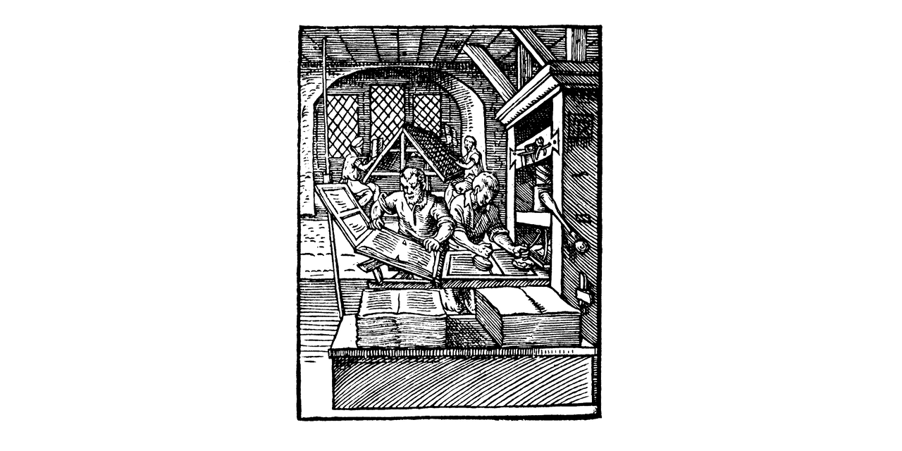
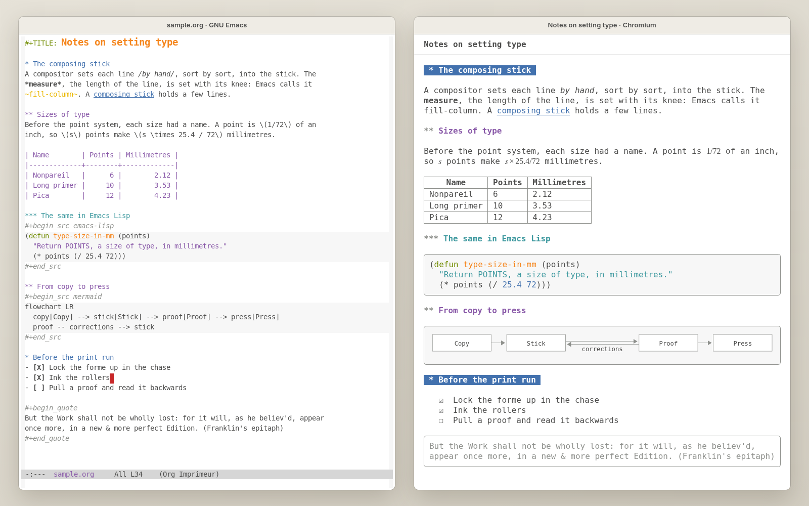
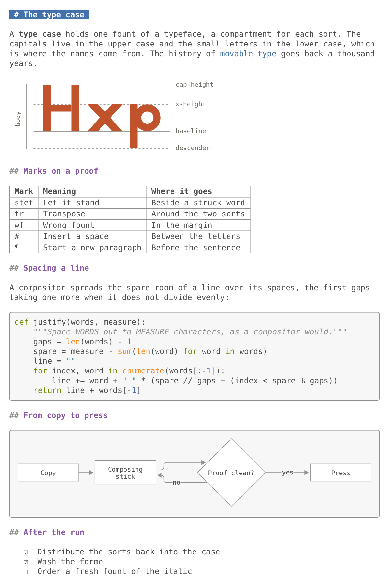

# imprimeur

[](#licence)
[](https://github.com/piotr-yuxuan/imprimeur/issues)



imprimeur shows the Org or Markdown buffer you are editing as a typeset
page, in a desktop window beside your Emacs frame. The page follows every
change a moment after you stop typing, saved or not, and replaces only the
blocks you touched. It shows your pictures, tables, code, maths, Mermaid
diagrams and videos, in the colours of your Emacs theme, and follows a
switch of theme without reloading. No document runs code in it, and an
untrusted one makes it fetch nothing from the network. Install it with
straight.el, then type `M-x imprimeur-mode` in the buffer.

<picture>
  <source media="(prefers-color-scheme: dark)" srcset="docs/images/emacs-and-page-dark.png">
  
</picture>

It is pre-release: the page opens in Chromium's own desktop window, in the
one skin it has so far. The aim is a view inside Emacs: within one Emacs
frame, two Emacs windows, one showing the source buffer and the other the
page. That, scroll sync and more skins arrive next (see
[Status](#status)).

## Install

You need Emacs 30.1 or later, [pandoc](https://pandoc.org/) 3 (tested with
3.7.0.2) and Chromium, or a browser that takes Chromium's options. For
Markdown, `markdown-mode`. For Mermaid diagrams,
[mermaid-cli](https://github.com/mermaid-js/mermaid-cli) (tested with
12.0.0), whose copy of Mermaid the page uses, or a Mermaid script of your
own.

With [straight.el](https://github.com/radian-software/straight.el) and
`use-package`:

```elisp
(use-package imprimeur
  :straight (imprimeur :type git :host github :repo "piotr-yuxuan/imprimeur"
                       ;; The repository holds two packages: take this one's
                       ;; Lisp files and the page's assets, which it finds
                       ;; beside them.
                       :files ("imprimeur/*.el" "imprimeur/assets")))
```

To work from a clone, add `:local-repo "<clone>"` to the recipe.

## Configure

Nothing is required. The package binds no key and changes nothing until
you turn the mode on. An example with every option at its default value:

```elisp
(use-package imprimeur
  :straight (imprimeur :type git :host github :repo "piotr-yuxuan/imprimeur"
                       :files ("imprimeur/*.el" "imprimeur/assets"))
  ;; A key of your own: `imprimeur-mode' toggles the page of this buffer.
  :bind ("C-c i" . imprimeur-mode)
  :custom
  ;; The browser that shows the page, in a desktop window and a profile of
  ;; its own.  Browsers built on Chromium take the same options, such as
  ;; "google-chrome-stable" or "brave"; only Chromium is tested.
  (imprimeur-browser-program "chromium")
  ;; pandoc 3.  A wrapper that adds options of its own is fine, as long as
  ;; the output stays a bare fragment: neither standalone nor with text
  ;; included before the body.
  (imprimeur-pandoc-program "pandoc")
  ;; Seconds after which a render is abandoned, and its error shown.
  (imprimeur-render-timeout 20)
  ;; Render 0.3 s after you stop typing, and every 2 s at least while you
  ;; type without a pause.
  (imprimeur-render-delay 0.3)
  (imprimeur-render-max-delay 2.0)
  ;; Load remote images (badges, pictures on the web) only for documents
  ;; that `trusted-content' accepts; nil never, t always.  Elsewhere each
  ;; one is a link that names its host, and nothing is fetched.
  (imprimeur-remote-images 'trusted)
  ;; Whether the page is light or dark: `auto' follows the background mode
  ;; of the Emacs frame that gives it its colours; `light' and `dark' force
  ;; one.  Emacs's colours stay: this chooses what stands in where a face
  ;; gives none.
  (imprimeur-appearance 'auto)
  ;; The Mermaid script with which the page draws diagrams: nil finds the
  ;; copy beside the program mmdc, from mermaid-cli; a file name uses that
  ;; file, a classic script that sets the global mermaid, which runs in the
  ;; page.  Without a script a diagram stays as code: the page never fetches
  ;; one from the network.
  (imprimeur-mermaid-script nil)
  :config
  ;; Markdown files without markdown-mode: choose the reader by file name.
  ;; Each entry is a major mode or a file-name pattern, and a pandoc reader.
  (add-to-list 'imprimeur-reader-alist '("\\.md\\'" . "gfm+sourcepos") t))

;; Documents you trust, such as your own notes, may load remote images and
;; include other files with #+INCLUDE: pandoc then runs without its sandbox.
;; This is Emacs's own option (Emacs 30), shared with other packages, some
;; of which then run code from those files: list only what you wrote.
(setq trusted-content '("~/notes/"))
```

## Use

In an Org or Markdown buffer, `M-x imprimeur-mode` opens the page in a
desktop window of Chromium, in its app mode. Then type: the page shows the
buffer's text a moment after each change, and what you did not touch stays
as it is. Pictures and videos under the document's directory, or under its
git repository, show in the page.

| Command | What it does |
|---|---|
| `imprimeur-mode` | Opens the page of this buffer, or closes it. |
| `imprimeur-browse` | Opens the desktop window again after you closed it. |
| `imprimeur-copy-url` | Copies the page's address, to open it in another browser. Anyone on this machine who has it can read the page while the mode is on. |
| `imprimeur-refresh-palette` | Gives the page the current colours and fonts, after a change that no switch of theme made, such as a new `imprimeur-appearance`. |
| `imprimeur-stop-all` | Closes every page; so do killing the buffer and leaving Emacs. |

Links in the page go through Emacs: web addresses open with `browse-url`,
and documents or media under the document's root with
`find-file-other-window`; for any other link, Emacs says that it leads
nowhere. If pandoc fails, the page keeps the last good version and shows
pandoc's message above it.

**Colours.** The page takes its colours and fonts from the faces of the
Emacs frame that shows the buffer, and its own light and dark colours only
where a face gives none. A switch of theme, by hand or by a package such as
auto-dark, recolours the page at once, and nothing reloads.

**Diagrams.** A Mermaid block, `#+begin_src mermaid` or a fence named
`mermaid`, is drawn in those colours when the page has a Mermaid script: the
copy that mermaid-cli installs beside its program `mmdc`, or the file that
`imprimeur-mermaid-script` names. Without one, the block stays as code. A
source that does not parse keeps its last drawing, with the message beneath.

**Videos.** A video plays and seeks, and keeps playing while you type
elsewhere. One that the page cannot play gets a link, "Open externally":
Emacs visits the file, and a media package such as ready-player can play it.

**Tables and maths.** A table too wide for the page scrolls by itself, and
long addresses in a cell break. LaTeX maths in Org and Markdown shows as
MathML, in a maths font if you have one, such as Libertinus Math or DejaVu
Math TeX Gyre; [how it works](docs/how-it-works.md#tables-and-maths) lists
the forms that each format reads.

The formats are those of `imprimeur-reader-alist`: Org, Markdown (GitHub's
dialect), reStructuredText, MediaWiki, Textile, Creole, POD, Jupyter
notebooks, CSV and TSV.



## How it works

<picture>
  <source media="(prefers-color-scheme: dark)" srcset="docs/images/architecture-dark.svg">
  
</picture>

A moment after you stop typing, Emacs sends the whole buffer to pandoc,
which returns HTML. A small HTTP server inside Emacs, on 127.0.0.1 only,
tells the page that a new version exists; the page fetches it, sanitises
it and replaces only the blocks that changed. [How imprimeur
works](docs/how-it-works.md) follows one edit to the page, explains the
scheduling, the colours, the diagrams and the videos, and lists every
defence against a hostile document.

## Security

A document you open may come from anyone. imprimeur treats it as untrusted
unless Emacs's `trusted-content` says otherwise:

- pandoc runs with `--sandbox`, so a document cannot include other files;
- the page runs no script from the document: each version is sanitised
  with DOMPurify, and every response carries a strict Content Security
  Policy;
- a diagram is drawn by Mermaid in its strict mode, under settings that no
  document can change, and what it draws is sanitised again; the script
  comes from your disk, never from the network;
- the page navigates nowhere by itself: Emacs decides where each link may
  lead;
- remote images load only for trusted documents;
- the server listens on 127.0.0.1 only, under a random token per page,
  and checks the `Host` of each request and the `Origin` of each message
  from the page, against other web pages and other users of the machine;
- the browser's desktop window has a profile of its own, deleted
  afterwards, and the token appears in no process's command line.

The tests check each of these against hostile documents and diagrams in a
headless Chromium.

## Status

Pre-release, built one plan at a time. Done: the page in Chromium's desktop
window, live, safe, in the core of the Minitel skin; the Emacs theme's
colours, which follow auto-dark without a reload; Mermaid diagrams; videos
that seek; an update that replaces only the blocks you touched. Next: the
page inside Emacs, in an Emacs window beside the one showing the source
buffer, within one Emacs frame; scroll sync both ways; then typeset skins
(French books of the XVII<sup>th</sup>, XVIII<sup>th</sup> and XIX<sup>th</sup>
centuries, a business briefing, a
vertical Chinese page, a handwritten notebook).

This repository also holds **sommaire**, a second package to come: mini
tables of contents in Org and Markdown buffers, one for the section around
point and one under a heading on request, never stacked. It will work
without imprimeur.

## Development

The checks run in `nix develop`, which provides every tool and the
packages' minimum Emacs versions:

```sh
nix develop --command make check
nix develop --command make test-min
```

`nix develop --accept-flake-config` fetches Emacs 29.1 and 30.1 from the
binary cache of nix-emacs-ci instead of building them. `AGENTS.md` gives
the workflow and the rules.

## Licence

imprimeur and sommaire are licensed under the European Union Public
Licence 1.2 (`LICENSE`) or, at your option, the GNU General Public License,
version 3 or any later version (`COPYING`): `EUPL-1.2 OR GPL-3.0-or-later`.

imprimeur ships a copy of DOMPurify, under the Apache License 2.0 or the
Mozilla Public License 2.0: see `imprimeur/assets/vendor/dompurify/`.
