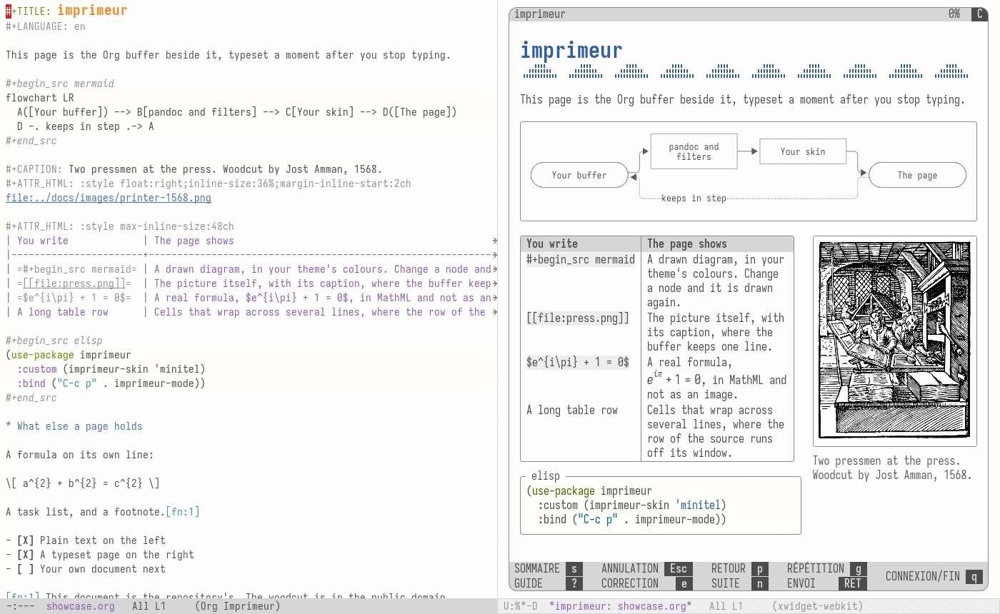
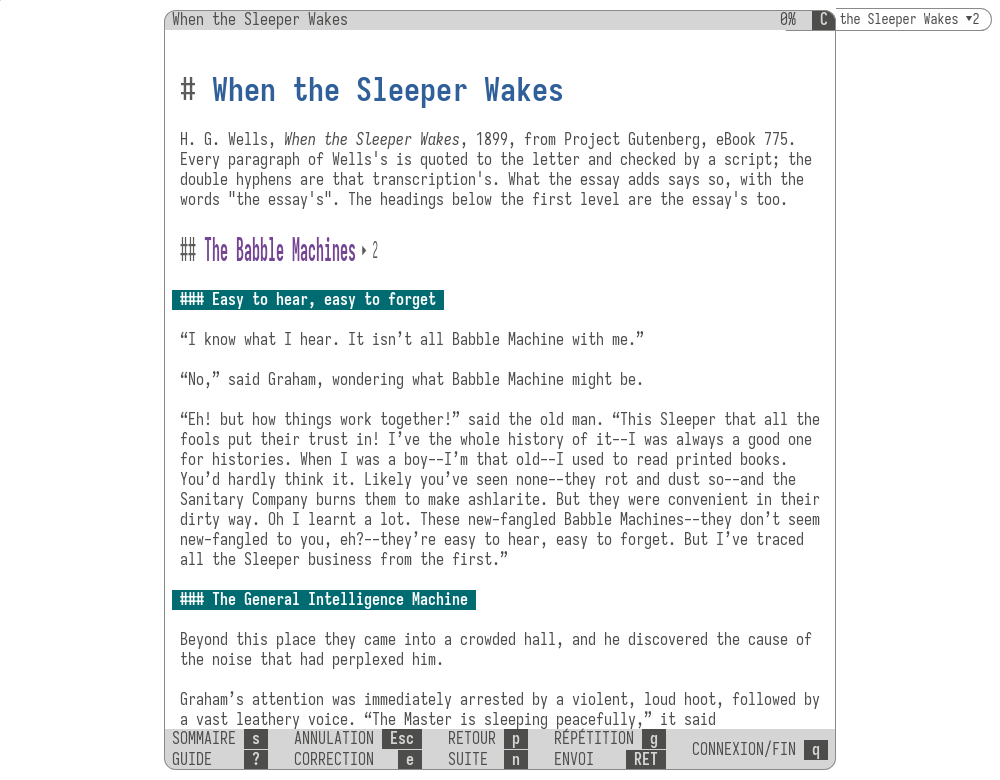
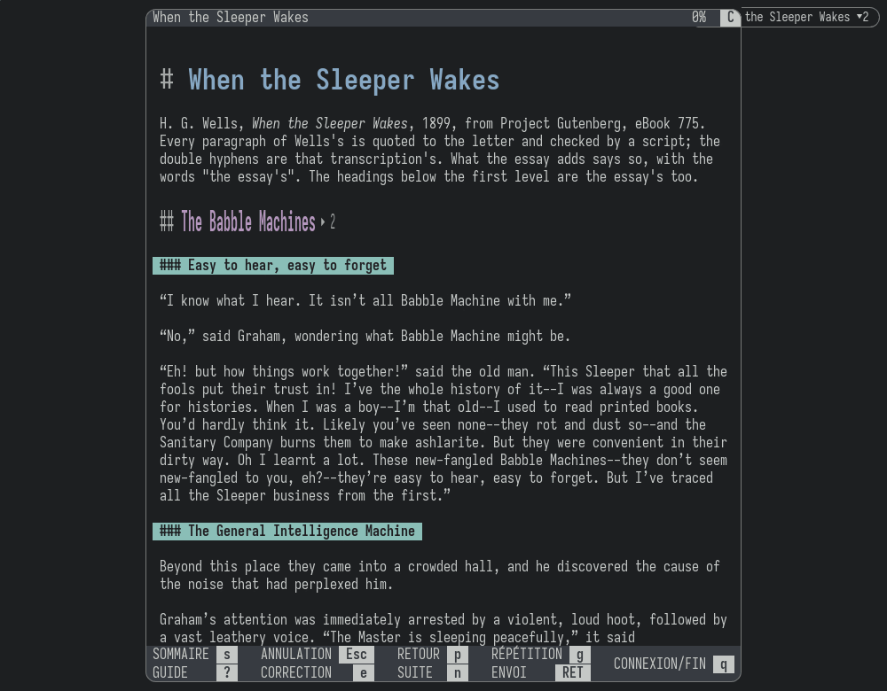
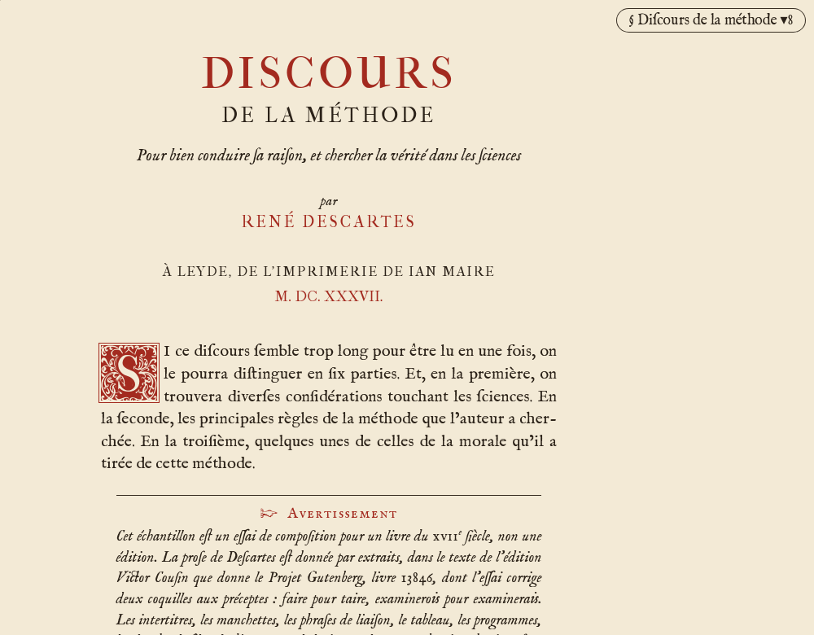
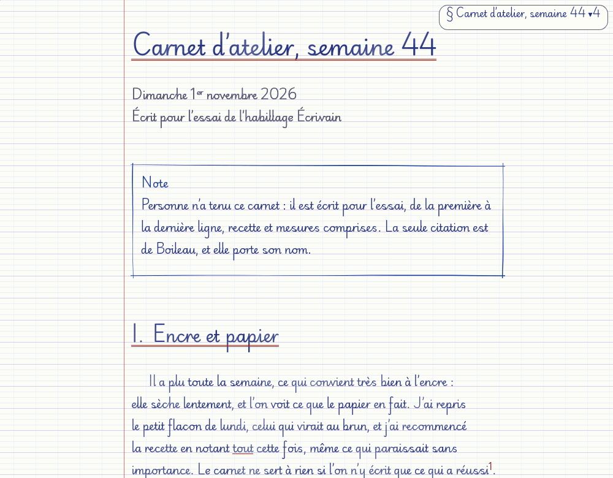
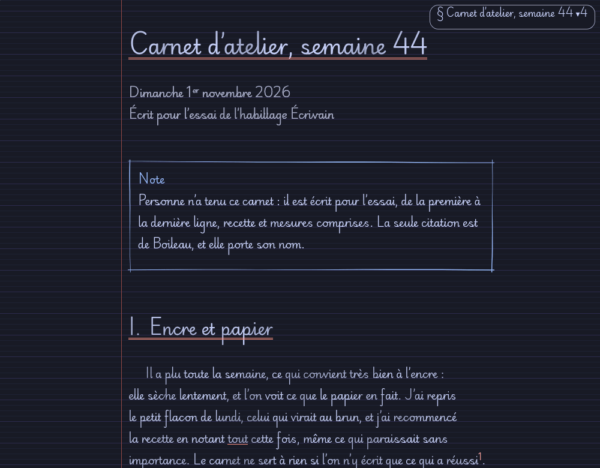
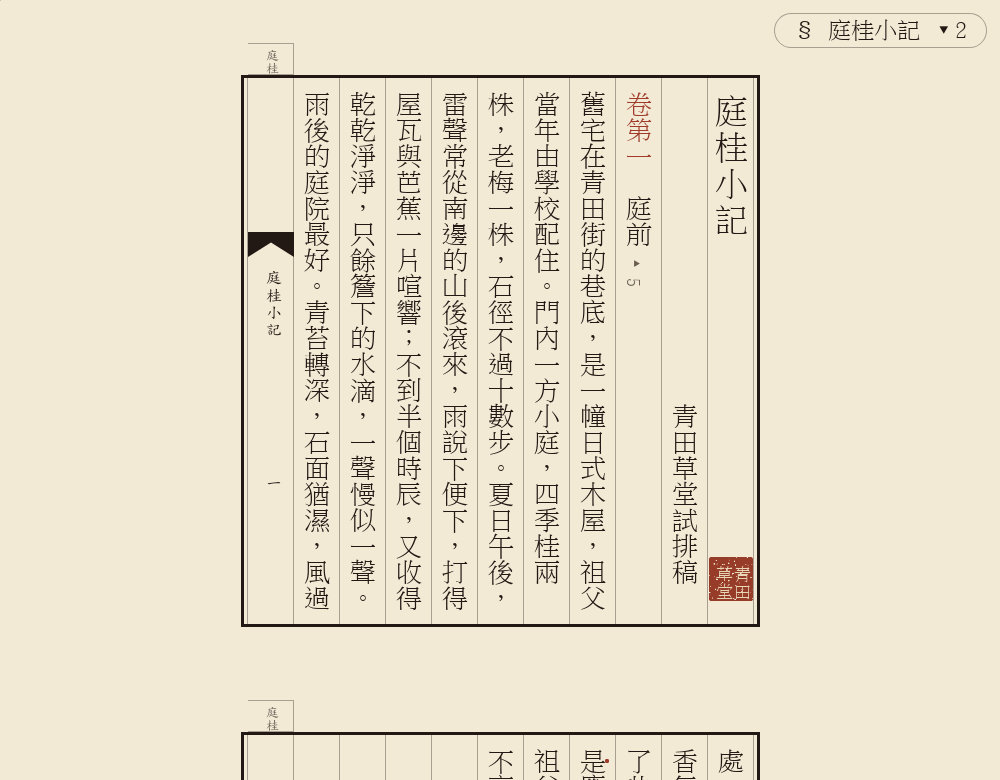
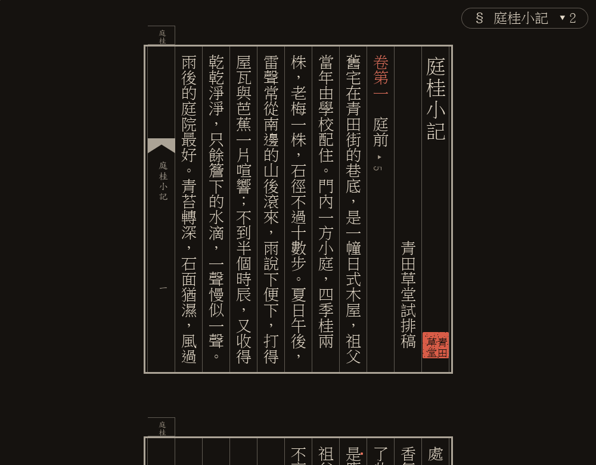
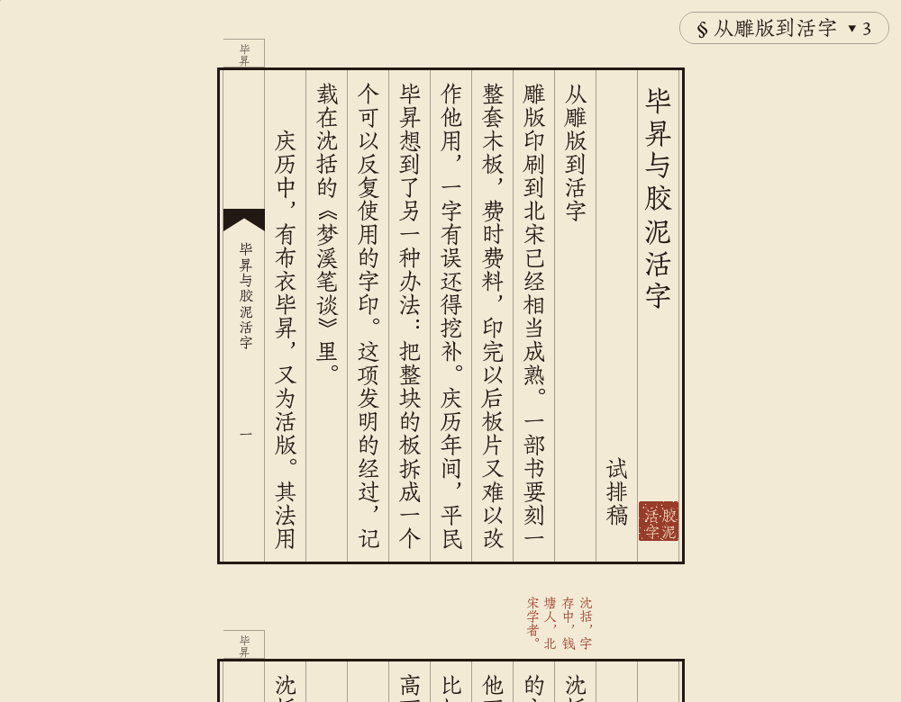

<div lang="zh-CN">

# imprimeur

[English](README.md) · [繁體中文](README.zh-Hant.md) · 简体中文

本文根据英文版提交 `7dd8e2e` 翻译。文中链接的文档均为英文。

[](https://github.com/piotr-yuxuan/imprimeur/actions/workflows/ci.yml)
[](https://github.com/piotr-yuxuan/imprimeur/actions/workflows/cd.yml)

<br>

imprimeur 把你正在编辑的 Org 或 Markdown 缓冲区排版成页面，显示在旁边的 Emacs 窗口（window）中，并让两者保持同步。无论是否保存，只要停止输入片刻，页面就会跟上每一处改动。文档不能在页面里运行代码，不受信任的文档也无法让页面从网络获取任何内容。目前仍处于预发布阶段。

<picture>
  <source media="(prefers-color-scheme: dark)" srcset="docs/images/emacs-view-dark.png">
  
</picture>

## 安装

需要 Emacs 31.1、[pandoc](https://pandoc.org/) 3，以及用来显示页面的环境：编译时启用了 xwidgets 的 Emacs（Nix 下用 `pkgs.emacs-pgtk`），或者 Chromium（在桌面窗口中显示）。使用 [straight.el](https://github.com/radian-software/straight.el) 和 `use-package` 时：

```elisp
(use-package imprimeur
  :straight (imprimeur :type git :host github :repo "piotr-yuxuan/imprimeur"
                       :files ("imprimeur/*.el" "imprimeur/assets")))
```

然后在缓冲区中执行 `M-x imprimeur-mode`。[第一次预览](docs/tutorials/first-preview.md)从克隆仓库讲起，不需要事先安装任何包。处理 Markdown 还要安装 `markdown-mode`；绘制 Mermaid 图表需要 [mermaid-cli](https://github.com/mermaid-js/mermaid-cli)；在 Emacs 窗口中播放视频，需要该 Emacs 的运行环境里有 GStreamer 插件。

上面的配方跟踪 `main` 的最新提交。如果要锁定某个[发布版本](https://github.com/piotr-yuxuan/imprimeur/releases)，可以用 Emacs 自带的 `:vc` 指定标签：

```elisp
(use-package imprimeur
  :vc (:url "https://github.com/piotr-yuxuan/imprimeur" :rev "0.0.0" :lisp-dir "imprimeur"))
```

straight 会沿用已有的克隆，克隆有改动时也未必察觉。要更新时，先退出 Emacs，更新克隆并删除构建结果，下次启动时会重新构建：

```sh
git -C ~/.emacs.d/straight/repos/imprimeur pull --ff-only
rm -rf ~/.emacs.d/straight/build/imprimeur* ~/.emacs.d/straight/build/sommaire
```

### 先试用 xwidgets

xwidgets 在 Emacs 中仍是实验性功能，一旦崩溃，未保存的内容也会丢失。所以正式使用之前，建议先在克隆的仓库中用单独的 Emacs 试一试：

```sh
nix develop --command make smoke-xwidget
```

它会打开一个单独的桌面窗口，在其中加载真实页面，运行约一分钟，并为每个检查项打印 `PASS` 或 `FAIL`。如果检查未通过，或者你不想用 xwidgets，可以设置 `(setq imprimeur-target 'browser)` 完全绕开它。

## 仓库内容

每个包都可以单独安装，配方见[配置](#configuration)。

| 包 | 用途 | 依赖 |
|---|---|---|
| `imprimeur` | 把缓冲区排版成页面 | Emacs 31.1、pandoc 3，以及 xwidgets 或 Chromium |
| `sommaire` | 缓冲区内的迷你目录：显示你在长文档中的位置，并可跳转到其他位置 | 只需要 Emacs 31.1，也不依赖 imprimeur |
| `imprimeur-skin-minitel` | 皮肤（skin）：向终端致敬，使用主题的配色。安装后页面默认使用它 | `imprimeur`，不需要字体 |
| `imprimeur-skin-xix` | 皮肤：十九世纪的法国书籍 | `imprimeur` 及其字体 |
| `imprimeur-skin-xviii` | 皮肤：十八世纪的法国书籍 | `imprimeur` 及其字体 |
| `imprimeur-skin-xvii` | 皮肤：十七世纪的法国书籍 | `imprimeur` 及其字体 |
| `imprimeur-skin-briefing` | 皮肤：现代商务备忘录 | `imprimeur` 及其字体 |
| `imprimeur-skin-ecrivain` | 皮肤：纸上手写 | `imprimeur` 及其字体，横线对齐依赖这些字体 |
| `imprimeur-skin-tianlu` | 皮肤：宋刻本版面，中文竖排 | `imprimeur`，以及约 580 MB 字体 |

安装皮肤就是安装代码：它的样式表在页面中运行，过滤器在 pandoc 中运行。

## 效果图

均为真实截图，由 `scripts/make-gallery` 生成。各文档见[示例](examples/README.md)。

| 皮肤 | 浅色 | 深色 |
|---|---|---|
| [Minitel](imprimeur-skin-minitel/README.md) |  |  |
| [XIX](imprimeur-skin-xix/README.md) |  |  |
| [XVIII](imprimeur-skin-xviii/README.md) |  |  |
| [XVII](imprimeur-skin-xvii/README.md) |  |  |
| [Briefing](imprimeur-skin-briefing/README.md) |  |  |
| [Écrivain](imprimeur-skin-ecrivain/README.md) |  |  |
| [Tianlu](imprimeur-skin-tianlu/README.md)，繁体：《庭桂小记》 |  |  |
| [Tianlu](imprimeur-skin-tianlu/README.md)，简体：《毕昇与胶泥活字》 |  |  |

## <a id="configuration"></a>配置

只有这个 Emacs 带有 xwidgets，页面才能显示在 Emacs 窗口中。要确认这一点，可以输入 `M-: (featurep 'xwidget-internal) RET`：结果为 `t` 表示带有 xwidgets，为 `nil` 则页面改在浏览器中打开。

下面是一份完整配置，按加载顺序排列；代码块里的注释保持英文。所有取值都是默认值，只需保留你改动过的项。删除某一项后，如果新版本改了默认值，它会随之变化；保留在这里的值则不变。

```elisp
;; imprimeur first: a skin's recipe needs it.
(use-package imprimeur
  :straight (imprimeur :type git :host github :repo "piotr-yuxuan/imprimeur"
                       ;; This package's Lisp files, and the page's assets beside them.
                       :files ("imprimeur/*.el" "imprimeur/assets"))
  ;; A key of your own.  The mode adds M-g v, M-g s and M-g o where it is on, and no other.
  :bind ("C-c i" . imprimeur-mode)
  :custom
  ;; Where the page opens: `auto', in an Emacs window when the selected Emacs frame is
  ;; graphic and this Emacs has xwidgets, otherwise in a desktop window of the browser;
  ;; `xwidget', in an Emacs window, refusing where that cannot run; `browser', in a
  ;; desktop window of the browser.
  (imprimeur-target 'auto)
  ;; How `display-buffer' shows the page in an Emacs window: on the right of the Emacs
  ;; frame, half its width, and the source stays selected.  '((display-buffer-same-window))
  ;; takes the source's Emacs window instead, and quitting brings the source back.
  (imprimeur-display-buffer-action
   '((display-buffer-reuse-window display-buffer-in-direction)
     (direction . right)
     (window . root)
     (window-width . 0.5)
     (dedicated . t)
     (reusable-frames . visible)))
  ;; Which way the page and the source follow each other's scrolling: `both'; `to-preview',
  ;; the page follows the source alone; nil, neither, until `imprimeur-follow-mode' by hand.
  (imprimeur-scroll-sync 'both)
  ;; The browser of a desktop window: Chromium, or one that takes its options.
  (imprimeur-browser-program "chromium")
  ;; pandoc 3, or a wrapper whose output stays a bare fragment.
  (imprimeur-pandoc-program "pandoc")
  ;; Which pandoc reader a buffer takes: a major mode, or a pattern on the file name.
  ;; Markdown without markdown-mode: add ("\\.md\\'" . "gfm+sourcepos").
  (imprimeur-reader-alist
   '((org-mode . "org")
     (markdown-mode . "gfm+sourcepos")
     (rst-mode . "rst")
     (mediawiki-mode . "mediawiki")
     (textile-mode . "textile")
     ("\\.creole\\'" . "creole")
     ("\\.pod\\'" . "pod")
     ("\\.ipynb\\'" . "ipynb")
     ("\\.csv\\'" . "csv")
     ("\\.tsv\\'" . "tsv")))
  ;; Seconds of quiet after a change before a render.
  (imprimeur-render-delay 0.3)
  ;; Seconds after which a render happens even while you go on typing.
  (imprimeur-render-max-delay 2.0)
  ;; Seconds after which a render is abandoned, and its error shown.
  (imprimeur-render-timeout 20)
  ;; Whether remote images load: `trusted', for documents that `trusted-content' accepts;
  ;; nil, never; t, always.  Elsewhere each one is a link that names its host.
  (imprimeur-remote-images 'trusted)
  ;; Whether the page is light or dark: `auto', as the Emacs frame; `light'; `dark'.
  (imprimeur-appearance 'auto)
  ;; The script that draws Mermaid diagrams: nil, the copy beside the program mmdc; or a
  ;; file name.  Without one a diagram stays as code, and nothing is fetched.
  (imprimeur-mermaid-script nil)
  ;; The skin of a new page: `auto', Minitel if installed and otherwise the plain page;
  ;; `base', the plain page; or a skin's name, such as `xix'.
  (imprimeur-skin 'auto)
  ;; Each skin's options, to start from; M-g o tries one, and says what to write here.
  (imprimeur-skin-options
   '((minitel
      ;; The colours: "emacs", your theme's; "videotex"; "greys".
      (palette . "emacs")
      ;; The columns: "80"; "40", in larger letters.
      (columns . "80")
      ;; The bar of keys: "fixed"; "end", at the document's end; "off".
      (keys . "fixed"))
     (xix
      ;; The text: "junicode", "bodoni-moda", "bodoni-moda-optical", "playfair",
      ;; "playfair-display", "old-standard", "theano", "libertinus", "eb-garamond".
      (text-face . "junicode")
      ;; "none", "common", "discretionary", "historical".
      (ligatures . "discretionary")
      ;; The column in rem: "24", "24-5" and so on by half a rem, to "40".
      (measure . "30"))
     (xviii
      ;; "baskervville", "junicode".
      (face . "baskervville")
      ;; Long s, under Junicode only: "off", "on".
      (long-s . "off")
      ;; "fleurons", "rinceau", "entrelacs", "perles", "filet".
      (bands . "fleurons"))
     (xvii
      ;; "im-fell", "eb-garamond", "garamond-libre".
      (face . "im-fell")
      ;; Long s: "on", "off".
      (long-s . "on")
      ;; Historical ligatures: "on", "off".
      (ligatures . "on")
      ;; Notes in the margin: "on"; "off", at the end of the section.
      (manchettes . "on"))
     (briefing
      ;; "blue", "teal", "aubergine", "graphite".
      (accent . "blue")
      ;; "compact", "regular", "airy".
      (density . "compact")
      ;; The bottom line, the titles and the callouts alone: "off", "on".
      (skim . "off"))
     (ecrivain
      ;; The hand and its paper: "cahier", "carnet", "notes", "ardoise".
      (variant . "cahier")
      ;; In Cahier: "moderne", "trad".
      (hand . "moderne")
      ;; "variante", the variant's own; "bleu-noir", "bleu", "noir", "violet", "sepia".
      (ink . "variante")
      ;; "pageless", one long sheet; "pages", the leaves of a notebook.
      (sheet . "pageless"))
     (tianlu
      ;; The grid and its dress: "song", "juzhen", "siku".
      (preset . "song")
      ;; "auto", as the preset says; "moe", "kai", "ming", "fang".
      (face . "auto")))))

;; A skin is one recipe, and imprimeur registers it once it loads.  Keep those you want.
(use-package imprimeur-skin-minitel
  :straight (imprimeur-skin-minitel :type git :host github :repo "piotr-yuxuan/imprimeur"
                                    :local-repo "imprimeur"
                                    :files ("imprimeur-skin-minitel/*.el" "imprimeur-skin-minitel/assets"))
  :defer t)

(use-package imprimeur-skin-xix
  :straight (imprimeur-skin-xix :type git :host github :repo "piotr-yuxuan/imprimeur"
                                :local-repo "imprimeur"
                                :files ("imprimeur-skin-xix/*.el" "imprimeur-skin-xix/assets"))
  :defer t)

(use-package imprimeur-skin-xviii
  :straight (imprimeur-skin-xviii :type git :host github :repo "piotr-yuxuan/imprimeur"
                                  :local-repo "imprimeur"
                                  :files ("imprimeur-skin-xviii/*.el" "imprimeur-skin-xviii/assets"))
  :defer t)

(use-package imprimeur-skin-xvii
  :straight (imprimeur-skin-xvii :type git :host github :repo "piotr-yuxuan/imprimeur"
                                 :local-repo "imprimeur"
                                 :files ("imprimeur-skin-xvii/*.el" "imprimeur-skin-xvii/assets"))
  :defer t)

(use-package imprimeur-skin-briefing
  :straight (imprimeur-skin-briefing :type git :host github :repo "piotr-yuxuan/imprimeur"
                                     :local-repo "imprimeur"
                                     :files ("imprimeur-skin-briefing/*.el" "imprimeur-skin-briefing/assets"))
  :defer t)

(use-package imprimeur-skin-ecrivain
  :straight (imprimeur-skin-ecrivain :type git :host github :repo "piotr-yuxuan/imprimeur"
                                     :local-repo "imprimeur"
                                     :files ("imprimeur-skin-ecrivain/*.el" "imprimeur-skin-ecrivain/assets"))
  :defer t)

(use-package imprimeur-skin-tianlu
  :straight (imprimeur-skin-tianlu :type git :host github :repo "piotr-yuxuan/imprimeur"
                                   :local-repo "imprimeur"
                                   :files ("imprimeur-skin-tianlu/*.el" "imprimeur-skin-tianlu/assets"))
  :defer t)

;; sommaire needs none of the above.
(use-package sommaire
  :straight (sommaire :type git :host github :repo "piotr-yuxuan/imprimeur"
                      :local-repo "imprimeur"
                      :files ("sommaire/*.el"))
  ;; On in every Org and Markdown buffer.
  :hook ((org-mode markdown-mode) . sommaire-mode)
  ;; Keys of your own, for the two commands that have none.
  :bind (:map sommaire-mode-map
              ("C-c m" . sommaire-panel)
              ("C-c M" . sommaire-toggle-inline))
  :custom
  ;; Show the segment in the header line: t; nil leaves the header line alone.
  (sommaire-header-line t)
  ;; A button on the headings that have an inline minitoc: t; nil, none.
  (sommaire-heading-buttons t)
  ;; Follow point after this many seconds of idle time.
  (sommaire-idle-delay 0.4)
  ;; What M-g m and the panel list: (ROOT . DEPTH).  ROOT is `section', around point, or
  ;; `document'.  DEPTH is how many levels below it: a positive integer, or `all'.
  (sommaire-scope '(section . 1)))

;; Documents you trust may load remote images and include other files, with pandoc outside
;; its sandbox.  Emacs's own option, which other packages read: list only what you wrote.
;; (setq trusted-content '("~/notes/"))
```

## 按键

| 按键 | 位置 | 作用 |
|---|---|---|
| `M-g v` | 源缓冲区 | 把光标（point）所在的块滚动到页面顶部 |
| `M-g v` | 页面所在的 Emacs 窗口 | 回到源缓冲区，定位到页面顶部对应的行 |
| `M-g s` | 两者均可 | 通过菜单选择皮肤 |
| `M-g o` | 两者均可 | 设置当前页面皮肤的选项，并给出保留该设置所需的那一行 |
| `SPC`, `DEL`, `C-v`, `M-v`, `C-n`, `C-p`, `M-<`, `M->` | 页面所在的 Emacs 窗口 | 滚动页面 |
| `q` | 页面所在的 Emacs 窗口 | 隐藏页面，页面仍会继续更新 |
| `t` | 页面 | 打开胶囊按钮的弹出层，即页面目录 |
| 双击 | 页面 | 把光标移到源缓冲区的对应行 |
| `M-g m` | sommaire 缓冲区 | 跳转到光标所在章节内的某个标题 |

[命令与按键](docs/reference/commands-and-keys.md)列出了全部按键。

## 字体

皮肤只指定字体，并不附带字体；缺少时，页面会回退到你已有的字体。Minitel 不需要字体。使用 Nix 时，把本仓库作为普通的 flake 输入，即 `inputs.imprimeur = { url = "github:piotr-yuxuan/imprimeur"; flake = false; };`，然后在 NixOS 中：

```nix
fonts.packages = lib.concatMap
  (skin: import "${inputs.imprimeur}/imprimeur-skin-${skin}/fonts.nix" { inherit pkgs; })
  [ "xix" "xviii" "xvii" "briefing" "ecrivain" ];
```

在 Home Manager 中，把同样的列表放进 `home.packages`，并设置 `fonts.fontconfig.enable = true`。Tianlu 有两款字体需要用 predicate 放行，请先阅读它们的许可证。不用 Nix 时，请安装各皮肤 README 中“Fonts”表列出的字体族；Écrivain 缺少支撑字体（strut）时，字母不会落在横线上。[安装字体](docs/how-to/install-the-fonts.md)给出了全部步骤。

## 文档

**教程**

- [第一次预览](docs/tutorials/first-preview.md)：从克隆仓库到排版好的页面。

**操作指南**

- [选择和调整皮肤](docs/how-to/choose-and-tune-a-skin.md)：选一款皮肤，设置选项并保存。
- [编写皮肤](docs/how-to/write-a-skin.md)：先写样式表，再写过滤器和模块。
- [安装字体](docs/how-to/install-the-fonts.md)：NixOS、Home Manager，或不用 Nix。
- [使用 sommaire](docs/how-to/use-sommaire.md)：在长缓冲区中找到当前位置。
- [同步与跟随](docs/how-to/sync-and-follow.md)：在源缓冲区和页面之间移动。
- [按症状排查问题](docs/how-to/troubleshoot.md)：某条消息是什么意思，该怎么办。

**参考**

- [选项](docs/reference/options.md)：所有选项及其默认值和可选值。
- [命令与按键](docs/reference/commands-and-keys.md)：所有命令、按键和点击操作。
- [文档可以包含什么](docs/reference/documents.md)：格式、媒体、图表、公式。
- [皮肤 API](docs/reference/skin-api.md)：`imprimeur-skin-define` 的每个键。
- [迷你目录规则](docs/reference/minitoc-rules.md)：什么文档生成什么样的迷你目录。
- [发布流水线](docs/reference/release-pipeline.md)：两个工作流、一次发布写入的内容，以及如何手动提升版本。
- 各皮肤的 README：[Minitel](imprimeur-skin-minitel/README.md)、[XIX](imprimeur-skin-xix/README.md)、[XVIII](imprimeur-skin-xviii/README.md)、[XVII](imprimeur-skin-xvii/README.md)、[Briefing](imprimeur-skin-briefing/README.md)、[Écrivain](imprimeur-skin-ecrivain/README.md)、[Tianlu](imprimeur-skin-tianlu/README.md)：字体、选项和限制。
- [示例](examples/README.md)：哪款皮肤该打开哪个文档。

**原理说明**

- [imprimeur 的工作原理](docs/explanation/how-it-works.md)：设计、一次编辑如何到达页面、防御措施，以及 sommaire。
- [为什么用页面而不用缓冲区](docs/explanation/why-a-page.md)：浏览器引擎带来了什么，又有什么代价。
- [为什么选这些皮肤和字体](docs/explanation/why-these-skins-and-faces.md)：包、清单、字体，以及每款皮肤放弃了什么。

## 安全

打开的文档可能来自任何人，所以除非 Emacs 的 `trusted-content` 另有说明，否则都视为不受信任。pandoc 在沙箱中运行；页面的每个版本都经过 DOMPurify 净化，并受严格的 Content Security Policy 约束；服务器只监听 127.0.0.1，并使用随机令牌；链接都交给 Emacs 打开。[防御措施](docs/explanation/how-it-works.md#the-defences)逐层作了解释。

## 当前状态

预发布阶段。以下情况尚未测试：真实的 Wayland 会话（Emacs 窗口目前只在 Xvfb 上运行过）；在 xwidget 中用手操作滚轮、按键和双击；视频能否在其中播放；以及 Mac。

## 开发

所有检查都在 `nix develop` 中运行，它提供全部工具，以及这些包面向的唯一 Emacs 版本：`nix develop --command make check`。`make gallery` 重新生成图片，`make smoke-xwidget` 试运行真实的 xwidget，两者都需要显示环境。规则见 `AGENTS.md`。

## 许可证

imprimeur、sommaire 和各皮肤采用欧盟公共许可证 1.2（`LICENSE`），也可任选 GNU 通用公共许可证第 3 版或任何更新版本（`COPYING`）：`EUPL-1.2 OR GPL-3.0-or-later`。

imprimeur 附带一份 DOMPurify，采用 Apache License 2.0 或 Mozilla Public License 2.0，见 `imprimeur/assets/vendor/dompurify/`；还附带 hyph-utf8 的法语和英式英语断字模式，采用 MIT 许可证，见 `imprimeur/assets/vendor/hyph-utf8/`。

</div>
