# How imprimeur works

imprimeur keeps a typeset page in step with a buffer by sending the whole
unsaved text to pandoc a moment after each change, and by serving the
result to the page from a small HTTP server inside Emacs, on 127.0.0.1
only. The page shows in an Emacs window of the Emacs frame, through an
xwidget, or else in a browser's desktop window. It fetches each new version,
sanitises it and replaces only the blocks that changed; it never navigates
by itself, and Emacs decides where every link may lead. This page explains
the pieces, follows one edit to the page, describes the view, scroll sync,
the colours, the diagrams and the videos, and lists the defences against a
hostile document.

The last section explains [sommaire](#sommaire), the other package of this
repository, which works without imprimeur.

## The pieces

<picture>
  <source media="(prefers-color-scheme: dark)" srcset="images/architecture-dark.svg">
  
</picture>

- **The session** belongs to the buffer: `imprimeur-mode` starts it and
  ending the mode, killing the buffer or leaving Emacs ends it. It survives
  a change of major mode when the new mode has a pandoc reader, such as
  `org-mode` after `org-mode`, and ends otherwise.
- **pandoc** reads the text on its standard input with the reader of
  `imprimeur-reader-alist`, through the Lua filter `imprimeur.lua`, and
  writes the document's title and language, then an HTML fragment.
- **The server** is one per Emacs, started by the first session and
  stopped by the last. Each session has a random 128-bit token, the first
  segment of every path it serves: the page, its assets, the document as
  JSON, an event stream, a path for what the page posts, and the pictures and
  videos under the document's root (its git repository, or else its directory).
- **The page** is the same for every session and either viewer: a shell, its
  scripts and two stylesheets, from a fixed list of assets. It holds no
  document text until it fetches it, and does not know where it is shown.
- **The view** is a buffer holding one xwidget, WebKit inside Emacs, which
  shows the page in an Emacs window beside the source. It belongs to the
  session, and [its own section](#the-view) describes it.
- **The browser's desktop window**, which your desktop manages as it does
  an Emacs frame, is the other viewer, where no xwidget can run or
  `imprimeur-target` says so. It belongs to the session too. Its profile is
  created for it and deleted when it closes.

## From a keystroke to the page

<picture>
  <source media="(prefers-color-scheme: dark)" srcset="images/edit-to-page-dark.svg">
  
</picture>

A render starts when 0.3 s have passed since the last change
(`imprimeur-render-delay`), or 2 s since the first change not yet rendered
(`imprimeur-render-max-delay`), so that continuous typing still shows. One
render runs at a time per session: an edit made meanwhile waits for it to
end. Nothing renders while no page is connected, and a change of text
properties alone, such as fontification, renders nothing. A check every
second notices edits that ran no change hook, as some made through an
indirect buffer do.

pandoc gets 20 s and 64 MiB of output. When it fails, the page keeps the
last good version and shows pandoc's message above it, as text; the next
good render clears it.

A change of Emacs theme runs no render: it takes the same event stream to
the page, as [the colours](#the-colours) explain.

## The block diff

An edit replaces only the blocks it touched, so that a video plays on, a
diagram is not drawn again and details the reader opened stay open. A block
is a top-level node of the sanitised fragment. Its key is its sanitised HTML
without the `data-pos` and `data-line` attributes, the source positions that
[scroll sync](#scroll-sync) reads, which an edit above it changes.

`imprimeur/assets/js/blocks.mjs` holds a pure function from the keys of the blocks
shown and of the new ones to, for each new block, the old block it reuses or
none: the common prefix, then the common suffix of what follows, then a
longest common subsequence of the middle. White space between blocks takes
no part in that subsequence: it costs nothing to make anew, and could
outvote a video that could stay. A middle of more than 2^20 pairs of blocks
reuses nothing.

The page keeps the key that each node was shown with, whatever has happened
to the node since, such as a diagram drawn in it. A reused node stays where
it is and takes the new block's `data-pos` and `data-line` attributes; new
blocks go between the nodes that stay. A block gives up its key when something
in it fails to load, so that the next edit makes it anew and the load is tried
again: the file may exist by then. A video in the same block as a broken picture
therefore restarts at each edit. A failed track, or a failed source with
another after it, costs nothing, as the video plays on.

Two limits remain. pandoc numbers code blocks (`id="doc-cb1"`) and footnotes
through the whole document, so adding one changes the keys of those after
it, and they are made anew. And the reader's place on the page is left to
the browser's scroll anchoring, which the tests check in Chromium alone,
through an edit above the block at its top; WebKitGTK 2.54.1 kept the place
in one trial too.

## The view

`imprimeur-target` says where a session shows its page. At `auto`, its default,
that is an Emacs window when the selected Emacs frame is graphic and the build
has xwidgets, `(featurep 'xwidget-internal)`, and a browser's desktop window
otherwise. At `xwidget`, where that cannot run, it is a `user-error` naming the
browser target, before any buffer or server exists. `imprimeur-browse` opens
the browser whatever the target says, and `imprimeur-show` goes where it says.

The view is the buffer `*imprimeur: NAME*`. Its major mode is exactly
`xwidget-webkit-mode`, whose resizing tests it with `eq`, with the minor mode
`imprimeur-view-mode`; the xwidget comes from `xwidget-insert`, with a callback
of ours. `xwidget-webkit-browse-url` would reuse the last session and take over
the selected Emacs window, and its callback would rename the buffer and answer
a download with a prompt and a file. `xwidget.el` loads with the first view and
not with the package, as it adds global hooks and keys. The Lisp compiles on a
build without xwidgets, through `declare-function`.

`display-buffer` shows the view, with `(category . imprimeur)` and the option
`imprimeur-display-buffer-action`: by default on the right of the Emacs frame,
over half its width, in a dedicated Emacs window, and the source stays selected.
An entry of `display-buffer-alist` for that category comes first. With
`((display-buffer-same-window))`, the view takes the source's Emacs window, and
quitting it brings the source back. An xwidget takes input in one place only,
so a second Emacs window that comes to show the view gets its previous buffer
back.

The keys of `xwidget-webkit-mode` scroll with a script, which the page cannot
tell from a scroll of its own, so the source would not follow.
`imprimeur-view-mode` remaps them to `imprimeur.scrollBy`, which the page takes
as the reader's input. A script holds an integer and nothing of the document.
`M-g v` asks the page for the line at its top with `imprimeur.postTop`.

A page reports each revision it shows with the message `ready`. A watchdog
judges the silence and the losses, as a pure function of a state, an event and
how long it has been in that state, `imprimeur-xwidget--next`:

| State | Event | Next state | Action |
|---|---|---|---|
| `loading`, `live` | a page reports a revision | `live` | |
| `retrying`, `revived`, `failed` | a page reports a revision | `revived` | |
| `loading` | 3 s without a report | `retrying` | load the page again |
| `retrying` | 3 s without a report | `failed` | the mode line says "not answering", and a message offers `imprimeur-browse` |
| `live` | the session's last stream closes, within 60 s of `live` | `retrying` | load the page again |
| `revived` | the session's last stream closes, within 60 s of `revived` | `failed` | as for `retrying` above |
| `live`, `revived` | the session's last stream closes, later than that | `loading` | load the page again |

So a WebKit process that dies takes its stream with it, and the page comes
back. A document decides whether its page survives being drawn, as a heavy
diagram may not let it, so what it can cost is bounded as a rate: at most two
loads a minute, for as long as the page keeps dying. A page has two chances, and
dying within a minute of its report spends one, as not answering does; after the
second, nothing more is tried, and killing the view then `imprimeur-show` tries
again. One that dies later than that has two again, so the loads can go on, at
that rate. A page with nothing to show yet, its stream open and no revision made,
is rightly silent, and the time starts again. One limit remains: two viewers of
one session share what the watchdog hears, as a message says nothing of who sent
it. So a `ready` of a browser's desktop window also counts for the view, and a
stream closing only counts when it was the last: while that desktop window is
open, a view whose WebKit process dies stays blank, and comes back when it closes,
as `make smoke-xwidget` checks with a headless Chromium. WebKit does not load a
killed page again by itself: a plain xwidget stays blank.

The session owns the view; the view owns its xwidget and its watchdog's timer,
and killing it releases both. There is no exit query, so killing the view asks
nothing and leaves the session on: `imprimeur-show` makes it anew. Killing the
source kills the view.

The view has run on Xvfb alone, through `GDK_BACKEND=x11`, with Emacs 31.1 built
for PGTK and WebKitGTK 2.54.1. `make smoke-xwidget` tries most of this there, in
a separate `emacs -Q`, on whichever display the environment gives; `make check`
judges the watchdog's table and what a view registers, without an xwidget. A real
Wayland session has not been tried, and nor have a wheel, keys and a
double-click by a person's hand, which the smoke test synthesises or leaves out.

## Scroll sync

### The lines of the page

A page follows its source by lines, so a block has to know its own. Markdown's
reader gives each one a `data-pos`, from the extension `+sourcepos`. pandoc's
Org reader says nothing of where a block comes from, so
`imprimeur-sync-org-text` puts anchors in the text that pandoc reads:
`#+IMPRIMEUR_LINE: N`, N being the block's first line in the widened buffer.
They go before each headline and where each element of a section starts, before
its affiliated keywords; never before a planning line, a drawer, a keyword or a
comment, and never inside a list, a paragraph, a footnote or a span that pandoc
reads as one inline. pandoc reads an anchor as a raw block, which the filter
makes an empty `div` with `data-imprimeur-line`. The page then makes that a
`data-line` on the next block and removes it, before the block diff, so that
rules such as `p + p` keep working.

Where anchors go is decided by a scanner of lines and not by Org's parser, which
takes a headline in a source block for a headline, and whose time grows with the
square of a long list, from a timer that `C-g` cannot stop. Up to 2 MiB and
32768 lines, it reads every line. Above either, only headlines get anchors.
Above 8 MiB, or with more than 32768 lines that hold a headline, an opener or a
closer, nothing does. Nor does anything when the scanner fails, which goes in the
log: the page is worth more than its lines. An anchor can change what pandoc
reads where pandoc reads on past what Org ends, as after a line break `\\`; the
page then follows Org, and the commentary of `imprimeur-sync.el` lists such
cases.

`imprimeur/assets/js/line-map.mjs` holds the map between lines and offsets on the
page, pure: it interpolates between the blocks that know their lines, clamped at
both ends, and drops a point that does not go on from those before it, as a
document can write its own marker, which at worst misleads scrolling. A page
without any point, as in a format that says nothing of its lines, or an Org
buffer above those limits, goes in proportion from the top of both to the end of
both. Two functions of the runtime, `measure` and `scrollToOffset`, alone know
that the page's block axis is vertical, so that a vertical skin has only them to
replace.

### From Emacs to the page

`window-scroll-functions` and `post-command-hook` both call
`imprimeur-sync--window-moved`, which only arms a timer, as the first runs during
redisplay, where nothing should write to a process. The timer tells the pages
where the source is, at most once per 50 ms, by the pure `imprimeur-sync--delay`,
with the event `scroll`, `{line, total, point, seq}`: the line of the window
start and that of point, both in the widened buffer whatever the narrowing, the
buffer's lines, and the number of the last move of the window start. A page moves
for a number that it has not applied, so that a report of point's line alone
moves nothing. The first `ready` aligns a page with the source, so that a view
opened on a scrolled source shows its top line.

A move is the window start leaving its text. An edit above changes the line there
and moves nothing, and the page keeps what it shows at its top through the
browser's scroll anchoring. A move and an edit together name a line of a text
that the page does not hold yet, so that move has a new number when a page reports
holding it. Text that goes in at the window start, or takes away the line there,
is such a move.

### From the page to Emacs

A scroll of the page is the reader's only within 250 ms of a wheel, key, touch or
pointer event, so that a change of the page's height tells Emacs nothing. A scroll
that goes on by itself for longer than that, such as a trackpad's fling, then
tells it nothing either, and the source may rest short of the page until the next
input; a virtual display has no trackpad, so this has not been tried. A scroll
posts `scroll`, `{line, seq}`, at most once per 50 ms, and the last place of a
burst goes when that time is over. `line` is that of the block at the top of the
view; through a block too long to be seen whole, up to the next point of the map,
the page interpolates. Emacs brings it to the window start of the Emacs window
showing the source, unless `seq` is behind its own last move: that page is about
to go where Emacs told it, and both end in the same place.

Neither side answers its own move. The page notes where it moved itself, and the
scroll event that comes from there is no input. Emacs notes where it put the
window start, so that its next report finds nothing new and the page stays where
the reader put it. Each of these is a pure decision, judged by a table: `onScroll`
and `applies` in `imprimeur/assets/js/sync.mjs`, `imprimeur-sync--judge` and
`imprimeur-sync--follows-page-p` in `imprimeur/imprimeur-sync.el`.

Two live pages of one session, a view and a browser's desktop window or a browser
that has the address, do not follow each other. A scroll of one moves the source,
and since Emacs notes where it put the window start, it tells neither of them
anything; the other stays where it was until the source next moves by itself,
which tells both.

### Following, jumps and folds

`imprimeur-follow-mode`, a buffer-local minor mode of the source, is the reader's
switch for all this. It comes on with a session unless `imprimeur-scroll-sync` is
nil, which also says the directions: `both`, or `to-preview` for the page
following the source alone. Off, neither moves for the other; on again, by hand
even with that option at nil, the page aligns with the source at once. It does
not touch rendering. The page talks to Emacs by the event stream and by POST in
either viewer, so the browser's desktop window follows as the view does.

A double-click asks for a place, and goes whatever that mode says. The page posts
`goto {line}`, the same line as a scroll would name at that height, as approximate
as the map. Emacs puts point there, within any narrowing, shows the source if it
is hidden, opens a fold that hides the line, with `org-reveal` in Org and
`outline-show-entry` elsewhere, and flashes the line with
`pulse-momentary-highlight-one-line`. A click already serves a link, a video, a
sound and a `summary`, and the banner has no line, so a double-click on these
asks nothing, and a link followed by its first click is not followed twice. No
Emacs frame comes forward, as Wayland would not let Emacs bring its own: in the
browser's desktop window, the focus stays in the browser.

`M-g v`, the command `imprimeur-jump`, goes the other way, in the mode's map,
which the first session puts in `minor-mode-map-alist` and the last takes away,
so it exists only where the mode is on. `M-g` is Emacs's own prefix for going
somewhere, and Org leaves that key free. The event `jump` brings the block of
point's line to the top of the page and marks it for 800 ms, an outline that
fades unless the reader's system asks for reduced motion. The window start
stays. A view that no Emacs window shows is shown; a page that nothing shows
opens, and goes there once it shows the text. In the view, the same key selects
the source's Emacs window, and the page posts `goto` for the line of its top
block.

Folded text is the reader's. A scroll from the page that lands in a fold leaves it
closed and rests the window start on the line that holds it, and the page is not
pulled back by the echo of that, since Emacs notes where the window start rested.
Only a jump opens a fold: a double-click, or `M-g v` from the view.

## The colours

The page takes its colours and fonts from the Emacs faces, read by
`imprimeur-palette.el` on a graphic Emacs frame showing the source buffer,
else on the selected Emacs frame, with their inheritance and inverse video.
Each becomes a CSS custom property on `:root`, from the first face of its
list that exists and gives a value:

| Property | Faces |
|---|---|
| `--emacs-bg`, `--emacs-fg` | `default` |
| `--emacs-muted` | `shadow` |
| `--emacs-link` | `org-link`, `markdown-link-face`, `link`, `button` |
| `--emacs-h1` to `--emacs-h6` | `org-level-N`, `markdown-header-face-N`, `outline-N` |
| `--emacs-region` | `region` |
| `--emacs-code-bg` | `org-block`, `markdown-code-face` |
| `--emacs-kw`, `-str`, `-com`, `-fn`, `-var`, `-type`, `-const`, `-builtin`, `-pre`, `-doc`, `-warn` | the keyword, string, comment, function name, variable name, type, constant, builtin, preprocessor, doc and warning `font-lock-*` faces, each also with `-weight` and `-style` |
| `--emacs-ansi-0` to `--emacs-ansi-7` | `ansi-color-black` to `ansi-color-white` |
| `--emacs-font-mono`, `--emacs-font-variable` | the family of `default`, of `variable-pitch` |

That order is the one of an Org buffer, whose major mode derives from
`org-mode`. In any other buffer, or a dead one, the faces named `org-*` come
last and the others keep their order: a Markdown buffer reads
`markdown-header-face-N`, `outline-N`, then `org-level-N`, so a page takes the
faces of its own mode, and a Markdown file keeps its colours when an Org file
happens to load Org. A change of major mode that keeps the session sends the
palette if that changes it.

A face in inverse video gives what Emacs paints, text in its background on a
block of its foreground, a colour it leaves out being that of `default`. A page
has no block, so text in the page's own background takes the block's colour.

A colour reaches the CSS only as `#rrggbb`, 16-bit channels being scaled by
rounding, and a font family only when it holds letters, digits, spaces,
dots, hyphens and underscores, and then quoted. A property whose face gives
nothing is left out, so that the skin's own value applies. Minitel reads the
colours of the page, its links, headings and code panes, the colour, weight and
slant of every token, and `--emacs-font-mono`; the rest wait for other skins. A
token whose face gives no weight or slant keeps that of the text around it,
except comments and documentation, which are italic. Bold and italic change
nothing of Minitel's one family and one size.

The appearance, `light` or `dark`, is the Emacs frame's background mode
unless `imprimeur-appearance` forces one. It sets `data-appearance` on
`html`, which gives the page its colour scheme, and with it which of
Minitel's own colours stand in where a face gives none; before the first
palette, the reader's `prefers-color-scheme` does. Forcing an appearance
against the theme leaves Emacs's colours in place, so that code in Emacs's
colours may then be hard to read on a pane in Minitel's own, where the theme
gives panes no colour.

A switch of theme, such as auto-dark makes, disables and enables themes in a
row, each running a hook. The hooks, `enable-theme-functions` and
`disable-theme-functions`, only arm a timer of 50 ms, which reads the faces
once. Something that spins events inside `enable-theme`, as a theme's option
may with a D-Bus call, lets that timer run there, where the faces are not
finished: it looks at the stack for `enable-theme` and waits again, so that a
slow switch still reads once. A session remembers the palette its pages have,
and sends the event `palette` with `{css, appearance}` only when it differs; a
page that connects gets it first, before any revision. The page puts the CSS in
`<style id="imprimeur-palette">` with `textContent`, sets `data-appearance`
and gives its diagrams their new look. Nothing reloads. The hooks are added
with the first session and removed with the last, so that loading the
package adds none. A face changed without a theme, or a new
`imprimeur-appearance`, shows at the next switch or after
`M-x imprimeur-refresh-palette`.

## Mermaid diagrams

The filter leaves a Mermaid block its class, so that it reaches the page as
`pre.mermaid`. The page has a script to draw it with when
`imprimeur-mermaid-script` names one or, when that is nil, when the true name
of the program `mmdc` has the tree that nixpkgs and npm install beside it,
which holds `mermaid.min.js`. imprimeur never runs `mmdc`, and never fetches
a script from a CDN. A script that is found is served as the versioned asset
`mermaid.js`, and the shell says so with `data-mermaid`; without one a
diagram stays as code. The page loads the script with a `<script>` element at
the first `pre.mermaid` only, once for all the diagrams, and tries again at
the next edit when it could not be fetched.

`imprimeur/assets/js/mermaid.mjs` holds the page's side of this. Each diagram
has a key, the FNV-1a hash (`imprimeur/assets/js/hash.mjs`) of its source and
of the page's look, its font family and the colours that it resolves from the
skin. A diagram whose key has not changed is not drawn again, and the page
keeps the last 64 drawings by key, so that an edit that goes back, or a
palette that comes back, draws nothing. A palette that changes that look
gives every diagram a new key, and so a new drawing, in place. One pass of
drawing runs at a time.

The slices of a pie take the colours of code, at an opacity of 0.3, on the pane.
Its percentages are in the foreground, one colour for every slice, and they would
not read on Mermaid's own 0.7.

The page waits 20 s for Mermaid to draw one diagram. Past that, the diagram
shows the message "This diagram took too long to draw." beneath it, as for a
parse error, and the page goes on to the next. It stays so until its source or
the page's look changes: a drawing that Mermaid finishes later is not kept. So a
pass has this bound per diagram, and the number of diagrams has none of its own
beyond pandoc's 64 MiB of output. The page only stops waiting: Mermaid goes on, and draws one diagram
at a time itself, so the diagrams after one that never ends each wait their
20 s too, and a loop in Mermaid that never yields holds the page all the same.

A source that does not parse keeps the previous drawing, with the message as
text beneath it; without a previous one, the code stays. An edit makes a new
node of a diagram it changes, so the page pairs them: when as many diagrams
went as came in one pass, each new one shows the drawing of the one gone at its
place in their order, until it has its own. An edit that changes one source, or
breaks several, so keeps their drawings. When the numbers differ, each new
diagram starts from its code. One limit remains: as many going as coming in
different places pair by order all the same, so a diagram deleted here and a
broken one added there shows the deleted drawing above its message.

A drawing keeps to SVG, as [the defences](#the-defences) require, so whatever
Mermaid puts in a `foreignObject` is lost, even with HTML labels off: a
journey's section titles, maths, the text of an event model or of a Venn set.
The page says so beneath such a drawing, unless a parse error has kept it and
shows its message instead.

## Videos

Pictures, videos and sounds under the root are served as they are. A media
answer carries `Accept-Ranges: bytes`, and a browser then asks for a video by
parts, which is what lets it seek. `imprimeur-server-parse-range` reads one
range: `bytes=A-B`, `bytes=A-` or the last N bytes, `bytes=-N`. The answer is
206 with `Content-Range`, holds at most 256 KiB, and only those bytes are read
from the disk. A reversed, multiple or unsatisfiable range gets 416 with
`Content-Range: bytes */SIZE`, and a unit other than bytes is ignored, as RFC
9110 asks; so is a Range on anything but a GET. Without a range, a file of
32 MiB or more is refused.

A `<video>` that cannot play gets a link right after it, "Open externally", to
the address that the document gave it. Like any link, it goes to Emacs, which
gives a web address to `browse-url` and visits a file when it lies under the
root and is a document, a media file that the server serves, or a video in a
container that the server does not serve, such as `mkv` or `avi`
(`imprimeur-server-unserved-video-extensions`). A media package such as
ready-player can then play it. A link that leads nowhere, to a missing file or
a container outside those lists, visits nothing, and Emacs says so in the echo
area.

The link goes with its block: the next edit makes the block anew, as for any
failed load, and the link is absent until the new video fails too. Where the
link wraps below the video, the text under it moves by a line at such an edit.
A video that names no address gets no link, nor one whose address DOMPurify
would take from a document's own link; a sound or a picture never gets one.

In the view, WebKit plays video through GStreamer, whose plugins must be in the
environment of the Emacs that runs it: `GST_PLUGIN_SYSTEM_PATH_1_0`, or the
system's. Without them, `canPlayType` answers nothing, and a video shows a still
picture and a play disc: its `networkState` is `NETWORK_NO_SOURCE`, and no `error`
event fires. So the page also looks at each video a second after showing a
revision, and offers the same link for one in that state, keeping its block, as
loading it again changes nothing. With the base and good plugins, `canPlayType`
says "probably" for VP8, and yet on Xvfb the clip stays in that state and asks
the server for nothing, while the same WebKit build plays it in a desktop window
of its own. An unverified guess is that WebKit starts no media for a view in
Emacs's offscreen window. So the link may be the only way out, plugins or not,
and `imprimeur-browse` is there too. `make smoke-xwidget` reports which holds,
without plugins and with those of `IMPRIMEUR_SMOKE_GST_PLUGINS`, which the
development shell sets. Whether a video plays in a real Emacs frame has not been
tried.

## Tables and maths

A table wider than the page scrolls by itself, and the page does not move
sideways. An address or a piece of code in a cell breaks anywhere, having no
spaces to wrap at; plain words do not, so a table of many long words scrolls.
Cells are aligned to the top, and a header starts where its text does unless
the document aligns its column.

Maths reaches the page as MathML, which the browser sets itself:

| Source | In Org | In Markdown |
|---|---|---|
| `$x$`, `$$x$$` | maths | maths |
| `\(x\)`, `\[x\]` | maths | text |
| `` $`x`$ `` | | maths |
| a fence named `math` | `#+begin_src math`: maths | maths |
| `\begin{equation}`, `\begin{align}` | maths | text |

In Markdown, this is pandoc's reading of GitHub's dialect. A `\newcommand` on
its own stays as raw TeX in Org, with a warning from pandoc, a
`#+begin_export latex` block is left out, and `#+begin_math` is only a block
around text, which stays text. Tall brackets only stretch in a font
made for maths, which `base.css` names: Latin Modern Math, STIX Two Math,
Libertinus Math, DejaVu Math TeX Gyre. With none of them installed, the browser
chooses, and a bracket may stay one line tall.

## The defences

<picture>
  <source media="(prefers-color-scheme: dark)" srcset="images/defences-dark.svg">
  
</picture>

A document is untrusted unless Emacs's `trusted-content` accepts it. Three
kinds of attacker are in view: a hostile document, a web page that tries
to reach the server through DNS rebinding, and another user of the same
machine. Each layer stops what the one above let through:

- **pandoc's sandbox** stops a document from reading other files
  (`#+INCLUDE`) or the network. The Lua filter does no input or output,
  which `scripts/check-public` enforces, since the sandbox does not cover
  filters.
- **The filter** turns each remote image into a link naming its host, so
  that a tracking pixel fetches nothing, unless the document is trusted
  and `imprimeur-remote-images` allows it.
- **DOMPurify** removes scripts, event handlers, `javascript:` addresses,
  forms and inputs, styles, frames, image maps, the attributes `target`,
  `ping` and `download`, and ids that would shadow the page's own
  properties.
- **Mermaid** gets a diagram's source, which is untrusted too, under the
  page's settings: `securityLevel: 'strict'`, `theme: 'base'`, no HTML
  labels, and a `secure` list, Mermaid's own plus `theme`, `themeVariables`,
  `themeCSS`, `fontFamily`, `htmlLabels`, `flowchart`, `darkMode` and
  `dompurifyConfig`, so that neither a `%%{init}%%` directive nor front
  matter can change them. While it draws, Mermaid puts some of the document's
  HTML, such as maths, in the live page, where only its own sanitiser stops
  a meta refresh; hence `dompurifyConfig` in that list. What Mermaid returns
  goes through DOMPurify again, with its SVG profile, in a document that
  loads nothing. That drops all HTML, and keeps Mermaid's own `<style>`,
  which the policy below stops from loading anything from elsewhere.
- **The Content Security Policy** of every response allows scripts and
  connections to the page's own origin only, pictures from it and from
  `data:` and `blob:`, and no frame, plugin, form or base address.
- **Links** never navigate the page: each click or middle click is
  cancelled and posted to Emacs, which opens web addresses with
  `browse-url`, documents and media under the root with
  `find-file-other-window`, and drops the rest, saying so.
- **The view** is a browser that Emacs holds, so it has stops of its own. Its
  callback acts on a load committed outside the session, which goes back to the
  page, and on a script's result, and on nothing else, a download above all,
  which Emacs's own callback answers with a prompt and a file. An xwidget that
  the page asks for is killed at once. A script that Emacs runs in the page
  holds an integer at most.
- **The messages** that the page posts are parsed at
  `imprimeur-server-parse-message`: `ready`, `scroll` and `goto` with integers of
  at most nine digits alone, and `open` with an address of at most 4096
  characters and no control character. So nothing that a document writes reaches
  Emacs as anything else: at worst, a marker of its own misleads scrolling.
- **The server** answers on 127.0.0.1 only, under the token, and requires
  a `Host` of `127.0.0.1` or `localhost` with its port, our `Origin` and
  JSON on a POST. It limits requests to 16 KiB of headers, 64 KiB of body,
  10 s to arrive and 32 connections. An asset is served only from a fixed
  list. Any other file is served only when its true name, symbolic links
  resolved, lies under the root and its extension is a picture's, a video's
  or a sound's.
- **The desktop window** starts on a file, readable by you only, inside its
  own profile, which leads to the page: the token appears in no process's
  command line, where any user could read it. A view takes the address through
  a function of Emacs, and a look at the processes of a running one found it in
  none of theirs either.

The tests check each layer: hostile Org and Markdown documents and hostile
diagrams in a headless Chromium, raw requests to the server, and the command
lines of every process while the desktop window is open. `make smoke-xwidget`
takes a hostile document through WebKit, which those tests do not reach, along
with a page's request for an xwidget and a load committed elsewhere.

## Why a page in a browser

A browser renders what Emacs cannot: kerning and OpenType features,
hyphenation, justification, vertical text, video, MathML and SVG
diagrams. Serving the page over HTTP lets the same page run in Chromium and
inside Emacs, in an xwidget, with the same code: everything the page tells
Emacs is an HTTP POST, and Emacs announces each new version, palette, scroll
or failure on one event stream, after which the page fetches what it needs.

The aim is one Emacs frame holding two Emacs windows, panes of that frame: one
showing the source buffer and the other the page. Chromium's own desktop window
stays as the fallback, where no xwidget can run or a video must play. The tests
drive Chromium alone, as nothing in `make check` opens a desktop window, so
WebKit has only `make smoke-xwidget`. And xwidgets stay experimental in Emacs:
its own `etc/NEWS.29` says so of a video in an xwidget, known to crash Emacs on
some systems.

## sommaire

sommaire shows mini tables of contents in Org and Markdown buffers. It is a
package of its own: it loads nothing of imprimeur, nor imprimeur anything of
it, and they share only [`minitoc-rules.md`](minitoc-rules.md), the authority
on what a document's minitocs are, and the fixtures written by hand from it.
That file's thresholds are constants and not options, and it leans on no
language, so that the JavaScript of the page can run the same fixtures later
and cannot drift.

Three parties make a minitoc, and only the second decides anything:

- **An adapter** reads the accessible part of a buffer into a tree, and keeps
  a map from the tree's ids to places in the buffer, as the rules hold no
  position. `sommaire-org.el` sits on `org-element-parse-buffer`, at element
  granularity. `sommaire-markdown.el` is a scanner of its own, which follows
  CommonMark's blocks as pandoc reads them, so that it gives the same tree
  under `markdown-mode`, `gfm-mode`, `markdown-ts-mode` or no mode at all; the
  tests compare its headings with pandoc's table of contents. A title reads as
  it is displayed: `sommaire-rules-plain` takes off its inline markup by a regexp
  of each format's, which pandoc judges in the tests too, so that a buffer's
  surfaces and a page's agree. Each adapter keeps its last outline for as long
  as the text and the narrowing stay the same.
- **The rules**, `sommaire-rules.el`, are pure functions of that tree:
  `sommaire-rules-minitocs` gives the inline minitocs, `sommaire-rules-local`
  the section around point, and `sommaire-rules-panel` the list of a scope.
- **The surfaces**, `sommaire.el`, draw those decisions.

**The timer.** One idle timer of 0.4 s (`sommaire-idle-delay`) serves every
buffer with the mode, and reads those that Emacs windows show, once each. The
first buffer starts it and the last stops it, so that loading the package adds
none. It reads through `while-no-input`, since an idle timer does not quit and
Org can take seconds over a large file of headings: a key ends the read, and
what is shown stays as it was. An adapter keeps its last outline, so a buffer
that has not changed costs nothing to read. It redraws only what has changed.
Redisplay reads no document, only what the timer left.

**The header line.** The mode adds one element to `header-line-format`, which
looks up the segment of the Emacs window being drawn, so that each Emacs window
of a buffer names its own section. The timer computes those segments from each
Emacs window's point, so one that was never selected has its own too. A list of
constructs takes the element in place, so that its owner, such as breadcrumb,
can still delete its part. With nothing else there, the segment carries the
heading path as well: Emacs draws a row for any header line that is not nil, so
an empty segment would leave a blank row, and removing the element as point
moves would shift the text. When the mode ends, the header line goes back to
what the mode found, unless something has changed it since, which then keeps its
change and loses only that element. `sommaire-segment` is pure, as
`format-mode-line` gives nothing in batch, so that the tests can judge the text.

**Buttons and the inline minitoc.** A button is an `after-string` overlay over
the heading's line, at a run anchor only. `jit-lock` creates it as the text
comes into view, and the timer does for what `jit-lock` does not see again and
in an indirect buffer, where it does not run. An inline minitoc is a
`before-string` overlay on the first character after the heading's metadata,
with the `window` property, so that one Emacs window shows it. Redisplay shows
no overlay string at invisible text, so folding hides the minitoc and no code
here folds. Org and `outline-minor-mode` hide the button at the end of a folded
heading's line too. A folded heading refuses to open a minitoc, which would show
only on unfolding, and a jump to a heading in a fold leaves it closed and says
so. Overlays move with the text, so an edit that leaves the decisions as they
were redraws nothing.

An inline minitoc never opens by itself, as the text under point would move
while you type. The panel is a side Emacs window and not a floating child
frame, which is untested under PGTK.

**The scope and the panel.** A scope is a root, the document or the section
around point, and a depth, a positive integer or `all`. The rules take it as
arguments and change no threshold for it: R1 still decides what a section is,
and R3 what shows inline. A reader's change is a buffer-local value of
`sommaire-scope`, so that an indirect clone has its own, as for folds. The panel
is a hidden buffer in a dedicated side Emacs window, at a slot of its own so
that no other gives way to it, and sommaire never selects it. Killing that buffer
removes the Emacs window. It redraws only when its scope or its decision changes.

**A list gone stale.** What a reader chooses from holds ids, and an id only
counts headings, so it names another heading once a heading is added above it.
Before going anywhere, `M-g m`, the panel and the inline minitoc read the buffer
again and compare its titles, in order, with those of the list. When they differ
nothing moves, and the reader is told to choose again.

**Bounds.** A document chooses its size, and an adapter reads it again after
each edit, so at most 1,000,000 accessible characters are read
(`sommaire-rules-largest-part`). A larger part has a root alone, and narrowing
is the way out. The reader hears of it once from the timer, and again from any
command or panel that then has no heading to show, which names the size and not
the scope. A document that the parser cannot read, such as one nested too deep
for the Lisp stack, also has a root alone, with a message each time it is read.
