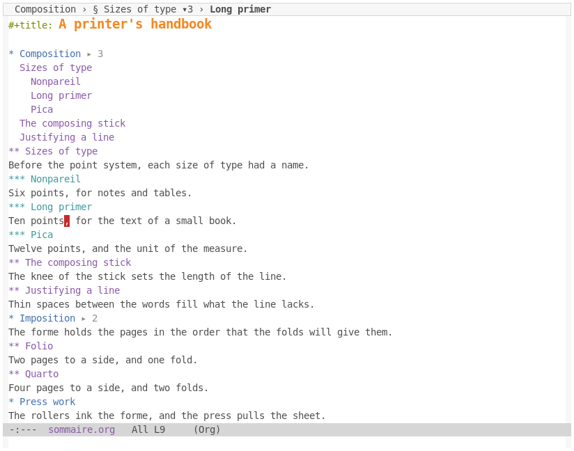

# Use sommaire

sommaire needs Emacs 31.1 and nothing else, imprimeur included. It works in Org and Markdown
buffers.



1. Turn it on in a buffer: `M-x sommaire-mode`. For every Org and Markdown buffer, add it to their
   hooks:

   ```elisp
   (add-hook 'org-mode-hook #'sommaire-mode)
   (add-hook 'markdown-mode-hook #'sommaire-mode)
   ```

2. See where you are: a moment after point stops moving, the header line names the section, the
   number of its entries and the entry that holds point.
3. Go to a heading: press `M-g m`, and pick one. It offers the direct children of the section
   around point, so the list stays short. `C-u M-g m` offers the whole document, and `M-2 M-g m`
   two levels, this once. `C-u C-SPC` comes back.
4. Keep a list open: click on the segment, or type `M-x sommaire-panel`. In the panel, `RET` goes,
   `+` and `-` change the depth, `r` changes the root, and `q` closes.
5. See a section's entries under its heading: click on a button such as `▸ 3`, or type
   `M-x sommaire-toggle-inline` near it. Another click closes it.
6. To fold Markdown, as sommaire never folds, give it Emacs's own outline:

   ```elisp
   (add-hook 'markdown-mode-hook #'outline-minor-mode)
   ```

7. Choose what it lists by default: set `sommaire-scope`, as [the options](../reference/options.md#sommaire)
   say. Set `sommaire-header-line` or `sommaire-heading-buttons` to `nil` to do without either.

[The rules](../reference/minitoc-rules.md) say which headings get what, and
[the reference](../reference/commands-and-keys.md#sommaires-commands) what each key does.
