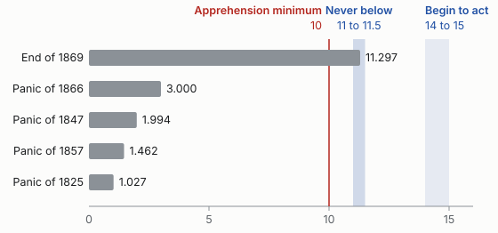

#+TITLE: Keep £11.5 million in reserve, and lend it freely in a panic
#+SUBTITLE: The Bank of England's reserve policy, from /Lombard Street/
#+AUTHOR: Walter Bagehot
#+DATE: 1873
#+STATUS: For decision
#+LANGUAGE: en-GB
#+TODO: TODO NEXT STARTED WAITING | DONE CANCELLED
#+OPTIONS: p:t toc:nil

* Bottom line

The Bank of England "holds the ultimate cash reserve of the country", so every other bank's safety rests on how it runs that reserve. Keep it at no less than £11.5 million. Start raising the rate when foreign demand draws it down to between £14 million and £15 million. In a panic, lend out of it, at a very high rate, on all good security.

- *Cost:* "Too much reserve only means a small loss of profit".
- *Benefit:* a public convinced "that though money may be dear, still money is to be had."
- *Ask:* that the Court of Directors accept the duty openly, by "a clear understanding between the Bank and the public".

#+begin_note
The argument, the figures and whatever stands in double quotation marks are Bagehot's, from /Lombard Street/, 1873; a program checked them against Project Gutenberg's text. The setting as a modern brief is an essay written for imprimeur: he wrote no memo, and the headings, the linking words, the priorities and owners, the glossary, the diagram and the chart are the essay's.
#+end_note

* London owes more on demand than any other market, on a thin reserve

"There never was so much borrowed money collected in the world as is now collected in London." Most of it is "held by bankers or others on short notice or on demand", and the owners "could ask for it all any day they please".

#+CAPTION: Known deposits, those of banks that publish their accounts, at the dates that Bagehot gives. London's unknown deposits, he adds, are "much greater".
| Market        | Return of           | Known deposits |
|---------------+---------------------+----------------|
| London        | 31st December, 1872 |   £120,000,000 |
| New York      | February, 1873      |    £40,000,000 |
| Paris         | 27th February, 1873 |    £13,000,000 |
| German Empire | 31st January, 1873  |     £8,000,000 |

All of it comes back to one till. Other London banks "keep their principal reserve on deposit at the Banking Department of the Bank of England", and that department's own position, at the year end of 1869, was this.

#+CAPTION: The Banking Department's liabilities on 29 December 1869, in pounds, against "a cash reserve of 11,297,000 L."[fn:1] The total adds up.
| Liability                 |     Amount |
|---------------------------+------------|
| Public deposits           |  8,585,000 |
| Private deposits          | 18,205,000 |
| Seven-day and other bills |    445,000 |
| Total                     | 27,235,000 |

The cash is "so exceedingly small that a bystander almost trembles when he compares its minuteness with the immensity of the credit which rests upon it."

#+begin_risk
"If any large fraction of that money really was demanded, our banking system and our industrial system too would be in great danger."
#+end_risk

* The last three panics all but emptied the reserve

"Three times 'Peel's Act' has been suspended because the Banking Department was empty." The Bank kept lending through each panic, and its loans rose as its till ran down.

#+CAPTION: The three panics since 1844, in pounds. The low points and the loans on private securities are Bagehot's; the increase is the essay's subtraction.
| Panic   | Reserve fell to | Loans before | Loans after |   Increase |
|---------+-----------------+--------------+-------------+------------|
| In 1847 |       1,994,000 |   18,963,000 |  20,409,000 |  1,446,000 |
| In 1857 |       1,462,000 |   20,404,000 |  31,350,000 | 10,946,000 |
| In 1866 |       3,000,000 |   18,507,000 |  33,447,000 | 14,940,000 |

So the Bank does its duty, and will not say so. It "does not distinctly acknowledge that it is its duty", and it lends "hesitatingly, reluctantly, and with misgiving". In 1866, the best of the three, "there was nevertheless an instant when it was believed the Bank would not advance on Consols", and that report "made the panic indefinitely worse."

#+begin_risk
"To lend a great deal, and yet not give the public confidence that you will lend sufficiently and effectually, is the worst of all policies; but it is the policy now pursued."
#+end_risk

* In a panic, lend early, at a very high rate, on all good security

"A panic, in a word, is a species of neuralgia, and according to the rules of science you must not starve it." The reserve is not there for show: "we keep that treasure for the very reason that in particular cases it should be lent."

1. *Price.* "these loans should only be made at a very high rate of interest."
   - It "will operate as a heavy fine on unreasonable timidity".
   - It comes "early in the panic, so that the fine may be paid early".
2. *Quantity.* "these advances should be made on all good banking securities, and as largely as the public ask for them."
   - Refusal is what spreads the fear: "the way to cause alarm is to refuse some one who has good security to offer."
   - Bad paper can still be turned away, as "the 'unsound' people are a feeble minority".

The usual difficulty is that the two drains arrive together, and call for opposite medicine. The order is settled: "We must look first to the foreign drain, and raise the rate of interest as high as may be necessary." Then lend at that rate.

#+CAPTION: The order of the response. The drawing is the essay's; its words are Bagehot's.
#+begin_src mermaid
flowchart LR
  F["the foreign drain"] --> R["raise the rate of interest"]
  D["an alarm within the country"] --> L["lend freely"]
  R --> L
  L --> S["all good banking securities"]
  S --> M["still money is to be had"]
#+end_src

There is a precedent. Of the panic of 1825 Mr. Harman said, for the Bank, "We lent it":

#+begin_quote
by every possible means and in modes we had never adopted before; we took in stock on security, we purchased Exchequer bills, we made advances on Exchequer bills, we not only discounted outright, but we made advances on the deposit of bills of exchange to an immense amount, in short, by every possible means consistent with the safety of the Bank, and we were not on some occasions over-nice.

/Mr. Harman, as Bagehot quotes him./
#+end_quote

"After a day or two of this treatment, the entire panic subsided, and the 'City' was quite calm."

#+begin_decision
"The only safe plan for the Bank is the brave plan, to lend in a panic on every kind of current security, or every sort on which money is ordinarily and usually lent."
#+end_decision

#+begin_risk
"This policy may not save the Bank; but if it do not, nothing will save it."
#+end_risk

* Hold at least £11.5 million, and act from £14 million to £15 million

The public sets the first line, not the balance sheet. "A panic is sure to be caused if that reserve is, from whatever cause, exceedingly low", and Bagehot puts the point at £10 million, below which "the mind of the monetary world would become feverish and fearful". He calls it the "apprehension minimum". The other two lines are that one plus what can go wrong while the Bank reacts.

#+CAPTION: The three lines, in pounds, as Bagehot drew them for his day.
| Line                                 |       From |         To |
|--------------------------------------+------------+------------|
| Begin to act, and raise the rate     | 14,000,000 | 15,000,000 |
| Practical minimum, never to be below | 11,000,000 | 11,500,000 |
| Apprehension minimum                 | 10,000,000 |            |

- *To the practical minimum:* "a million, or a million and a half, may be taken from us at any time".
- *To the point of action:* "between 2,000,000 L. and 3,000,000 L. may, probably enough, be withdrawn from the Bank store before the right rate of interest is found".

He names two figures for the floor, and reckons from the higher, "in order not to be below 11,500,000 L."; this brief does the same.

#+CAPTION: The reserve against the lines, in millions of pounds. The chart is the essay's; every number on it is Bagehot's.

At the end of 1869 the reserve stood at £11,297,000: inside that band, and below the floor that this brief takes. The error to fear is on that side: "errors of excess are innocuous but errors of defect are destructive." "Too much reserve only means a small loss of profit, but too small a reserve may mean 'ruin.'"

These are judgements, and he says so: "It will be said that this estimate is arbitrary and these figures are conjectures. I reply that I only submit them for the judgment of others."

#+begin_ask
That the Court adopt the lines as its working rule, so that when "the reserve is between 14,000,000 L. and 15,000,000 L., and when it begins to be diminished by foreign demand", the Bank will "begin to act, and to raise the rate of interest."
#+end_ask

* Four other courses were weighed, and rejected

- *A fixed share of liabilities.* "The old notion that one-third, or any other such fraction, is in all cases enough, must be abandoned." What a foreign government may withdraw does not show in the Bank's return.
- *Following the market rate.* "This rule was, indeed, always erroneous." The market rate does not feel the demands that fall on the reserve.
- *Governors named by the State, as in France.* "But no such plan would answer in England." The governor would "change as chance majorities and the strength of parties decide."
- *Many banks, each with its own reserve.* It is the natural system, and it cannot be had from here: "Credit is a power which may grow, but cannot be constructed."

** Terms used in this brief

- Banking Department :: the part of the Bank that takes deposits and lends, and holds the reserve. The Issue Department, which issues the notes, is separate under the Act of 1844.
- Peel's Act :: the Bank Charter Act of 1844, which limits the notes that the Bank may issue.
- Consols :: government stock, which bankers count as part of their reserve in quiet times.
- Discount :: to buy a bill before it falls due, for less than it will pay.
- Foreign drain :: gold leaving the country; a domestic drain is cash called for at home.

This glossary is the essay's.

* Who does what

The priorities and owners are the essay's; the one date is that of the meeting in the book's Note D.

** DONE [#B] Tell the proprietors what the Bank lent in 1866 :record:
CLOSED: [1866-09-13 Thu]
:PROPERTIES:
:OWNER: Governor
:END:

The Governor told them: "We did not flinch from our post." And later, in the same meeting: "We advanced in the space of three months the sum of 45,000,000 L.; and what more than that do you want?"

** TODO [#A] Accept the duty in public :court:decision:
:PROPERTIES:
:OWNER: Court of Directors
:END:

"At present the Board of Directors are a sort of semi-trustees for the nation. I would have them real trustees, and with a good trust deed."

** TODO [#A] Adopt the three lines as the working rule :court:reserve:
:PROPERTIES:
:OWNER: Court of Directors
:END:

"We must not suffer from a dangerous policy because we have inherited an imperfect form of administration."

** NEXT [#A] Move the rate early on any foreign drain :rate:
:PROPERTIES:
:OWNER: Governor
:END:

The right rate takes time to find: "It requires several 'moves,' as the phrase goes, several augmentations of the rate of discount by the Bank, before the really effectual rate is reached".

** STARTED [#C] Read the Government's weekly account beside the Bank's return :reserve:
:PROPERTIES:
:OWNER: Treasurer
:END:

"But Mr. Lowe has lately given us a weekly account, and from this, and not from the Bank account, we are able to form a judgment."

** WAITING [#B] Reduce what other banks ask of the Bank :banks:
:PROPERTIES:
:OWNER: London bankers
:END:

"The central machinery being inevitably frail, we should carefully and as much as possible diminish the strain upon it."

** TODO [#B] Bring more banking experience into the Bank's government :court:
:PROPERTIES:
:OWNER: Proprietors
:END:

"We should diminish the 'amateur' element; we should augment the trained banking element; and we should ensure more constancy in the administration."

** CANCELLED Replace the single reserve with many :structure:

"My plain answer is that I do not propose it."

[fn:1] Project Gutenberg's text writes the pound as =L.= after the figure, and a quotation here keeps that form. The essay's tables and its own words use the sign =£= before it.
