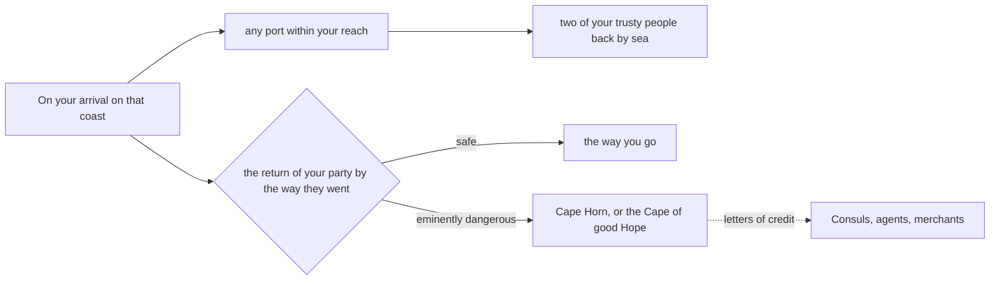
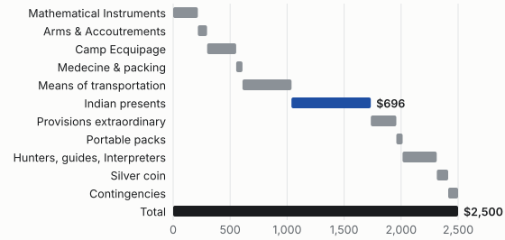

# Bottom line

"The object of your mission is to explore the Missouri river, & such principal stream of it, as, by it's course & communication with the waters of the Pacific ocean, may offer the most direct & practicable water communication across this continent, for the purposes of commerce."

- **Cost:** 2,500 dollars, by Lewis's own recapitulation, the sum Jefferson requested of Congress.
- **Benefit:** a route, and "the information you will have acquired".
- **Ask:** "to bring back your party safe, even if it be with less information".

> [!NOTE]
> The letter and the estimate are real; their setting as a brief is an essay, written for imprimeur. Whatever stands in double quotation marks is quoted to the letter: Jefferson's or Lewis's. A program checked it, capitals and punctuation included, against Founders Online: *The Papers of Thomas Jefferson*, vol. 40, pp. 176 to 183, and vol. 39, pp. 342 and 343. Each action title takes their words, with a first capital. The prose between the quotations and the service titles, such as *Words of the period*, are the essay's. So are the priorities, the figure, the diagram, the film and the program, which say so where they stand.

# You are appointed to carry them into execution

The letter goes to Lewis as Captain of the 1<sup>st</sup> Regiment of infantry, and opens on what he already knows: "Your situation as Secretary of the President of the United States has made you acquainted with the objects of my confidential message of Jan. 18. 1803. to the legislature: you have seen the act they passed, which, tho' expressed in general terms, was meant to sanction those objects". The figures behind that message were probably Lewis's own. The page is in his hand[^1], and Jefferson's editors think it likely that he prepared these figures before 18 January, when the same 2,500 dollars was requested of Congress.

Table: "Recapitulation of an estimate of the sum necessary to carry into effect the Missie. expedicion." The eleven articles add to the total exactly; a program checked it. The spelling is Lewis's.

| Article                                                                                                | Dollars |
|--------------------------------------------------------------------------------------------------------|--------:|
| Mathematical Instruments                                                                               |    $217 |
| Arms & Accoutrements extraordinary                                                                     |      81 |
| Camp Ecquipage                                                                                         |     255 |
| Medecine & packing                                                                                     |      55 |
| Means of transportation                                                                                |     430 |
| Indian presents                                                                                        |     696 |
| Provisions extraordinary                                                                               |     224 |
| Materials for making up the various articles into portable packs                                       |      55 |
| For the pay of hunters guides & Interpreters                                                           |     300 |
| In silver coin to defray the expences of the party from Nashville to the last white settlement on the Missisourie |     100 |
| Contingencies                                                                                          |      87 |
| Total                                                                                                  |  $2,500 |

Presents are the largest article, more than the boats or the men's pay. The letter takes the whole list for granted, in one breath:

> "light articles for barter, & presents among the Indians, arms for your attendants, say for from 10. to 12. men, boats, tents, & other travelling apparatus, with ammunition, medecine, surgical instruments & provisions you will have prepared with such aids as the Secretary at War can yield in his department"
>
> *Jefferson to Lewis, at Washington, 20 June 1803.*

> [!CAUTION]
> **Risk:** "if a superior force, authorised or not authorised, by a nation, should be arrayed against your further passage, & inflexibly determined to arrest it, you must decline it's further pursuit, and return."

# The most direct & practicable water communication across this continent

Nobody yet knows whether the water runs through. So the letter makes one safeguard for the notes, and leaves the party two ways home.

1. **The notes, by sea.** "to send two of your trusty people back by sea, in such way as shall appear practicable, with a copy of your notes".
2. **The party, by sea.** "then ship the whole, & return by sea, by the way of Cape Horn, or the Cape of good Hope, as you shall be able".
   - The party will arrive "without money, clothes or provisions", and may draw on the credit of the United States "in any part of the world".
   - "Our consuls Thomas Hewes at Batavia in Java, William Buchanan at the isles of France and Bourbon, & John Elmslie at the Cape of good hope will be able to supply your necessities by draughts on us."
3. **The party, by the way it went.** "Should you find it safe to return by the way you go, after sending two of your party round by sea".

Lewis's estimate was not the last word on cost. The purveyor of public goods at Philadelphia kept his own account of what was bought there, which the editors of Jefferson's papers set out beside the estimate[^2].

Table: Estimated by Lewis against recorded by the purveyor's office, in dollars. The rows and the totals are the essay's arrangement; the purveyor's account leaves out what came from the Harpers Ferry armory and the government stores, so it is no complete cost.

| Article                       | Estimated | Recorded |
|-------------------------------|----------:|---------:|
| Mathematical instruments      |       217 |   412.95 |
| Arms and accoutrements        |        81 |   182.08 |
| Camp equipage                 |       255 |   116.68 |
| Medicine                      |        55 |    94.49 |
| Presents                      |       696 |   669.50 |
| Provisions                    |       224 |   366.70 |
| Clothing                      |           |   317.73 |
| Total of these rows           |     1,528 | 2,160.13 |

Written $c_i$ for each of the eleven articles of the estimate, the presents being <i>c</i><sub>6</sub>, the sum is the one Jefferson requested. Lewis's page names no number of men; the letter would arm "from 10. to 12. men". Taken at twelve, that is $2500 / 12 \approx 208$ dollars a man. Both the sum and the division are the essay's.

$$\sum_{i=1}^{11} c_i = c_1 + c_2 + \dots + c_{11} = 2500$$

> [!IMPORTANT]
> **Decision:** "we wish you to err on the side of your safety, & to bring back your party safe, even if it be with less information."

## To your own discretion therefore must be left the degree of danger you may risk

"As it is impossible for us to foresee in what manner you will be recieved by those people, whether with hospitality or hostility, so is it impossible to prescribe the exact degree of perseverance with which you are to pursue your journey. we value too much the lives of citizens to offer them to probable destruction."

# Your observations are to be taken with great pains & accuracy

They are "to be entered distinctly, & intelligibly for others as well as yourself", because the calculations will be made by other men, in another place. Everything else in the mission hangs on what survives the journey: "several copies of these, as well as of your other notes, should be made at leisure times, & put into the care of the most trustworthy of your attendants".



Figure: The way home, as the letter lays it out. The drawing was written for this essay; its words are Jefferson's.

The one rule that may not fail is succession, and the letter gives it without a word to spare: "To provide, on the accident of your death, against anarchy, dispersion & the consequent danger to your party, and total failure of the enterprise, you are hereby authorised, by any instrument signed & written in your own hand, to name the person among them who shall succeed to the command on your decease".

## Several copies of these, as well as of your other notes, should be made at leisure times

### A further guard would be that one of these copies be written on the paper of the birch

"as less liable to injury from damp than common paper".

#### What the estimate looks like when it is added up

The letter names no sum at all; the estimate names eleven, and one article, the presents, outweighs any other.



The sum, for its part, can be checked again today. This small program was written for the essay, and adds the dictionary `articles` one by one, in Lewis's order:

```python
# Written for this essay: Lewis's recapitulation, added up.
articles = {"Mathematical Instruments": 217, "Arms & Accoutrements": 81,
            "Camp Ecquipage": 255, "Medecine & packing": 55,
            "Means of transportation": 430, "Indian presents": 696,
            "Provisions extraordinary": 224, "portable packs": 55,
            "hunters guides & Interpreters": 300, "silver coin": 100,
            "Contingencies": 87}

total = sum(articles.values())
print(f"{total} of 2500; the largest is {max(articles, key=articles.get)}")
```

The instructions are at https://founders.archives.gov/documents/Jefferson/01-40-02-0136-0005 and the estimate is on [Founders Online](https://founders.archives.gov/documents/Jefferson/01-39-02-0298). Founders Online refused the requests made for this essay, so both were read through the Internet Archive's captures of December 2024.


##### What Jefferson struck out

The draft is more telling than the fair copy. On Levi Lincoln's advice he would not offer his citizens to ~~certain~~ <u>probable</u> destruction, and the passport from France was first a protection ~~against~~ <u>with</u> the subjects of that country.

###### Left out of this brief

The rest of the letter, which repays reading whole. On the page, the key <kbd>s</kbd> leaves only the titles and the callouts.

## Words of the period

<dl>
<dt>Kine-pox</dt><dd>cowpox, whose matter Lewis was to carry as a vaccine against the small pox.</dd>
<dt>Log-line</dt><dd>a knotted line paid out astern, by which a boat’s speed through the water is reckoned.</dd>
<dt>Cypher</dt><dd>the table Jefferson drew up for Lewis, for whatever might be read by the wrong hands.</dd>
<dt>Draught</dt><dd>a written order on the Treasury, which a merchant might take as money.</dd>
</dl>

This glossary of words of the XIX<sup>th</sup> century is the essay's.

<details><summary>What the sum assumes</summary><p>The eleven articles add to 2,500 exactly, as Lewis’s total says. The date is the editors’: the page is undated, and they think it likely that it came before 18 January 1803, when Jefferson requested the same sum of Congress. The purveyor’s figures are no full account either: they are what one office recorded for seven kinds of goods, and the total of 2,160.13 is this essay’s addition, which appears in no source. Lewis’s list has no row for clothing, and the purveyor’s has none for boats, pay or contingencies.</p></details>

Before the departure from the United States, four things must stand:

- [x] "Instruments for ascertaining by celestial observations"
- [x] "the passport you have from the Minister of France"
- [ ] "the number of attendants abovementioned"
- [ ] "open letters of credit"

---

# What follows will respect your proceedings after your departure from the US.

The priorities, the owners and the deadline are the essay's; each date is one that the letter or its editors give.

## DONE: [#A] My confidential message of Jan. 18. 1803. :congress:

CLOSED: 1803-01-18, OWNER: Th: Jefferson

The message requested an appropriation of $2,500, the total of Lewis's table, as the editors note.

## DONE: [#A] Instruments for ascertaining by celestial observations :instruments:

CLOSED: 1803-05-14, OWNER: Capt. Lewis

They "have been already provided", in the letter's words, and the editors date the matter by Lewis's letter of 14 May.

## TODO: [#A] Carry with you some matter of the kine-pox :natives:medicine:

DEADLINE: 1803-07-04, OWNER: Capt. Lewis

> [!WARNING]
> **Ask:** "inform those of them with whom you may be, of it's efficacy as a preservative from the small pox; and instruct & encourage them in the use of it. this may be especially done wherever you winter."

## NEXT: [#A] Open letters of credit shall be furnished you :credit:

SCHEDULED: 1803-07-04, OWNER: Th: Jefferson

The editors point to Jefferson's letter to Lewis of 4 July for these.

## STARTED: [#B] Putting into cypher whatever might do injury if betrayed :journal:

"avail yourself of these means to communicate to us, at seasonable intervals, a copy of your journal, notes & observations of every kind".

## WAITING: [#B] Repair yourself with your papers to the seat of government :return:

"On re-entering the US. and reaching a place of safety, discharge any of your attendants who may desire & deserve it".

## CANCELLED: My sincere prayers for your safe return :draft:

The draft closed "to which I have only to add my sincere prayers for your safe return." He cancelled it, and the letter ends instead on the order of succession.

## DONE: [#C] Given under my hand at the city of Washington :signature:

CLOSED: 1803-06-20

[^1]: The page is wholly in Lewis's hand and bears no date, and the editors place it before 18 January 1803. *The Papers of Thomas Jefferson*, vol. 39, pp. 342 and 343, through Founders Online.

[^2]: *The Papers of Thomas Jefferson*, vol. 39, pp. 342 and 343, citing Donald Jackson's edition of the expedition's letters. The figures are the editors'; the arrangement of the table is not.
