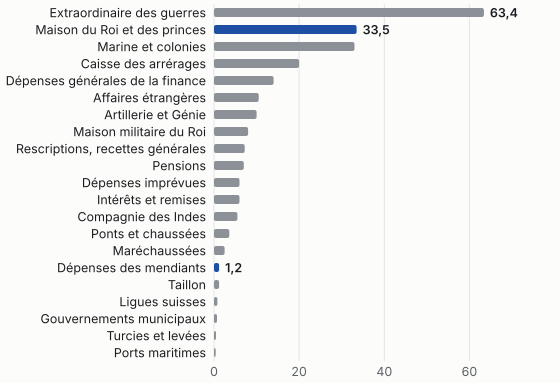

#+TITLE: Point de banqueroute ; point d'augmentation d'impositions ; point d'emprunts
#+SUBTITLE: Lettre au roi en prenant possession de la place de contrôleur général
#+AUTHOR: Turgot
#+DATE: 1774-08-24
#+STATUS: Pour décision
#+LANGUAGE: fr
#+TODO: TODO NEXT STARTED WAITING | DONE CANCELLED
#+OPTIONS: p:t toc:nil

* L'essentiel

« Je me borne en ce moment, Sire, à vous rappeler ces trois paroles : \\
Point de banqueroute \\
Point d'augmentation d'impositions[fn:1] \\
Point d'emprunts. »

« Pour remplir ces trois points, il n'y a qu'un moyen. C'est de réduire la dépense au-dessous de la recette, et assez au-dessous pour pouvoir économiser chaque année une vingtaine de millions, afin de rembourser les dettes anciennes. »

- *Coût :* un déficit de 21 498 710 livres à combler, au tableau de 1775, puis « économiser chaque année une vingtaine de millions ».
- *Bénéfice :* « la prospérité de votre règne, le calme dans l'intérieur, la considération au dehors, le bonheur de la nation et le vôtre ».
- *Demande :* que le roi « exige des ordonnateurs de toutes les parties qu'ils se concertent avec le ministre de la finance ».

#+begin_note
La lettre est vraie ; sa mise en forme de note de décision est un essai, composé pour imprimeur. Ce qui est entre guillemets est cité à la lettre : Turgot sauf mention, Daire ou Schelle quand la phrase les nomme ; un programme l'a vérifié, capitales et ponctuation comprises. Les titres d'action reprennent les mots de Turgot, avec une capitale initiale. Le texte de liaison, hors guillemets, et les titres de service, tel /Les mots du temps/, sont de l'essai. Le texte suivi est celui de Daire (/Œuvres de Turgot/, Guillaumin, 1844, t. II, p. 165 à 169), relu sur Wikisource ; les trois paroles, le tableau de 1775 et la note de Malesherbes viennent de Schelle (/Œuvres de Turgot et documents le concernant/, t. IV, n^{os} 150 et 172, paginé selon la réédition de l'Institut Coppet), qui suit la minute. Les priorités, les échéances, la figure, le diagramme, le film et le programme sont de l'essai, et le disent à leur place.
#+end_note

* Sans cela, le premier coup de canon forcerait l'État à la banqueroute

« Je dois observer à Votre Majesté que j'entre en place dans une conjoncture fâcheuse, par les inquiétudes répandues sur les subsistances ». Pour les finances, le temps lui manque encore : « je me réserve de m'expliquer plus au long quand j'aurai pu prendre des connaissances plus exactes ». Ces connaissances, il les fait établir pour l'année suivante, et le tableau que voici est le sien.

#+CAPTION: Dépenses à payer par le Trésor royal en 1775, en livres, d'après le tableau dressé par Turgot (Schelle, t. IV, p. 296). Les vingt et un articles font bien le total, et les trois dernières lignes suivent : un programme l'a vérifié.
| Article                                                                                                       |      Livres |
|---------------------------------------------------------------------------------------------------------------+-------------|
| Extraordinaire des guerres                                                                                    |  63 400 000 |
| Artillerie et Génie                                                                                           |  10 000 000 |
| Taillon (comprenant les appointements des gendarmes, etc.)                                                    |   1 186 756 |
| Maréchaussées                                                                                                 |   2 500 000 |
| Marine et colonies, y compris les dettes et lettres de change                                                 |  33 000 000 |
| Affaires étrangères                                                                                           |  10 500 000 |
| Maison militaire du Roi                                                                                       |   8 000 000 |
| Gouvernements municipaux                                                                                      |     700 000 |
| Dépenses des mendiants                                                                                        |   1 200 000 |
| Ponts et chaussées                                                                                            |   3 600 000 |
| Turcies et levées                                                                                             |     480 000 |
| Ports maritimes                                                                                               |     396 000 |
| Remboursements et intérêts des rescriptions et dépenses de la caisse des recettes générales                   |   7 200 000 |
| Ligues suisses                                                                                                |     800 000 |
| Caisse des arrérages                                                                                          |  20 000 000 |
| Intérêts et remboursements des actions de la Compagnie des Indes et dépenses de la Compagnie                  |   5 500 000 |
| Maison du Roi, y compris celle des princes                                                                    |  33 500 000 |
| Dépenses générales de la finance                                                                              |  14 000 000 |
| Dépenses imprévues                                                                                            |   6 000 000 |
| Pensions des différents départements                                                                          |   7 000 000 |
| Intérêts et remises des différents services                                                                   |   6 000 000 |
| Total des dépenses à faire par le Trésor royal en 1775                                                        | 234 962 756 |
| Revenus libres suivant l'état d'autre part                                                                    | 213 464 046 |
| Déficit                                                                                                       |  21 498 710 |
| La dette exigible arriérée montant 235 261 360 l., on ne peut payer sur cette dette, par année, moins de      |  15 000 000 |
| Déficit total                                                                                                 |  36 498 710 |

Trente-trois millions et demi pour la Maison du Roi et des princes, un million deux cent mille pour les mendiants : le tableau dit sans phrases ce que la lettre demande au roi de regarder.

#+begin_quote
Il faut, Sire, vous armer contre votre bonté de votre bonté même ; considérer d'où vous vient cet argent que vous pouvez distribuer à vos courtisans, et comparer la misère de ceux auxquels on est quelquefois obligé de l'arracher par les exécutions les plus rigoureuses, à la situation des personnes qui ont le plus de titres pour obtenir vos libéralités.

/Turgot au roi, à Compiègne, le 24 août 1774./
#+end_quote

#+begin_risk
« Tant que la finance sera continuellement aux expédients pour assurer les services, Votre Majesté sera toujours dans la dépendance des financiers, et ceux-ci seront toujours les maîtres de faire manquer, par des manœuvres de place, les opérations les plus importantes. »
#+end_risk

* Pour remplir ces trois points, il n'y a qu'un moyen

Trois issues sont écartées avant que la quatrième soit nommée.

1. *La banqueroute.* « ni avouée, ni masquée par des réductions forcées ».
2. *L'impôt.* « la raison en est dans la situation de vos peuples, et encore plus dans le cœur de Votre Majesté ».
3. *L'emprunt.* « il nécessite au bout de quelque temps ou la banqueroute, ou l'augmentation des impositions ».
   - Une seule réserve, et pour le temps de paix : « que pour liquider les dettes anciennes, ou pour rembourser d'autres emprunts faits à un denier plus onéreux ».
   - L'essai lit l'année 1775 comme fidèle à cette réserve. Schelle y compte 66 millions de remboursements d'anciennes dettes, dont « 51 millions environ provinrent d'emprunts », 19,2 déjà contractés par l'abbé Terray ; et « les emprunts nouvellement contractés étaient moins onéreux que les emprunts remboursés ».

Reste l'économie. L'abbé Terray avait dressé trois états pour 1774 ; Turgot en dresse un pour 1775, qui ne dépense pas moins, mais qui reçoit davantage.

#+CAPTION: Recette nette, dépenses et déficit, en livres : les trois états de l'abbé Terray pour 1774, puis le tableau de Turgot pour 1775 (Schelle, t. IV, p. 293 à 296).
| État                  | Recette nette |    Dépenses |    Déficit |
|-----------------------+---------------+-------------+------------|
| Terray, premier état  |   200 031 000 | 225 130 000 | 25 099 000 |
| Terray, deuxième état |   196 901 557 | 224 720 000 | 27 818 443 |
| Terray, troisième état |   206 992 524 | 234 220 000 | 27 227 476 |
| Turgot, 1775          |   213 464 046 | 234 962 756 | 21 498 710 |

Le déficit de 1775 se lit sans calcul, et se vérifie de même, $d_{k}$ étant chacun des vingt et un articles et $L$ les 213 464 046 livres du revenu libre. À raison d'« une vingtaine de millions » par an, $235\,261\,360 / 20\,000\,000 \approx \text{11,8}$ : près de douze ans pour la seule dette exigible arriérée. Ce calcul est de l'essai ; Turgot ne le fait pas.

$$\text{déficit} = \sum_{k=1}^{21} d_{k} - L = 21\,498\,710$$

#+begin_decision
« Il est donc de nécessité absolue que Votre Majesté exige des ordonnateurs de toutes les parties qu'ils se concertent avec le ministre de la finance. »
#+end_decision

** Point d'emprunts, parce que tout emprunt diminue toujours le revenu libre

Le revenu libre est ce qui reste quand l'engagé est payé, et l'intérêt d'un emprunt de plus se prend là. La lettre regarde plus loin : « si l'économie n'a précédé, aucune réforme n'est possible ». Et tant que la finance reste aux expédients : « Il n'y aura aucune amélioration possible, ni dans les impositions, pour soulager les contribuables, ni dans aucuns arrangements relatifs au gouvernement intérieur et à la législation. L'autorité ne sera jamais tranquille, parce qu'elle ne sera jamais chérie ».

* Chaque ordonnateur, dans sa partie, soutiendra que presque toutes les dépenses particulières sont indispensables

« Ils peuvent dire de fort bonnes raisons ; mais comme il n'y en a pas pour faire ce qui est impossible, il faut que toutes ces raisons cèdent à la nécessité absolue de l'économie. »[fn:2] La parade tient en une phrase : « lorsque vous aurez, Sire, arrêté l'état des fonds de chaque département, vous défendiez à celui qui en est chargé, d'ordonner aucune dépense nouvelle sans avoir auparavant concerté avec la finance les moyens d'y pourvoir ».

#+CAPTION: Le raisonnement de la lettre. Le dessin est de l'essai ; les mots sont de Turgot.
#+begin_src mermaid
flowchart LR
  E["Tout emprunt"] --> L["diminue toujours le revenu libre"]
  L --> B["la banqueroute"]
  L --> I["l’augmentation des impositions"]
  D["réduire la dépense"] --> V["une vingtaine de millions"]
  V --> A["les dettes anciennes"]
  C["le premier coup de canon"] -. "sans cela" .-> B
#+end_src

** Il faut, Sire, vous armer contre votre bonté de votre bonté même

*** De ce genre sont les intérêts, les croupes, les privilèges

« Il y a des grâces auxquelles on a cru pouvoir se prêter plus aisément, parce qu'elles ne portent pas immédiatement sur le Trésor royal. » Le titre les a nommées ; « elles sont de toutes les plus dangereuses et les plus abusives. Tout profit sur les impositions qui n'est pas absolument nécessaire pour leur perception, est une dette consacrée au soulagement des contribuables, ou aux besoins de l'État. »

« D'ailleurs, ces participations aux profits des traitants sont une source de corruption pour la noblesse, et de vexation pour le peuple, en donnant à tous les abus des protecteurs puissants et cachés. »

**** Le tableau chiffre ce que la lettre ne chiffre pas

La lettre ne donne qu'un nombre, cette vingtaine de millions. Le tableau en donne vingt et un, et deux seulement font l'argument.

#+CAPTION: Les dépenses de 1775 par article, en millions de livres, de la plus forte à la plus faible. La figure est de l'essai ; ses chiffres sont ceux du tableau 1.

Le tableau, lui, se recompte. Ce petit programme a été écrit pour l'essai ; il refait l'addition de Turgot, la liste =articles= suivant l'ordre de sa page :

#+begin_src python
# Écrit pour l'essai : l'addition du tableau de 1775.
articles = [63_400_000, 10_000_000, 1_186_756, 2_500_000, 33_000_000,
            10_500_000, 8_000_000, 700_000, 1_200_000, 3_600_000, 480_000,
            396_000, 7_200_000, 800_000, 20_000_000, 5_500_000, 33_500_000,
            14_000_000, 6_000_000, 7_000_000, 6_000_000]

total = sum(articles)
deficit = total - 213_464_046
print(f"total {total:_}, déficit {deficit:_}, avec l'arriéré {deficit + 15_000_000:_}")
#+end_src

Le texte de Daire se lit sur [[https://fr.wikisource.org/wiki/%C5%92uvres_de_Turgot_(Daire,_1844)/Actes_du_Minist%C3%A8re_de_Turgot][Wikisource]] et celui de Schelle sur [[https://archive.org/details/turgot-oc-4_202606][le site de l'Internet Archive]]. Le film ci-dessous rappelle les trois paroles, l'une après l'autre.

[[file:turgot-paroles.webm][Les trois paroles, une à une : un court film, composé pour l'essai.]]

***** Ce que la minute a rayé

Le brouillon, dit Dubois de l'Estang que Schelle reproduit, est « couvert de ratures et de surcharges ». La phrase célèbre n'y venait pas d'un jet. Turgot avait d'abord écrit « +c'est à sa bonté même à l'en défendre+ » ; il en fit « _vous armer contre votre bonté de votre bonté même_ ». Ailleurs il s'arrête au milieu d'une énumération, « contre la générosité de V. M. et de la… », et le mot qui allait suivre, note le même commentateur, « est aisé à deviner ».

****** Ce qui reste hors de cette note

Le reste de la lettre, qui vaut d'être lu entier. Sur la page, la touche @@html:<kbd>s</kbd>@@ ne laisse que les titres et les encadrés.

** Les mots du temps

- Ordonnateur :: celui qui engage la dépense d'une partie, la Guerre, la Marine ou la Maison du roi.
- Croupe :: participation aux profits d'un traitant, accordée à un tiers comme une grâce.
- Traitant :: financier qui traite avec le roi du recouvrement d'une imposition.
- Anticipations :: selon Daire, « les avances faites par les financiers sur le produit des exercices postérieurs ».
- Denier :: l'expression du taux : au denier vingt, un pour vingt, soit 5 %.

Ce glossaire des mots du XVIII^{e} siècle est de l'essai.

#+begin_export html

Ce que vaut le chiffre du déficit

Les témoins ne s’accordent pas. Le tableau de Turgot donne 21 498 710 livres. Le récit de Schelle dit « les dépenses à 233 » et « d’où un déficit de 21 », alors que 233 moins 213 font 20 ; le tableau, lui, porte 234 962 756. Daire écrit « un déficit de 22 millions », soit 235 moins 213. Les bureaux accusaient 37 157 126 livres, avec l’arriéré et les imprévus. Le récapitulatif de l’état de Terray imprime 206 992 324 où ses deux autres mentions portent 206 992 524, et c’est la seconde forme qui donne le déficit imprimé. Enfin, le tableau des recettes de Turgot ne se refait pas tout à fait : ses trente-sept produits font 370 267 398 livres quand la page totalise 370 167 398, et la Régie des droits réunis et les Impositions de Paris ne retombent pas sur leur net. Ces écarts sont peut-être ceux de la réédition ; seul l’imprimé de Schelle le dirait.

#+end_export

Avant que l'état des fonds soit arrêté, quatre points doivent être acquis :

- [X] Les trois paroles rappelées au roi
- [X] Le tableau de 1775 dressé article par article
- [ ] Les ordonnateurs concertés avec la finance
- [ ] Les grâces retranchées, et d'abord les croupes

-----

* Voilà les points que Votre Majesté a bien voulu me permettre de lui rappeler

Les dates sont celles que donne Daire ; les priorités, et le rattachement de chaque date à une action, sont de l'essai.

** DONE [#A] Je me charge d'un fardeau peut-être au-dessus de mes forces :cour:
CLOSED: [1774-08-24 mer.]
:PROPERTIES:
:OWNER: Turgot
:END:

« que c'est à elle personnellement, à l'homme honnête, à l'homme juste et bon, plutôt qu'au roi, que je m'abandonne. »

** TODO [#A] Que Votre Majesté exige des ordonnateurs de toutes les parties qu'ils se concertent :roi:décision:
DEADLINE: <1775-01-01 dim.>
:PROPERTIES:
:OWNER: Le roi
:END:

#+begin_ask
« Il est indispensable qu'il puisse discuter avec eux en présence de Votre Majesté le degré de nécessité des dépenses proposées. »
#+end_ask

** NEXT [#A] Considérer d'où vous vient cet argent :roi:grâces:

« Votre Majesté sait qu'un des plus grands obstacles à l'économie, est la multitude des demandes dont elle est continuellement assaillie ».

** STARTED [#B] Les inquiétudes répandues sur les subsistances :subsistances:
SCHEDULED: <1774-09-13 mar.>

L'arrêt du Conseil du 13 septembre 1774 rend libre la circulation des grains à l'intérieur. Turgot avertit d'avance : « je la supplie d'en maintenir l'exécution avec fermeté, sans se laisser effrayer par des clameurs ».

** WAITING [#B] Une récolte qui paraît avoir été médiocre :subsistances:

« inquiétudes fortifiées par la fermentation des esprits depuis quelques années, par la variation des principes des administrateurs, par quelques opérations imprudentes, et surtout par une récolte qui paraît avoir été médiocre ».

** CANCELLED Se permettre d'emprunter :finance:

« Il ne faut en temps de paix se permettre d'emprunter que pour liquider les dettes anciennes ».

** DONE [#C] Je suis prêt à la remettre à Votre Majesté :cour:
CLOSED: [1776-05-12 dim.]

« Je ne regretterai point de perdre une place à laquelle je ne m'étais jamais attendu. » Malesherbes, qui en gardait une copie, voyait plus loin :

#+begin_quote
Je crois bien qu'un jour cette lettre sera connue par les copies qu'on en aura laissé prendre et qu'elle passera à la postérité ; or je pense que la famille doit le désirer.

/Malesherbes, note jointe au brouillon, que reproduit Schelle./
#+end_quote

[fn:1] Le mot varie. Daire imprime « Point d'augmentation d'impôts » aux deux endroits. Schelle, d'après la minute, donne « Point d'augmentation d'impositions » dans les trois paroles, puis « Point d'augmentation d'impôts » dans leur développement, et lui-même, dans son récit, cite « point d'augmentations d'impôts ». Le titre de cette note joint les trois lignes par les points-virgules de Daire, sur le mot de la minute.

[fn:2] Daire écrit « presque toutes les dépenses particulières », Schelle « toutes les dépenses particulières » ; le titre suit Daire. D'autres écarts sont de même ordre : « ne sera jamais tranquille » chez Daire, « ne sera pas tranquille » chez Schelle ; et Daire porte « daigné presses mes mains » où Schelle donne « daigné presser mes mains », une coquille que cette note ne cite pas dans son corps.
