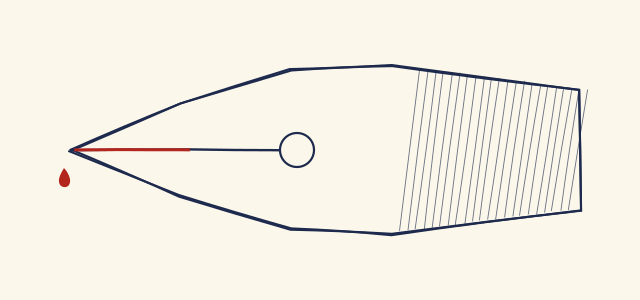

#+TITLE: Carnet d'atelier, semaine 44
#+AUTHOR: Écrit pour l'essai de l'habillage Écrivain
#+DATE: Dimanche 1er novembre 2026
#+LANGUAGE: fr
#+TODO: TODO EN-COURS | FAIT

#+begin_note
Personne n'a tenu ce carnet : il est écrit pour l'essai, de la première à la dernière ligne, recette et mesures comprises. La seule citation est de Boileau, et elle porte son nom.
#+end_note

* Encre et papier

Il a plu toute la semaine, ce qui convient très bien à l'encre : elle sèche lentement, et l'on voit ce que le papier en fait. J'ai repris le petit flacon de lundi, celui qui virait au brun, et j'ai recommencé la recette en notant /tout/ cette fois, même ce qui paraissait sans importance. Le carnet ne sert à rien si l'on n'y écrit que ce qui a réussi[fn:fer].

Le résultat est moins noir que je ne l'espérais, mais il coule bien, et la plume ne griffe plus le papier ivoire. Sur le papier blanc du cahier, il bave un peu au bout des jambages : c'est le *papier* qu'il faut changer, pas l'encre. Pense-t-on à vérifier cela avant d'accuser la plume ? +Jamais.+ Rarement. Il faudra @@html:<mark>noter le grammage</mark>@@ sur chaque essai.

** La recette de lundi

Tout tient en quatre gestes, et l'ordre compte plus que les quantités :

1. faire tremper la noix de galle concassée dans l'eau de pluie, une nuit entière ;
2. filtrer sur un linge, puis ajouter le sulfate de fer peu à peu :
   - la liqueur noircit à vue d'œil ;
   - si elle mousse, attendre ;
3. ajouter la gomme arabique, déjà fondue dans un peu d'eau chaude ;
4. laisser reposer, et ne jamais secouer le flacon.

*** Ce qui a raté

La première cuve a tourné au bout de trois jours, parce que je l'avais laissée près du radiateur. La chaleur n'y était peut-être pour rien, d'ailleurs ; je n'ai changé qu'une chose à la fois, comme il se doit, et la deuxième cuve tient. C'est encore Boileau qui a raison :

#+begin_quote
Hâtez-vous lentement ; et, sans perdre courage, \\
Vingt fois sur le métier remettez votre ouvrage : \\
Polissez-le sans cesse et le repolissez ; \\
Ajoutez quelquefois, et souvent effacez.
#+end_quote

Nicolas Boileau, /L'Art poétique/, chant I, 1674.

**** Une question qui reste

Pourquoi l'encre monte-t-elle si vite dans la fente de la plume, et si peu dans celle de l'ancienne ? La loi de Jurin donne la hauteur $h$ d'un liquide dans un canal de rayon $r$, et c'est bien le rayon qui commande :

\[ h = \frac{2 \gamma \cos \theta}{\rho\, g\, r} \]

Pour une fente d'environ 0,05 mm de rayon, de l'eau ($\gamma$ d'environ 0,072 N/m) monterait de près de trente centimètres, bien plus qu'il n'en faut. Ce n'est donc pas la hauteur qui manque, mais le débit[fn:jurin].

***** Et la gomme ?

Elle épaissit la liqueur, donc elle ralentit tout. La formule du sulfate, FeSO_{4}, ne le dit pas.

****** Pour plus tard

Comparer avec une plume d'oie.

#+begin_tip
Quand une plume neuve refuse d'écrire, ne pas la forcer : la passer à la flamme une seconde, ou la frotter avec un peu de salive. Le vernis de fabrique part aussitôt.
#+end_tip

* Les réglures

Trois papiers sur la table cette semaine, et un quatrième pour comparer. Les mesures sont les miennes, à la règle : on verra qu'elles ne disent pas grand-chose de l'agrément de la main.

#+CAPTION: Les quatre papiers de la semaine, mesurés au double décimètre.
| Réglure         | Pas (mm) | Lignes par page | Encre | Bave ? |
|-----------------+----------+-----------------+-------+--------|
| <l>             |      <r> |             <r> | <l>   | <l>    |
| Seyès           |        8 |              31 | noire | un peu |
| Petits carreaux |        5 |              50 | noire | non    |
| Points          |        5 |              42 | bleue | non    |
| Ligné           |        7 |              36 | bleue | oui    |

Le quadrillage de Seyès est le plus exigeant. Son grand carreau mesure 8 mm et chaque interligne 2 mm : la plupart des lettres tiennent dans un interligne, les hampes montent à trois, et les jambages descendent de deux.

- Grand carreau :: la marge rouge, puis des verticales tous les 8 mm.
- Interligne :: un trait bleu tous les 2 mm, plus fin que la ligne d'écriture.
- Ligne d'écriture :: le trait violet, le seul où la main se pose.

#+CAPTION: Bec de plume en coupe, avec sa fente et son évent. Dessin de l'essai.

La plume se tient à quarante-cinq degrés environ. Plus droite, elle griffe ; plus couchée, elle se vide d'un coup. Voici le geste, filmé pour l'essai : un trait sur le papier à points, sans lever la main.

[[file:ecriture.webm][Un trait tracé d'un seul geste. Film de l'essai, sans le son.]]

#+begin_warning
L'encre ferro-gallique attaque le papier avec les années, et elle tache tout ce qui l'approche. Ne pas la garder dans un stylo à réservoir plus d'une semaine.
#+end_warning

** Du flacon à la page

Le chemin complet, avec la seule boucle qui compte : une encre qui bave retourne au flacon.

#+CAPTION: De la noix de galle au carnet. Schéma de ce carnet, tracé par Mermaid.
#+begin_src mermaid
flowchart TB
  G["Noix de galle"] --> T["Tremper, filtrer"]
  T --> S["Sulfate de fer"]
  S --> R["Repos"]
  R --> E{"Essai sur papier"}
  E -- "elle bave" --> A["Ajouter de la gomme"]
  A --> R
  E -- "elle tient" --> C["Carnet"]
#+end_src

Et qui fait quoi pendant l'essai. Le schéma se tient droit, dans les couleurs du carnet.

#+CAPTION: Un essai de plume, pas à pas.
#+begin_src mermaid
sequenceDiagram
  participant M as Main
  participant P as Plume
  participant F as Feuille
  M->>P: tremper
  P->>F: premier trait
  F-->>M: la fibre boit
  M->>P: moins d'encre
  P->>F: deuxième trait
#+end_src

* Le petit programme

Je garde les mesures dans un fichier, et un petit programme me dit quelle encre a tenu sur quel papier. Il tient en quelques lignes de /Python/, et il renvoie vite ce qu'on lui demande :

#+begin_src python
# Quelle encre a tenu ? Un essai réussit s'il ne bave pas.
from dataclasses import dataclass

@dataclass
class Essai:
    encre: str
    papier: str
    bave: float  # en dixièmes de millimètre

def tenues(essais: list[Essai], seuil: float = 1.5) -> dict[str, int]:
    compte: dict[str, int] = {}
    for essai in essais:
        if essai.bave <= seuil and essai.encre != "brouillon":
            compte[essai.encre] = compte.get(essai.encre, 0) + 1
    return compte

print(tenues([Essai("noire", "seyès", 1.2), Essai("bleue", "ligné", 3.0)]))
#+end_src

Le même, côté Emacs, pour ouvrir la fiche du jour dans le carnet :

#+begin_src elisp
;; La fiche du jour, créée si besoin, en bas du carnet.
(defun carnet-fiche-du-jour ()
  "Aller à la fiche d'aujourd'hui."
  (interactive)
  (find-file "~/carnet/atelier.org")
  (goto-char (point-max))
  (unless (search-backward (format-time-string "* %F") nil t)
    (insert (format-time-string "\n* %F %A\n"))))
#+end_src

Et le filtre qui pose les espaces fines, en /Lua/ ; sa dernière ligne est trop longue pour un carnet, exprès, pour voir comment elle se replie :

#+begin_src lua
-- Une espace fine insécable avant ; ! ? et une insécable avant :
local fine, pleine = "\u{202F}", "\u{A0}"
function Str(mot)
  local avant, signes = mot.text:match("^(.-)([;:!?]+)$")
  if not signes or avant == "" then return nil end
  return pandoc.Str(avant .. (signes:sub(1, 1) == ":" and pleine or fine) .. signes .. " -- et cette ligne dépasse quatre-vingts colonnes pour le voir")
end
#+end_src

Un résultat brut, sans langue, tel que la machine l'a écrit :

#+begin_example
essai 41  noire  seyès    bave 1,2  ok
essai 42  bleue  ligné    bave 3,0  à refaire
#+end_example

Pour relancer le tout, @@html:<kbd>C-c</kbd>@@ @@html:<kbd>C-c</kbd>@@ dans le bloc, ou bien =python3 tenues.py= dans un terminal, comme on voudra. Le fichier se lit sur [[https://example.invalid/carnet/atelier][la page de l'atelier]], ou plus crûment à https://example.invalid/carnet/atelier/fiches/semaine-44/essais-de-plume.org pour qui aime savoir où il va.

#+begin_important
Ne rien effacer : barrer, et écrire à côté. Une erreur datée vaut mieux qu'un souvenir propre.
#+end_important

#+begin_caution
Le sulfate de fer tache la peau, et il ne faut pas en respirer la poussière. Travailler fenêtre ouverte.
#+end_caution

-----

* À faire la semaine prochaine

** TODO Commander du papier 90 g                                 :papier:achat:
** EN-COURS Refaire la deuxième cuve                                    :encre:
** FAIT Nettoyer les plumes                                            :atelier:

Avant de refermer le carnet, ce soir :

- [X] noter le grammage de chaque essai ;
- [X] laver le flacon de lundi ;
- [ ] recopier la recette au propre, à l'encre de la deuxième cuve ;
- [ ] demander à quelqu'un de lire ces pages à voix haute.

[fn:fer] Le mot /ferro-gallique/ désigne une encre faite de sels de fer et de tanin, en usage depuis le Moyen Âge. Les quantités de ce carnet ne valent que pour l'essai.

[fn:jurin] Le calcul prend $\theta \approx 0$ et la tension de l'eau pure ; une encre gommée monte moins haut. James Jurin a publié sa loi au XVIIIe siècle.
