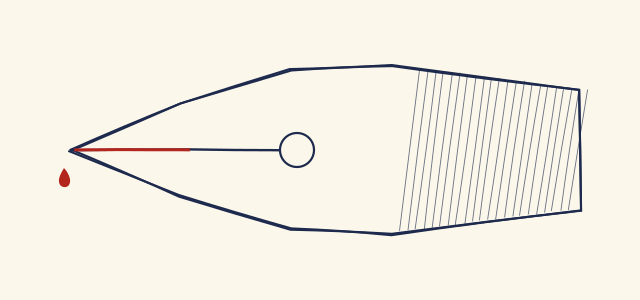
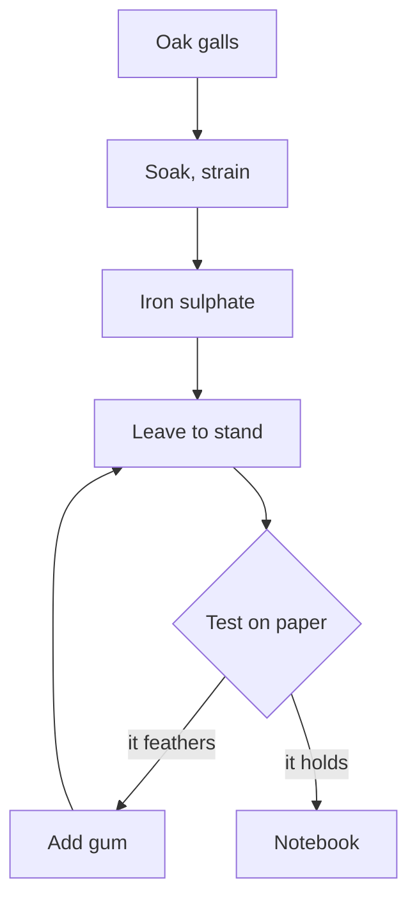

> [!NOTE]
> Nobody kept this notebook: it was written to try this skin, every line of it, measurements included. The one quotation is Pope's, and it carries his name.

# Three papers and a nib

It rained all week, which suits ink very well: it dries slowly, and you can see what the paper does with it. I went back to Monday's small bottle, the one that was turning brown, and began the recipe again, writing *everything* down this time, even what seemed not to matter. A notebook is no use if it only holds what worked[^iron].

The result is less black than I had hoped, but it flows, and the nib no longer scratches the ivory paper. On the white paper of the exercise book it feathers a little at the end of the descenders: it is the **paper** that must change, not the ink. ~~The nib is to blame.~~ Who thinks to check that before blaming the nib? Hardly anyone. From now on, <mark>the weight of the paper</mark> goes on every test.

## Monday's recipe

It all comes down to four gestures, and their order counts for more than the quantities:

1. soak the crushed oak galls in rainwater for a whole night;
2. strain through a cloth, then add the iron sulphate little by little:
   - the liquor blackens as you watch;
   - if it foams, wait;
3. add the gum arabic, already melted in a little hot water;
4. leave it to stand, and never shake the bottle.

### What went wrong

The first batch turned after three days, because I had left it near the radiator. The heat may have had nothing to do with it, as it happens; I changed only one thing at a time, as one should, and the second batch is holding. Practice, not luck, as the poet has it:

> True ease in writing comes from art, not chance,\
> As those move easiest who have learn'd to dance.

Alexander Pope, *An Essay on Criticism*, 1711.

#### A question that remains

Why does the ink climb the slit of this nib so fast, and hardly at all in the old one? Jurin's law gives the height $h$ of a liquid in a channel of radius $r$, and the radius is what governs it:

$$h = \frac{2 \gamma \cos \theta}{\rho\, g\, r}$$

For a slit of about 0.05 mm radius, water ($\gamma$ about 0.072 N/m) would climb nearly thirty centimetres, far more than is needed. So height is not what is lacking, but flow[^jurin].

##### And the gum?

It thickens the liquor, so it slows everything down. The sulphate's formula, FeSO<sub>4</sub>, does not say so.

###### For later

Compare with a goose quill.

> [!TIP]
> When a new nib refuses to write, do not force it: pass it through a flame for a second, or wipe it with a little saliva. The factory varnish comes off at once.

# The rulings

Three papers on the table this week, and a fourth to compare. The measurements are mine, by ruler; they say little, as you will see, about how pleasant each is under the hand.

Table: The week's four papers, measured with a ruler.

| Ruling        | Pitch (mm) | Lines per page | Ink   | Feathers? |
|:--------------|-----------:|---------------:|:------|:----------|
| Seyès         |          8 |             31 | black | a little  |
| Small squares |          5 |             50 | black | no        |
| Dots          |          5 |             42 | blue  | no        |
| Lined         |          7 |             36 | blue  | yes       |

The French Seyès ruling asks the most. Its large square measures 8 mm and each interline 2 mm: most letters fit one interline, ascenders reach three, and descenders go two below.



Hold the nib at about forty-five degrees. Any steeper and it scratches; any flatter and it empties at once. Here is the gesture, filmed for this sample: one stroke across the dotted paper, without lifting the hand.

[A single stroke, in one gesture. This sample's film, without sound.](ecriture.webm)

> [!WARNING]
> Iron-gall ink eats the paper over the years, and it stains whatever comes near it. Do not leave it in a fountain pen for more than a week.

## From the bottle to the page

The whole route, with the one loop that matters: ink that feathers goes back to the bottle.



Plate: From the oak gall to the notebook. This sample's scheme, drawn by Mermaid.

# The little program

I keep the measurements in a file, and a little program tells me which ink held on which paper. It fits in a few lines of *Python*, and it returns what it is asked for quickly:

```python
# Which ink held? A test passes if it does not feather.
from dataclasses import dataclass


@dataclass
class Test:
    ink: str
    paper: str
    feather: float  # in tenths of a millimetre


def holding(tests: list[Test], limit: float = 1.5) -> dict[str, int]:
    count: dict[str, int] = {}
    for test in tests:
        if test.feather <= limit and test.ink != "rough":
            count[test.ink] = count.get(test.ink, 0) + 1
    return count


print(holding([Test("black", "seyes", 1.2), Test("blue", "lined", 3.0)]))
```

A raw result, with no language, as the machine wrote it:

```
test 41  black  seyes   feather 1.2  ok
test 42  blue   lined   feather 3.0  redo
```

To run it all again, <kbd>C-c</kbd> <kbd>C-c</kbd> in the block, or `python3 holding.py` in a terminal, as you like. The file is on [the workshop's page](https://example.invalid/notebook/workshop), or more baldly at https://example.invalid/notebook/workshop/cards/week-44/nib-tests.md for those who like to see where they are going.

> [!IMPORTANT]
> Erase nothing: cross it out, and write beside it. A dated mistake is worth more than a tidy memory.

> [!CAUTION]
> Iron sulphate stains the skin, and its dust should not be breathed. Work with the window open.

---

# Next week

Before closing the notebook tonight:

- [x] note the weight of each test paper
- [x] wash Monday's bottle
- [ ] copy the recipe out fair, in the ink of the second batch
- [ ] ask someone to read these pages aloud

[^iron]: *Iron-gall* names an ink of iron salts and tannin, in use since the Middle Ages. The quantities in this notebook hold only for this sample.

[^jurin]: The sum takes $\theta \approx 0$ and the tension of pure water; a gummed ink climbs less. James Jurin published his law in the XVIII<sup>th</sup> century.
