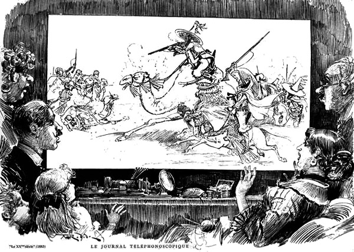

#+TITLE: Le Vingtième Siècle
#+LANGUAGE: fr

# essai
Albert Robida, /Le Vingtième Siècle/, Georges Decaux, 1883 : première partie, chapitres V et VI, d'après Wikisource. Chaque paragraphe de Robida est cité mot pour mot et vérifié par un script. Ce que l'essai ajoute le dit, par la mention « ajout de l'essai ». Les titres, hormis les deux de ses chapitres, sont de l'essai, pris dans ses mots.

* Les merveilles du téléphonoscope

Parmi les sublimes inventions dont le XX^{e} siècle s’honore, parmi les mille et une merveilles d’un siècle si fécond en magnifiques découvertes, le téléphonoscope peut compter pour une des plus merveilleuses, pour une de celles qui porteront le plus haut la gloire de nos savants.

L’ancien télégraphe électrique, cette enfantine application de l’électricité, a été détrôné par le téléphone et ensuite par le téléphonoscope, qui est le perfectionnement suprême du téléphone. L’ancien télégraphe permettait de comprendre à distance un correspondant ou un interlocuteur, le téléphone permettait de l’entendre, le téléphonoscope permet en même temps de le voir. Que désirer de plus ?

** La plaque de cristal

L’invention du téléphonoscope fut accueillie avec la plus grande faveur ; l’appareil, moyennant un supplément de prix, fut adapté aux téléphones de toutes les personnes qui en firent la demande. L’art dramatique trouva dans le téléphonoscope les éléments d’une immense prospérité ; les auditions théâtrales téléphoniques, déjà en grande vogue, firent fureur, dès que les auditeurs, non contents d’entendre, purent aussi voir la pièce.

L’appareil consiste en une simple plaque de cristal, encastrée dans une cloison d’appartement, ou posée comme une glace au-dessus d’une cheminée quelconque. L’amateur de spectacle, sans se déranger, s’assied devant cette plaque, choisit, son théâtre, établit sa communication et tout aussitôt la représentation commence.

#+CAPTION: Le journal téléphonoscopique. Gravure d'Albert Robida pour /Le Vingtième Siècle/, 1883.

Avec le téléphonoscope, le mot le dit, on voit et l’on entend. Le dialogue et la musique sont transmis comme par le simple téléphone ordinaire ; mais en même temps, la scène elle-même avec son éclairage, ses décors et ses acteurs, apparaît sur la grande plaque de cristal avec la netteté de la vision directe ; on assiste donc réellement à la représentation par les yeux et par l’oreille. L’illusion est complète, absolue ; il semble que l’on écoute la pièce du fond d’une loge de premier rang.

** Une représentation de Faust

Après dîner, comme on ne sortait pas, M. Ponto s’étendit dans son fauteuil devant son téléphonoscope et se demanda ce qu’il allait se faire jouer.

« Oh, papa ! surtout pas de tragédie, ou nous nous en allons ! s’écria Barbe en allant s’asseoir à côté de lui.

— Choisis toi-même alors, dit M. Ponto ; tiens, voici le programme universel que la Compagnie adresse chaque jour à ses abonnés.

— Un peu de musique, proposa Hélène.

— C’est cela, dit M. Ponto, j’aime la musique ; elle m’endort mieux que la simple prose ou les vers.

— Que joue-t-on à Vienne ? demanda Barnabette.

— Voyons : grand Opéra de Vienne… les Niebelungen de Wagner.

— Ah ! mon enfant, à Vienne, c’est commencé ! l’heure de Vienne avance de quarante-cinq minutes sur celle de Paris ; il est donc huit heures quarante-cinq, nous n’aurons pas le commencement.

— À Berlin, alors ?

— Non, c’est commencé aussi.

— Voyons, l’Opéra de New-York, en ce cas !

— Non, il est trop tôt, ce n’est pas commencé. New-York retarde, il nous faudrait attendre quelques heures.

#+CAPTION: Ajout de l'essai : le programme universel de ce soir-là, tel que le dialogue le donne. M. Ponto parle vers huit heures, à Paris.
| Théâtre           | Œuvre           | Avance (min) | Ce qu'en dit M. Ponto    |
|-------------------+-----------------+--------------+--------------------------|
| Opéra de Vienne   | Les Niebelungen |          +45 | « c'est commencé »       |
| Berlin            | non dit         |              | « c'est commencé aussi » |
| Opéra de New-York | non dit         |              | « il est trop tôt »      |
| Opéra de Paris    | Faust           |            0 | « Va pour Faust ! »      |

— Restons à Paris, alors, dit Hélène ; que donne-t-on à l’Opéra de Paris ?

— Faust, répondit Barbe.

— Va pour Faust ! dit M. Ponto, je ne l’ai encore entendu que douze ou quinze cents fois… une fois de plus ou de moins !…

*** « Mettez-moi en communication »

Et M. Ponto appuya sur le timbre de l’appareil et prononça ces mots dans le tube téléphonique :

« Mettez-moi en communication avec Opéra de Paris ! »

Un timbre lui répondit immédiatement.

« La communication est établie ! dit M. Ponto ; baissez les lampes, nous n’avons pas besoin de lumière. »

# essai
#+CAPTION: Ajout de l'essai : la même scène en diagramme.
#+begin_src mermaid
sequenceDiagram
    participant P as M. Ponto
    participant B as Bureau de section
    participant O as Opéra de Paris
    P->>B: Mettez-moi en communication
    B->>O: établit la communication
    B-->>P: un timbre répond
    Note over P,O: La communication est établie
    O-->>P: la scène, le dialogue, la musique
#+end_src

Une sorte d’éclair traversa la plaque de cristal, un point lumineux se forma au centre, grandit avec des mouvements vibratoires et des scintillements, puis brusquement la scène de l’Opéra tout entière apparut avec la plus grande netteté.

# essai
#+begin_export html
<video src="plaque.webm" poster="plaque.png" controls>Un film de quelques secondes : la plaque de cristal s'éclaire.</video>
#+end_export

# essai
/Ajout de l'essai : un film de quelques secondes, tiré de la gravure de Robida, où la plaque s'éclaire comme le dit le texte./

En même temps éclata le tonnerre des cuivres de l’orchestre[fn:1] ; les trombones, les saxophones et les bugles, habilement perfectionnés et portés à un très haut degré de puissance, rugirent une phrase musicale à faire crouler un édifice moins solidement construit que la maison Ponto.

*** Applaudir et siffler

« Ah ! on peut applaudir ? dit Barnabette.

— Parbleu ! répondit M. Ponto ; les spectateurs à domicile peuvent envoyer leurs applaudissements aussi. Tenez, j’ouvre la communication avec la salle, vous pouvez applaudir !

— Alors, fit Barbe en riant, on pourrait aussi transmettre des sifflets en cas de besoin ?

— Ah ! mais non, fit M. Ponto, c’est défendu ! Vous comprenez que s’il était permis de transmettre des marques d’improbation, des farceurs pourraient, du coin de leur feu, troubler des représentations…

— Mais alors, reprit Barbe, quand une pièce ennuie un spectateur à domicile, il n’a pas le droit de le dire ? C’est fort désagréable, il faut refouler ses sentiments et garder sa mauvaise impression pour soi.

#+begin_warning
— Mais non, petite sotte ; le spectateur à domicile peut siffler tout à son aise quand une pièce l’ennuie, mais il doit avoir soin de fermer la communication avec la salle ; de la sorte, il satisfait sa mauvaise humeur sans porter le désordre au théâtre !
#+end_warning

**** L'entr'acte

« Ah ! très bien ! on a retourné l’appareil, dit Barbe.

— Comme toujours, à chaque entr’acte on fait pivoter le téléphonoscope, pour permettre aux spectateurs à domicile de passer la revue de la salle et de saluer leurs connaissances…

***** Loge 24, premier étage

« Mettez-moi en communication avec Mme de Montepilloy, loge 24, 1er étage. »

Les jeunes filles virent presque aussitôt Mme de Montepilloy se retourner dans sa loge et saisir derrière sa chaise un cordon téléphonique.

****** En dehors du téléphone

— Elles sont là, répondit M. Ponto, à côté de moi, qui vous admirent comme moi… vous êtes toujours la plus charmante des belles, chère comtesse… Un peu bien maquillée ! ajouta M. Ponto en dehors du téléphone.

— Oh ! mon cher tuteur, elle va vous entendre ! s’écria Hélène.

* Le fruit défendu

** Interdit aux jeunes filles

— Ah ! la fin de l’entr’acte, voici les trois coups ! s’écria Barnabette.

#+begin_quote
— Interdit aux jeunes filles ! » s’écria M. Ponto en fermant rapidement la communication du téléphonoscope.
#+end_quote

La plaque de cristal s’éteignit subitement et le salon se trouva plongé dans l’obscurité.

** La suppression de l'absence

« Comme c’est commode, dit Hélène, le téléphonoscope supprime l’absence !

— À peu près, répondit M. Ponto, puisque l’on peut, tant que l’on veut, causer avec l’absent que l’on regrette et le voir aussi longtemps qu’on le désire…

— À la condition d’être abonné…

— Ce n’est pas indispensable ; il y a les téléphonoscopes de l’administration… il suffit, quand on n’est pas abonné, de se rendre au bureau de l’administration ; la personne demandée se rend au bureau correspondant et la communication est établie… Excellent pour les voyageurs, le téléphonoscope !… on ne craint plus de s’expatrier, puisque tous les soirs on retrouve sa famille au bureau du téléphonoscope !

* Ajouts de l'essai

# essai
Rien ici n'est de Robida. Un écran de Minitel tient 40 colonnes sur 24 lignes, plus la ligne 0, celle du C ou du F, et il reçoit à 1 200 bauds, soit 120 caractères à la seconde. Une page pleine demande donc :

# essai
\[
t = \frac{40 \times 24}{120} = 8\ \text{s}
\qquad\text{soit}\qquad
\sum_{k=1}^{24} \frac{40}{120} = 8
\]

# essai
Ce que M. Ponto écrirait aujourd'hui, si son programme universel était un programme :

# essai
#+begin_src python
"""Le programme universel, ajout de l'essai."""
from dataclasses import dataclass

AVANCE = {"Vienne": +45, "Paris": 0}  # minutes, d'après M. Ponto

@dataclass(frozen=True)
class Salle:
    ville: str
    oeuvre: str
    heure: int = 20 * 60  # lever du rideau, heure locale

    def commence(self, paris: int) -> bool:
        """Dire si le rideau est levé, à l'heure de Paris donnée."""
        return paris + AVANCE.get(self.ville, 0) >= self.heure

def choisir(salles: list[Salle], paris: int) -> Salle | None:
    pas_commencees = [s for s in salles if not s.commence(paris)]
    if not pas_commencees:
        raise LookupError("Va pour Faust !")
    return min(pas_commencees, key=lambda s: s.heure)

print(choisir([Salle("Vienne", "Les Niebelungen"), Salle("Paris", "Faust")], 19 * 60 + 30))
#+end_src

# essai
Une soirée à succès, d'après Robida : « trois ou quatre mille » spectateurs dans la salle, cinquante mille abonnés à domicile. Le diagramme, ajout de l'essai, en compte quatre mille.

# essai
#+begin_src mermaid
pie showData
    title Une pièce à succès, ajout de l'essai
    "Dans la salle" : 4000
    "À domicile" : 50000
#+end_src

# essai
Et la liste de la soirée :

# essai
- [X] Baisser les lampes.
- [X] Appuyer sur le timbre, prononcer le nom du théâtre.
- [X] Modérer l'orchestre, d'un tour de la clef du compteur.
- [ ] Fermer la communication avant de siffler.
- [ ] Mettre le téléphonoscope au cran de sûreté :
  1. avant d'aller dormir ;
  2. avant de recevoir une dame à son petit lever.

# essai
#+begin_note
Le C et le F de la ligne 0 sont les lettres du Minitel, connecté ou non. Ici, C veut dire que la page suit Emacs, et F qu'elle a cessé de le suivre. La touche ~q~ de la barre, =CONNEXION/FIN=, fait passer de l'un à l'autre. Une fois la session finie dans Emacs, F reste, et aucune touche ne le reprend. Ajout de l'essai, comme tout ce chapitre.
#+end_note

[fn:1] L’Opéra est un des rares théâtres qui ont conservé un orchestre particulier. Les théâtres lyriques, on le conçoit, ne peuvent s’en passer, mais les autres théâtres se sont entendus pour payer à frais communs un seul orchestre établi dans un local spécial construit selon des données scientifiques, et relié à tous les théâtres par des fils téléphoniques. L’orchestre central joue chaque soir quatre morceaux que les fils transmettent aux théâtres abonnés. Les théâtres ne sont pas forcés de jouer tous à la même heure ; par une combinaison phonographique, les morceaux sont retenus dans les tuyaux jusqu’au moment où le souffleur tourne le robinet placé dans le fond de sa boîte.
