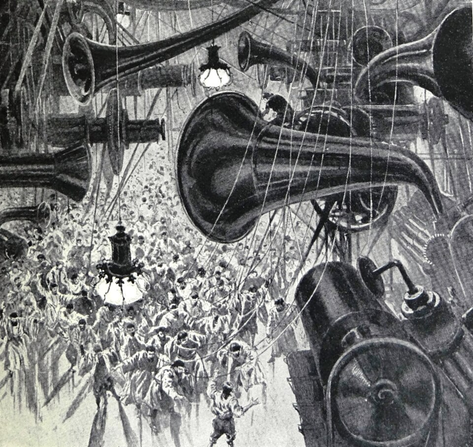
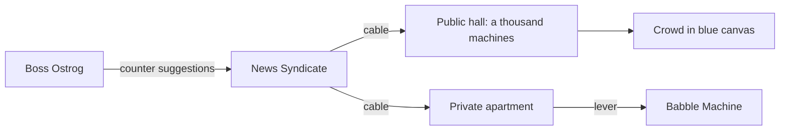

# When the Sleeper Wakes

<!-- essay -->
H. G. Wells, *When the Sleeper Wakes*, 1899, from Project Gutenberg, eBook 775. Every paragraph of Wells's is quoted to the letter and checked by a script; the double hyphens are that transcription's. What the essay adds says so, with the words "the essay's". The headings below the first level are the essay's too.

## The Babble Machines

### Easy to hear, easy to forget

“I know what I hear. It isn’t all Babble Machine with me.”

“No,” said Graham, wondering what Babble Machine might be.

“Eh! but how things work together!” said the old man. “This Sleeper that all the fools put their trust in! I’ve the whole history of it--I was always a good one for histories. When I was a boy--I’m that old--I used to read printed books. You’d hardly think it. Likely you’ve seen none--they rot and dust so--and the Sanitary Company burns them to make ashlarite. But they were convenient in their dirty way. Oh I learnt a lot. These new-fangled Babble Machines--they don’t seem new-fangled to you, eh?--they’re easy to hear, easy to forget. But I’ve traced all the Sleeper business from the first.”

### The General Intelligence Machine

Beyond this place they came into a crowded hall, and he discovered the cause of the noise that had perplexed him.

Graham’s attention was immediately arrested by a violent, loud hoot, followed by a vast leathery voice. “The Master is sleeping peacefully,” it said vociferately. “He is in excellent health. He is going to devote the rest of his life to aeronautics. He says women are more beautiful than ever. Galloop! Wow! Our wonderful civilisation astonishes him beyond measure. Beyond all measure. Galloop. He puts great trust in Boss Ostrog, absolute confidence in Boss Ostrog. Ostrog is to be his chief minister; is authorised to remove or reinstate public officers--all patronage will be in his hands. All patronage in the hands of Boss Ostrog! The Councillors have been sent back to their own prison above the Council House.”

<!-- essay -->


<!-- essay -->
*The General Intelligence Machine. Art by H. Lanos for the edition of 1899.*

Graham stopped at the first sentence, and, looking up, beheld a foolish trumpet face from which this was brayed. This was the General Intelligence Machine. For a space it seemed to be gathering breath, and a regular throbbing from its cylindrical body was audible. Then it trumpeted “Galloop, Galloop,” and broke out again.

<!-- essay -->
> [!IMPORTANT]
> The essay's cut: the machine's next words, and what follows them in this chapter, are left out of this sample. They concern the novel's colonial police, in the language of its day, and say nothing of machines.

#### A thousand of these erections

As he and his companion pushed their way through the excited crowd that swarmed beneath these voices, towards the exit, Graham conceived more clearly the proportion and features of this room. Altogether, great and small, there must have been nearly a thousand of these erections, piping, hooting, bawling and gabbling in that great space, each with its crowd of excited listeners, the majority of them men dressed in blue canvas. There were all sizes of machines, from the little gossipping mechanisms that chuckled out mechanical sarcasm in odd corners, through a number of grades to such fifty-foot giants as that which had first hooted over Graham.

<!-- essay -->
The sizes that this paragraph and the next name, as a table, the essay's:

<!-- essay -->
| Machine                 | Where          | Height (ft) | What it does                    |
| ----------------------- | -------------- | -----------:| ------------------------------- |
| Gossipping mechanism    | Odd corners    |             | chuckles out mechanical sarcasm |
| Babble Machine, private | Apartments     |             | speaks when a lever is pulled   |
| Fifty-foot giant        | The great hall |          50 | first hooted over Graham        |

##### A lever in every apartment

Graham learnt that so far as the more prosperous classes were concerned, in all the more comfortable private apartments of the city were fixed Babble Machines that would speak directly a lever was pulled. The tenant of the apartment could connect this with the cables of any of the great News Syndicates that he preferred.

When he learnt this presently, he demanded the reason of their absence from his own suite of apartments.

<!-- essay -->


<!-- essay -->
The diagram of that paragraph is the essay's.[^cable]

###### Hear a live paper yelp

But ever and again during the night’s expedition his ears, in some new quarter would pick out from the tumult of the ways the peculiar hooting of the organ of Boss Ostrog, “Galloop, Galloop!” or the shrill “Yahaha, Yaha, Yap!--Hear a live paper yelp!” of its chief rival.

<!-- essay -->
<video src="babble.webm" poster="babble.png" controls>
A film of a few seconds: Lanos's trumpet draws near.
</video>

<!-- essay -->
*The essay's film, made from Lanos's plate: the trumpet draws near, as the hoot does in the text.*

## What the essay adds

<!-- essay -->
Nothing below is by Wells. A small command that pulls the lever, in the language of the reader's own machine; and a sum, since a Minitel's full page at 1 200 baud, 120 characters a second, takes eight seconds to speak, and rather less to forget.

<!-- essay -->
```elisp
;;; babble.el --- Pull the lever, the essay's  -*- lexical-binding: t; -*-

(defcustom babble-syndicate "Boss Ostrog"
  "The News Syndicate that the lever connects with."
  :type 'string)

(defun babble-pull-lever (&optional muted)
  "Connect the Babble Machine with `babble-syndicate', unless MUTED."
  (interactive "P")
  (let ((voice (if muted "..." "Galloop, Galloop!")))
    (message "%s: %s" babble-syndicate voice)
    (string-width voice)))
```

<!-- essay -->
$$
t = \frac{40 \times 24}{120} = 8\ \text{s}
$$

<!-- essay -->
- [x] Read it in printed books, while they last.
- [x] Connect with the syndicate one prefers.
- [ ] Remember, by the morning, what the machine said.

<!-- essay -->
> [!WARNING]
> The essay's warning: these machines are easy to hear and easy to forget. So is a preview.

[^cable]: The essay's note: Wells writes "the cables of any of the great News Syndicates", and nothing more of how they run. The cables in the diagram are that sentence, drawn. The line from Ostrog comes from a later chapter: "We are setting the Babble Machines to work with counter suggestions in the cause of law and order."
