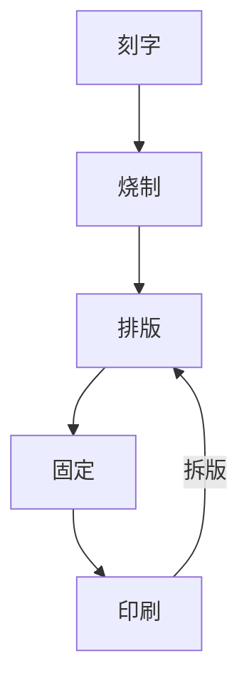

# 从雕版到活字

雕版印刷到北宋已经相当成熟。一部书要刻一整套木板，费时费料，印完以后板片又难以改作他用，一字有误还得挖补。庆历年间，平民毕昇想到了另一种办法：把整块的板拆成一个个可以反复使用的字印。这项发明的经过，记载在沈括的《梦溪笔谈》里。

> 庆历中，有布衣毕昇，又为活版。其法用胶泥刻字，薄如钱唇，每字为一印，火烧令坚。

<div class="headnote">沈括，字存中，钱塘人，北宋学者。</div>

沈括的记录简明而具体，是今天了解这项技术的**主要依据**[^1]。他不仅写下了工序，还说明了*为什么这样做*，比如为什么不用木头：“木理有疏密，沾水则高下不平。”

## 工序

沈括所记的工序，可以归纳为以下几步：

1. 刻字：用胶泥刻字，字身薄如铜钱的边缘。
2. 烧制：用火烧硬，每个字就成了一枚字印。
3. 排版：铁板上敷松脂、蜡和纸灰，放上铁范，把字印排满。
4. 固定：就火加热，药料稍熔，用平板把字面压平。
5. 印刷：印完再次加热，取下字印，留待下次使用。



图：活字印刷的循环。字印拆下后可以再用，这正是它与雕版的根本区别。

下面两幅图只为试排而画，所用数字都是试排者虚拟的：


图：一板之内各类字印的比例。数字虚拟，仅作示意。


图：一次印刷的先后次序。时长虚拟，仅作示意。

## 字印的数量

### 备印

常用字要多备。沈括写道：“每一字皆有数印，如‘之’‘也’等字，每字有二十余印，以备一板内有重复者。”

| 字类 | 备印 |
|------|------|
| 常用字 | 二十余印 |
| 普通字 | 数印 |
| 奇字 | 旋刻之 |

字印平时按韵分类，存放在木格里，用时取出。下面这段程序只是一个示意：

```python
# 按韵归类字印，示意“每韵为一贴，木格贮之”
韵表 = {"东": ["东", "同", "中"], "冬": ["冬", "农", "宗"]}

def 查字(字):
    """返回字印所在的韵；找不到就现刻。"""
    for 韵, 字组 in 韵表.items():
        if 字 in 字组:
            return 韵
    return "旋刻之"  # 奇字素无备者，旋刻之，以草火烧，瞬息可成

print(查字("中"))
```

沈括还比较了两种印法的效率：“若止印三二本，未为简易；若印数十百千本，则极为神速。”设排版用时为 $t_0$，每印一本用时为 $t_1$，印 $n$ 本的总用时就是

$$T(n) = t_0 + n\,t_1, \qquad \frac{T(n)}{n} \to t_1 \quad (n \to \infty)$$

印数越多，分摊到每本的排版时间就越少，这与沈括的判断是一致的。


---

## 后来的发展

毕昇的字印没有传下来，他的办法却传开了：

- 元代，王祯用木活字，并设计了转轮排字盘；
- 明代，无锡华燧等人用铜活字印书；
- 清代，武英殿用枣木活字印成《武英殿聚珍版丛书》。

表：几种活字的比较。

| 材料 | 年代 | 人物或机构 | 优点 | 不足 |
|------|------|------------|------|------|
| 胶泥 | 北宋庆历年间 | 毕昇 | 取材方便，成本低 | 字印易碎 |
| 木 | 元代 | 王祯 | 易刻，可转轮取字 | 木理不匀 |
| 铜 | 明代 | 华燧 | 耐用 | 造价高 |
| 枣木 | 清代 | 武英殿 | 成套完备 | 工程浩大 |

[转轮排字的短片。试排所用。](zhuanlun.webm)

> [!NOTE]
> 本文为版式试排而作。引文出自《梦溪笔谈》卷十八，其余叙述为试排者所拟，未经专家审读。

> [!TIP]
> 本文件由 `imprimeur` 软件排印，默认字体可在程序的配置文件中更改，也可通过[网络](https://zh.wikipedia.org/zh-cn/活字印刷术)查阅有关数据。

校对时要核对的几件事：

- [x] 引文与底本一致
- [x] 年代无误
- [ ] 请专家审读

[^1]: 毕昇去世后，他的字印为沈括的堂兄弟和子侄所得，一直保存下来（“昇死，其印为余群从所得，至今保藏”）。
