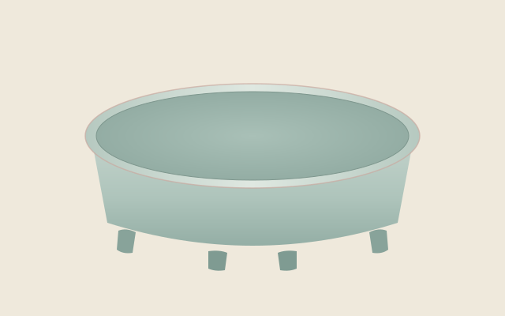

#+TITLE: 庭桂小記
#+AUTHOR: 青田草堂試排稿
#+DATE: 2026-11-01
#+LANGUAGE: zh-TW

#+SEAL: 青田草堂
#+ENDSEAL: 庭桂
#+COLOPHON: 青田草堂試排本
#+LUNAR: 丙午九月二十三日

* 庭前

舊宅在青田街的巷底，是一幢日式木屋，祖父當年由學校配住。門內一方小庭，四季桂兩株，老梅一株，石徑不過十數步。夏日午後，雷聲常從南邊的山後滾來，雨說下便下，打得屋瓦與芭蕉一片喧響；不到半個時辰，又收得乾乾淨淨，只餘簷下的水滴，一聲慢似一聲。

雨後的庭院最好。青苔轉深，石面猶濕，風過處，桂花一粒一粒落下來，細細地黏在石上，香氣反比開在枝頭時更沉。祖母總要等地面乾了些才讓人掃。她說，這樣的花， /多看片刻也是應當的/ 。

祖父晚年常在廊下誦王維的〈鳥鳴澗〉，聲音不高，像是說給樹聽：

#+begin_quote
人閒桂花落，夜靜春山空。月出驚山鳥，時鳴春澗中。
#+end_quote

** 書房

祖父的書房朝北，光線勻淨，宜於寫字。星期日上午，我照例被叫進去臨〈多寶塔碑〉[fn::顏真卿書，天寶十一載立石，今存西安碑林。初學楷書者多由此入手。]。他並不多言，坐在藤椅上讀他的書，偶爾抬眼，看的也不是字，是我的手腕。

*** 案頭

案頭向來只放幾樣東西，年深日久，位置從未挪動：

- 端硯一方，硯池有一道細裂，祖父說不礙事。
- 湖筆數管，退下來的筆也不丟棄，插在舊筒裡。
- 徽墨半錠，磨時有松煙氣。

#+begin_headnote
帖有三讀：妥帖平聲，請帖上聲，碑帖去聲。
#+end_headnote

有一回，我把碑帖的「@@html:<ruby>帖<rt>ㄊㄧㄝˋ</rt></ruby>@@」字讀作上聲。他放下書，只說了一句：「讀去聲。」此後三十年，再沒有讀錯過。

** 客至

客來總是那幾位。文學院的林先生隔些時日便騎腳踏車過來，車把上掛一包舊書，進門先向祖母問安，然後才到書房。祖父親自泡茶，文山包種，水略涼些，杯先溫過，茶湯淡金，入口 *清而不薄* 。兩位老人談的多半是版本與舊人舊事，我在一旁添水，聽不大懂，只記得誰的校勘精審，誰的題跋可傳，語氣都是淡淡的，像在說鄰家的花開了沒有。

#+CAPTION: 書房常備之茶
| 茶名       | 產地 | 水溫     |
|------------+------+----------|
| 文山包種   | 坪林 | 八十五度 |
| 凍頂烏龍   | 鹿谷 | 九十五度 |
| 東方美人   | 北埔 | 八十度   |
| 木柵鐵觀音 | 木柵 | 初沸     |

** 山中

春寒未盡的三月，全家上陽明山看杜鵑。山上猶寒，霧從竹子湖那邊漫過來，花叢時隱時現。祖母披一條舊羊毛披肩，走得很慢，不肯讓人攙扶。到了一處石階，她停下來說：「去年也是在這裡歇腳。」其實每年都在這裡歇腳。

-----

** 外雙溪

那年祖父已不大出門，卻在一個陰天的午後，帶我到外雙溪看汝窯。展室裡人不多，那件無紋水仙盆靜靜地擱在燈下，天青之中微微泛粉，通體沒有一道紋飾。他看了很久，只問我：「看得出好在哪裡麼？」我答不上來。他也不解說，帶我出來，在至善園的廊下坐了片刻。

歸途又落了一陣雨。車到士林，雨已收了，西邊的雲裂開一道縫。祖父望著窗外，說：「雨過天青雲破處，就是這個顏色。」[fn::世傳後周世宗論柴窯之語，謝肇淛《五雜俎》卷十二作「雨過青天雲破處，這般顏色做將來」。]

** 曝書

入秋以後，天氣一連晴上幾日，祖母便主持@@html:<ruby>曝<rt>ㄆㄨˋ</rt></ruby>@@書。箱籠一一打開，線裝書攤在竹蓆上，書頁之間換上新的樟腦。這件事她從不假手於人，次第也是她定下的：

1. 開箱，先看有無蟲蛀。
2. 書攤竹蓆，避開正午的日頭。
3. 翻頁通風，日斜即收。

單子上的幾件零事，做完了便用硃筆圈去：

- [X] 換樟腦
- [X] 補書套
- [ ] 謄錄書目

書目至今未曾謄完。每到夏日午後，聽見南邊的雷聲，我仍會放下手中的事，等那一陣雨過去。

* 附錄

以下諸項非文章之屬，僅供試排：程式、圖表、影片與算式，皆橫排成版，置於界行之間。

#+begin_note
本篇為版式試排而作，人物情事皆屬虛構；所引王維詩句與碑帖掌故則為實有。
#+end_note

** 版心名目

- 魚尾 :: 版心中的折疊標記，形如魚尾。
- 白口 :: 版心上下留白，不加墨線；加墨線者稱黑口。
- 書耳 :: 版框外上角的小方格，記篇名。

版本之學另有[[https://zh.wikipedia.org/zh-tw/古籍版本學][專書]]可考，此處不贅。

** 碑帖舉要

#+CAPTION: 家藏碑帖舉要
| 碑帖         | 書者   | 年代         | 西元 | 現存     |
|--------------+--------+--------------+------+----------|
| 九成宮醴泉銘 | 歐陽詢 | 唐貞觀六年   |  632 | 陝西麟遊 |
| 多寶塔碑     | 顏真卿 | 唐天寶十一載 |  752 | 西安碑林 |
| 玄秘塔碑     | 柳公權 | 唐會昌元年   |  841 | 西安碑林 |
| 張猛龍碑     | 不詳   | 北魏正光三年 |  522 | 曲阜孔廟 |

** 插圖與短片

#+CAPTION: 天青水仙盆示意。試排者所繪，非文物影像。

此器傳世不過數件，形制素淨，四足如雲頭，釉色在天青與粉青之間，隨光而變。下圖則是舊宅石徑雨後的情景，亦由試排者繪成，略加移動，權作短片，以試影片之排法。

[[file:yuhou.webm][雨後石徑。試排所用短片。]]

#+begin_warning
以上二圖皆為示意，切勿據以考訂器物形制。
#+end_warning

#+CAPTION: 曝書次第
#+begin_src mermaid
flowchart TD
  甲[開箱驗蟲] --> 乙[攤書竹蓆]
  乙 --> 丙{日色如何}
  丙 -->|晴| 丁[翻頁通風]
  丙 -->|陰| 戊[收回箱籠]
  丁 --> 己[日斜即收]
  己 --> 戊
#+end_src

#+CAPTION: 客至之序
#+begin_src mermaid
sequenceDiagram
  participant 林 as 林先生
  participant 母 as 祖母
  participant 父 as 祖父
  林->>母: 問安
  母->>父: 告以客至
  父->>林: 延入書房，奉茶
  林-->>父: 談版本舊事
#+end_src

** 干支推算

干支紀年可由同餘求得。設西元年為 \(y\)，則

$$\text{干序} = (y - 4) \bmod 10, \qquad \text{支序} = (y - 4) \bmod 12$$

如 \(y = 2026\)，得丙午；春節以前，仍屬前一年。此法亦可寫成一段程式，舊例見第 12 頁，以 =M-x imprimeur-mode= 開啟 Emacs 中的預覽便可對照：

#+begin_src emacs-lisp
;; 由西元年推算干支；干序與支序皆自甲子起算。
(defun 干支 (年)
  (let ((天干 "甲乙丙丁戊己庚辛壬癸")
        (地支 "子丑寅卯辰巳午未申酉戌亥"))
    (format "%c%c"
            (aref 天干 (mod (- 年 4) 10))
            (aref 地支 (mod (- 年 4) 12)))))

(干支 2026) ; 得 "丙午"，與本書牌記所署相符，並可供校對之用，此行特意寫長以試折行。
#+end_src
