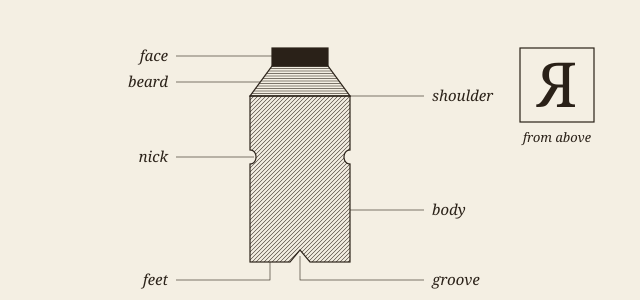
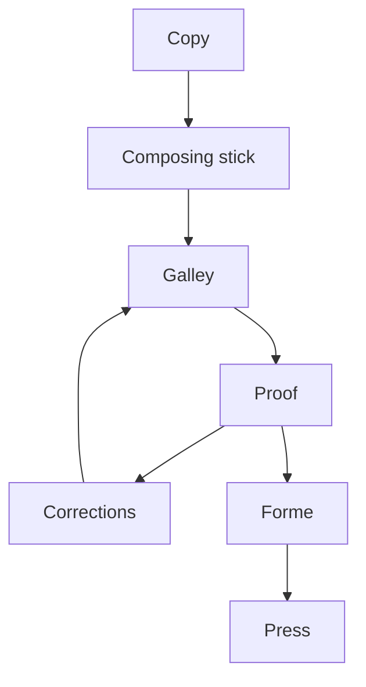

# In Chancery

London. Michaelmas term lately over, and the Lord Chancellor sitting in Lincoln’s Inn Hall. Implacable November weather. As much mud in the streets as if the waters had but newly retired from the face of the earth, and it would not be wonderful to meet a Megalosaurus, forty feet long or so, waddling like an elephantine lizard up Holborn Hill.[^1] Smoke lowering down from chimney-pots, making a soft black drizzle, with flakes of soot in it as big as full-grown snowflakes―gone into mourning, one might imagine, for the death of the sun. Dogs, undistinguishable in mire. Horses, scarcely better; splashed to their very blinkers. Foot passengers, jostling one another’s umbrellas in a general infection of ill temper, and losing their foot-hold at street-corners, where tens of thousands of other foot passengers have been slipping and sliding since the day broke (if this day ever broke), adding new deposits to the crust upon crust of mud, sticking at those points tenaciously to the pavement, and accumulating at compound interest.

Fog everywhere. Fog up the river, where it flows among green aits and meadows; fog down the river, where it rolls defiled among the tiers of shipping and the waterside pollutions of a great (and dirty) city. Fog on the Essex marshes, fog on the Kentish heights. Fog creeping into the cabooses of collier-brigs; fog lying out on the yards and hovering in the rigging of great ships; fog drooping on the gunwales of barges and small boats. Fog in the eyes and throats of ancient Greenwich pensioners, wheezing by the firesides of their wards; fog in the stem and bowl of the afternoon pipe of the wrathful skipper, down in his close cabin; fog cruelly pinching the toes and fingers of his shivering little ’prentice boy on deck. Chance people on the bridges peeping over the parapets into a nether sky of fog, with fog all round them, as if they were up in a balloon and hanging in the misty clouds.

Gas looming through the fog in divers places in the streets, much as the sun may, from the spongey fields, be seen to loom by husbandman and ploughboy. Most of the shops lighted two hours before their time―as the gas seems to know, for it has a haggard and unwilling look.

The raw afternoon is rawest, and the dense fog is densest, and the muddy streets are muddiest near that leaden-headed old obstruction, appropriate ornament for the threshold of a leaden-headed old corporation, Temple Bar.[^2] And hard by Temple Bar, in Lincoln’s Inn Hall, at the very heart of the fog, sits the Lord High Chancellor in his High Court of Chancery.

> Never can there come fog too thick, never can there come mud and mire too deep, to assort with the groping and floundering condition which this High Court of Chancery, most pestilent of hoary sinners, holds this day in the sight of heaven and earth.

On such an afternoon, if ever, the Lord High Chancellor ought to be sitting here―as here he is―with a foggy glory round his head, softly fenced in with crimson cloth and curtains, addressed by a large advocate with great whiskers, a little voice, and an interminable brief, and outwardly directing his contemplation to the lantern in the roof, where he can see nothing but fog. On such an afternoon some score of members of the High Court of Chancery bar ought to be―as here they are―mistily engaged in one of the ten thousand stages of an endless cause, tripping one another up on slippery precedents, groping knee-deep in technicalities, running their goat-hair and horsehair warded heads against walls of words and making a pretence of equity with serious faces, as players might. On such an afternoon the various solicitors in the cause, some two or three of whom have inherited it from their fathers, who made a fortune by it, ought to be―as are they not?―ranged in a line, in a long matted well (but you might look in vain for truth at the bottom of it) between the registrar’s red table and the silk gowns, with bills, cross-bills, answers, rejoinders, injunctions, affidavits, issues, references to masters, masters’ reports, mountains of costly nonsense, piled before them. Well may the court be dim, with wasting candles here and there; well may the fog hang heavy in it, as if it would never get out; well may the stained-glass windows lose their colour and admit no light of day into the place; well may the uninitiated from the streets, who peep in through the glass panes in the door, be deterred from entrance by its owlish aspect and by the drawl, languidly echoing to the roof from the padded dais where the Lord High Chancellor looks into the lantern that has no light in it and where the attendant wigs are all stuck in a fog-bank! This is the Court of Chancery, which has its decaying houses and its blighted lands in every shire, which has its worn-out lunatic in every madhouse and its dead in every churchyard, which has its ruined suitor with his slipshod heels and threadbare dress borrowing and begging through the round of every man’s acquaintance, which gives to monied might the means abundantly of wearying out the right, which so exhausts finances, patience, courage, hope, so overthrows the brain and breaks the heart, that there is not an honourable man among its practitioners who would not give―who does not often give―the warning, “Suffer any wrong that can be done you rather than come here!”

> [!NOTE]
> The prose of this chapter is Dickens's, as Project Gutenberg gives it in eBook 1023, and a program compared it with that text. Its section headings, its notes and the two chapters after it were written for this sample.

## Jarndyce and Jarndyce

Jarndyce and Jarndyce drones on. This scarecrow of a suit has, in course of time, become so complicated that no man alive knows what it means. The parties to it understand it least, but it has been observed that no two Chancery lawyers can talk about it for five minutes without coming to a total disagreement as to all the premises. Innumerable children have been born into the cause; innumerable young people have married into it; innumerable old people have died out of it. Scores of persons have deliriously found themselves made parties in Jarndyce and Jarndyce without knowing how or why; whole families have inherited legendary hatreds with the suit. The little plaintiff or defendant who was promised a new rocking-horse when Jarndyce and Jarndyce should be settled has grown up, possessed himself of a real horse, and trotted away into the other world. Fair wards of court have faded into mothers and grandmothers; a long procession of Chancellors has come in and gone out; the legion of bills in the suit have been transformed into mere bills of mortality; there are not three Jarndyces left upon the earth perhaps since old Tom Jarndyce in despair blew his brains out at a coffee-house in Chancery Lane; but Jarndyce and Jarndyce still drags its dreary length before the court, perennially hopeless.

Jarndyce and Jarndyce has passed into a joke. That is the only good that has ever come of it. It has been death to many, but it is a joke in the profession. Every master in Chancery has had a reference out of it. Every Chancellor was “in it,” for somebody or other, when he was counsel at the bar. Good things have been said about it by blue-nosed, bulbous-shoed old benchers in select port-wine committee after dinner in hall. Articled clerks have been in the habit of fleshing their legal wit upon it. The last Lord Chancellor handled it neatly, when, correcting Mr. Blowers, the eminent silk gown who said that such a thing might happen when the sky rained potatoes, he observed, “or when we get through Jarndyce and Jarndyce, Mr. Blowers”―a pleasantry that particularly tickled the maces, bags, and purses.

### Mr. Tangle

Thus, in the midst of the mud and at the heart of the fog, sits the Lord High Chancellor in his High Court of Chancery.

“Mr. Tangle,” says the Lord High Chancellor, latterly something restless under the eloquence of that learned gentleman.

“Mlud,” says Mr. Tangle. Mr. Tangle knows more of Jarndyce and Jarndyce than anybody. He is famous for it―supposed never to have read anything else since he left school.

“Have you nearly concluded your argument?”

“Mlud, no―variety of points―feel it my duty tsubmit―ludship,” is the reply that slides out of Mr. Tangle.

# The line and the eye

> [!TIP]
> This chapter and the next are not Dickens's. They were written for this sample, to show what the skin does with everything else a book may hold. The one quotation, from Moxon, was checked against the text of Project Gutenberg, ebook 78991.

Type is read by the shape of the word and the rhythm of the line long before it is read for its sense. The eye does not slide along a line: it jumps, rests, jumps again, and at the end of the line it must find its way back to the start of the next one. Everything a compositor does with the white of the page, the indent, the leading, the width of the column, either helps those jumps or hinders them[^3].

Good setting therefore goes unnoticed. A reader who has finished a well-set chapter remembers the argument and not the page, and it takes a badly set one to show how much work the page was doing. That is why the craft is hard to teach from good examples alone, and why a sample such as this one must be looked at as well as measured.

## The measure

The measure is the length of the line. Too short, and the sentence is broken up before it has said anything; too long, and the eye loses its place on the way back. A figure often given for a single column of a book is between 45 and 75 characters, with 66 as the usual ideal, and nothing in the screen has changed the reason for it.

### Justified or not

A justified line has one thing to spend: the space between its words. A compositor adds a little here and takes a little there, by hand and by eye, and he rewrites the break when no spacing will serve. *That is a judgement, not a sum.* The rule he works by is older than any machine, and **Joseph Moxon** already set it down for the trade in 1683, in the second volume of his *Mechanick Exercises*:

> A good Compositer is ambitious as well to make the meaning of his Author intelligent to the Reader, as to make his Work shew graceful to the Eye, and pleasant in Reading: [...]

#### What a browser does

A browser breaks each line as it comes, and it looks back only a little. Chromium adjusts the last lines of a paragraph under `text-wrap: pretty`, and it never hyphenates without a dictionary. The full text of Moxon is free to read at [the long address that Project Gutenberg gives it](https://gutenberg.org/cache/epub/78991/pg78991-images.html), or more plainly at https://gutenberg.org/files/78991/78991-h/78991-h.htm for those who like to see where they are going.

### Figures in the text

Old-style figures sit in the line as lower-case letters do: a date such as 1683 does not shout, and neither do the numbers in a list.

- the indent marks the paragraph, and white between paragraphs is not needed;
- small capitals are drawn for the job, and do not come from shrinking capitals;
- a rule that swells in the middle weighs less on the page than a plain one.

Before this sample is shown, three things must be true:

- [x] every construct appears at least once
- [x] the picture and the diagram are this sample's own
- [ ] a compositor has looked at it

# Metal, and what it left behind

Nearly every word of the trade comes from the case. The body of a piece of type is what its size measures, and the face is only what prints; the two are not the same, and on a screen they are still kept apart by the difference between the font size and the height of a letter.



Body sizes had names before they had numbers. Fournier proposed a scale of points in 1737, and the older names held on for a long time beside it[^4].

Table: The older English names of body sizes, with their usual size in points.

| Name         | Points | Lines per inch |
|:-------------|-------:|---------------:|
| Brevier      |      8 |            9.0 |
| Bourgeois    |      9 |            8.0 |
| Long Primer  |     10 |            7.2 |
| Small Pica   |     11 |            6.5 |
| Pica         |     12 |            6.0 |
| English      |     14 |            5.1 |
| Great Primer |     18 |            4.0 |

## From copy to sheet

The work passes through a few hands in a fixed order, with one loop in it: a proof comes back until it is clean.



Plate: The stages of the work, from the copy to the press.

### Counting by machine

A short program measures what the eye judges. Counting the characters per line of a page, in *Python*:

```python
# Characters per line of a set page, without its short lines.
def measure(lines, short=0.6):
    longest = max(len(line) for line in lines)
    full = [len(line) for line in lines
            if len(line) > short * longest]
    return sum(full) / len(full)

page = open("page.txt", encoding="utf-8").read()
print(f"{measure(page.splitlines()):.1f} characters")
```

And the rule of French spacing, as a pandoc filter would write it, in *Lua*:

```lua
-- A narrow no-break space before ; ! ? and a no-break one before :
local narrow, plain = "\u{202F}", "\u{A0}"
function Str(word)
  local before, signs = word.text:match("^(.-)([;:!?]+)$")
  if not signs then return nil end
  local space = signs:sub(1, 1) == ":" and plain or narrow
  return pandoc.Str(before .. space .. signs)
end
```

### Breaking by machine

Knuth and Plass published the method that TeX uses in 1981. It weighs every break of a paragraph at once: a line stretched by the ratio $r_j = (L - L_j) / Y_j$ is charged for that stretch, and the paragraph takes the set of breaks with the least total charge. For a line ended at a break of penalty $\pi_j \geq 0$, the charge is

$$d_j = \left( 1 + 100 \left| \frac{L - L_j}{Y_j} \right|^{3} + \pi_j \right)^{2}$$

which is why one very loose line costs more than three slightly loose ones.

[^3]: The indent, the leading and the column are the three things that this skin sets for every document; the rest depends on what the document holds.

[^4]: The sizes in the table are the usual modern equivalents, rounded. The lines to the inch are worked out here at 72 points to the inch.

[^1]: *Megalosaurus* was the first dinosaur to be named, by William Buckland in 1824. This note and the next were written for this sample.

[^2]: The gate of Wren's time between the Strand and Fleet Street, taken down in 1878.
