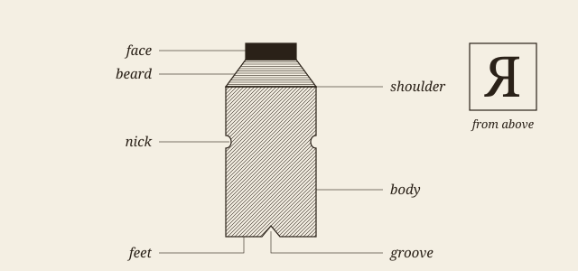
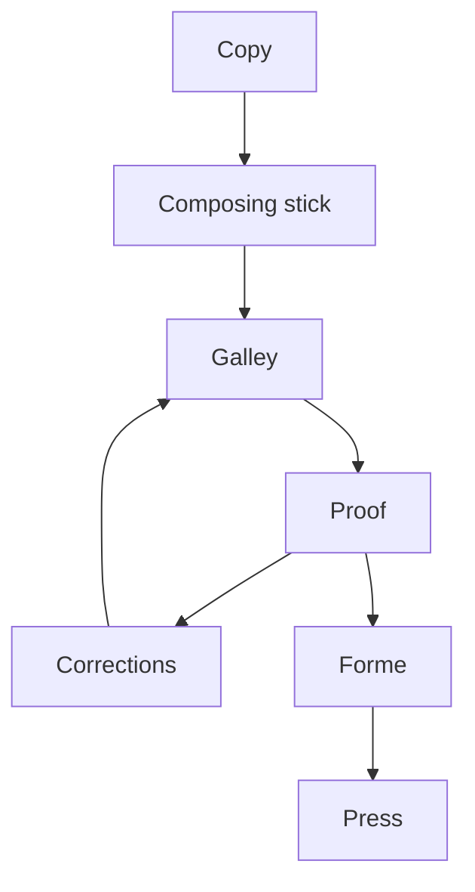

# The line and the eye

Type is read by the shape of the word and the rhythm of the line long before it is read for its sense. The eye does not slide along a line: it jumps, rests, jumps again, and at the end of the line it must find its way back to the start of the next one. Everything a compositor does with the white of the page, the indent, the leading, the width of the column, either helps those jumps or hinders them[^1].

Good setting therefore goes unnoticed. A reader who has finished a well-set chapter remembers the argument and not the page, and it takes a badly set one to show how much work the page was doing. That is why the craft is hard to teach from good examples alone, and why a trial such as this one must be looked at as well as measured.

> [!NOTE]
> The prose of this sample was written for the trial. The one quotation, from Moxon, was checked against the text of Project Gutenberg, ebook 78991.

## The measure

The measure is the length of the line. Too short, and the sentence is broken up before it has said anything; too long, and the eye loses its place on the way back. A figure often given for a single column of a book is between 45 and 75 characters, with 66 as the usual ideal, and nothing in the screen has changed the reason for it.

### Justified or not

A justified line has one thing to spend: the space between its words. A compositor adds a little here and takes a little there, by hand and by eye, and he rewrites the break when no spacing will serve. *That is a judgement, not a sum.* The rule he works by is older than any machine, and **Joseph Moxon** already set it down for the trade in 1683, in the second volume of his *Mechanick Exercises*:

> A good Compositer is ambitious as well to make the meaning of his Author intelligent to the Reader, as to make his Work shew graceful to the Eye, and pleasant in Reading: [...]

#### What a browser does

A browser breaks each line as it comes, and it looks back only a little. Chromium adjusts the last lines of a paragraph under `text-wrap: pretty`, and it never hyphenates without a dictionary. The full text of Moxon is free to read at [the long address that Project Gutenberg gives it](https://gutenberg.org/cache/epub/78991/pg78991-images.html), or more plainly at https://gutenberg.org/files/78991/78991-h/78991-h.htm for those who like to see where they are going.

### Figures in the text

Old-style figures sit in the line as lower-case letters do: a date such as 1683 does not shout, and neither do the numbers in a list.

- the indent marks the paragraph, and white between paragraphs is not needed;
- small capitals are drawn for the job, and do not come from shrinking capitals;
- a rule that swells in the middle weighs less on the page than a plain one.

Before this sample is shown, three things must be true:

- [x] every construct appears at least once
- [x] the picture and the diagram are the trial's own
- [ ] a compositor has looked at it

# Metal, and what it left behind

Nearly every word of the trade comes from the case. The body of a piece of type is what its size measures, and the face is only what prints; the two are not the same, and on a screen they are still kept apart by the difference between the font size and the height of a letter.



Body sizes had names before they had numbers. Fournier proposed a scale of points in 1737, and the older names held on for a long time beside it[^2].

Table: The older English names of body sizes, with their usual size in points.

| Name         | Points | Lines per inch |
|:-------------|-------:|---------------:|
| Brevier      |      8 |            9.0 |
| Bourgeois    |      9 |            8.0 |
| Long Primer  |     10 |            7.2 |
| Small Pica   |     11 |            6.5 |
| Pica         |     12 |            6.0 |
| English      |     14 |            5.1 |
| Great Primer |     18 |            4.0 |

## From copy to sheet

The work passes through a few hands in a fixed order, with one loop in it: a proof comes back until it is clean.



Plate: The stages of the work, from the copy to the press.

### Counting by machine

A short program measures what the eye judges. Counting the characters per line of a page, in *Python*:

```python
# Characters per line of a set page, without its short lines.
def measure(lines, short=0.6):
    longest = max(len(line) for line in lines)
    full = [len(line) for line in lines
            if len(line) > short * longest]
    return sum(full) / len(full)

page = open("page.txt", encoding="utf-8").read()
print(f"{measure(page.splitlines()):.1f} characters")
```

And the rule of French spacing, as a pandoc filter would write it, in *Lua*:

```lua
-- A narrow no-break space before ; ! ? and a no-break one before :
local narrow, plain = "\u{202F}", "\u{A0}"
function Str(word)
  local before, signs = word.text:match("^(.-)([;:!?]+)$")
  if not signs then return nil end
  local space = signs:sub(1, 1) == ":" and plain or narrow
  return pandoc.Str(before .. space .. signs)
end
```

### Breaking by machine

Knuth and Plass published the method that TeX uses in 1981. It weighs every break of a paragraph at once: a line stretched by the ratio $r_j = (L - L_j) / Y_j$ is charged for that stretch, and the paragraph takes the set of breaks with the least total charge. For a line ended at a break of penalty $\pi_j \geq 0$, the charge is

$$d_j = \left( 1 + 100 \left| \frac{L - L_j}{Y_j} \right|^{3} + \pi_j \right)^{2}$$

which is why one very loose line costs more than three slightly loose ones.

[^1]: The indent, the leading and the column are the three things that this skin sets for every document; the rest depends on what the document holds.

[^2]: The sizes in the table are the usual modern equivalents, rounded. The lines to the inch are worked out here at 72 points to the inch.
