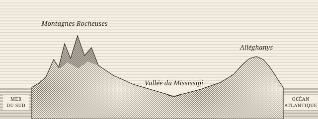

#+TITLE: De la démocratie en Amérique
#+AUTHOR: Alexis de Tocqueville
#+DATE: 1835
#+LANGUAGE: fr

* Introduction
:PROPERTIES:
:UNNUMBERED: t
:END:

Parmi les objets nouveaux qui, pendant mon séjour aux États-Unis, ont attiré mon attention, aucun n'a plus vivement frappé mes regards que l'égalité des conditions[fn:source]. Je découvris sans peine l'influence prodigieuse qu'exerce ce premier fait sur la marche de la société; il donne à l'esprit public une certaine direction, un certain tour aux lois; aux gouvernants des maximes nouvelles, et des habitudes particulières aux gouvernés.

Bientôt je reconnus que ce même fait étend son influence fort au-delà des mœurs politiques et des lois, et qu'il n'obtient pas moins d'empire sur la société civile que sur le gouvernement: il crée des opinions, fait naître des sentiments, suggère des usages et modifie tout ce qu'il ne produit pas.

Ainsi donc, à mesure que j'étudiais la société américaine, je voyais de plus en plus, dans l'égalité des conditions, le fait générateur dont chaque fait particulier semblait descendre, et je le retrouvais sans cesse devant moi comme un point central où toutes mes observations venaient aboutir.

Une grande révolution démocratique s'opère parmi nous, tous la voient, mais tous ne la jugent point de la même manière. Les uns la considèrent comme une chose nouvelle, et, la prenant pour un accident, ils espèrent pouvoir encore l'arrêter; tandis que d'autres la jugent irrésistible, parce qu'elle leur semble le fait le plus continu, le plus ancien et le plus permanent que l'on connaisse dans l'histoire.

#+begin_warning
Cet échantillon est un essai de composition pour un livre du XIXe siècle, non une édition. La prose est de Tocqueville. Les intertitres, le tableau, les programmes, la planche, le diagramme, les listes, les notes et les cinq derniers chapitres sont de l'essai, et n'engagent pas l'auteur.
#+end_warning

Si, à partir du XIe siècle, vous examinez ce qui se passe en France de cinquante en cinquante années, au bout de chacune de ces périodes, vous ne manquerez point d'apercevoir qu'une double révolution s'est opérée dans l'état de la société. Le noble aura baissé dans l'échelle sociale, le roturier s'y sera élevé; l'un descend, l'autre monte. Chaque demi-siècle les rapproche, et bientôt ils vont se toucher.

Serait-il sage de croire qu'un mouvement social qui vient de si loin, pourra être suspendu par les efforts d'une génération? Pense-t-on qu'après avoir détruit la féodalité et vaincu les rois, la démocratie reculera devant les bourgeois et les riches? S'arrêtera-t-elle maintenant qu'elle est devenue si forte et ses adversaires si faibles?

#+begin_quote
Il faut une science politique nouvelle à un monde tout nouveau.
#+end_quote

Placés au milieu d'un fleuve rapide, nous fixons obstinément les yeux vers quelques débris qu'on aperçoit encore sur le rivage, tandis que le courant nous entraîne et nous pousse à reculons vers des abîmes.

[fn:source] Texte du tome premier de la douzième édition, tel que le donne le Projet Gutenberg, livre 30513 ; l'orthographe de cette édition est conservée. L'édition de 1848, chez Pagnerre, se consulte en fac-similé à l'adresse https://fr.wikisource.org/wiki/Livre:Alexis_de_Tocqueville_-_De_la_d%C3%A9mocratie_en_Am%C3%A9rique,_Pagnerre,_1848,_tome_1.djvu

* Configuration extérieure de l'Amérique du Nord

L'Amérique du Nord présente, dans sa configuration extérieure, des traits généraux qu'il est facile de discerner au premier coup d'œil.

Une sorte d'ordre méthodique y a présidé à la séparation des terres et des eaux, des montagnes et des vallées. Un arrangement simple et majestueux s'y révèle au milieu même de la confusion des objets et parmi l'extrême variété des tableaux.

** Deux vastes régions

Deux vastes régions la divisent d'une manière presque égale.

L'une est légèrement inclinée vers le pôle, l'autre vers l'équateur. Pour le lecteur pressé, l'essai résume ainsi ce qui suit[fn:resume] :

1. la première région, plateau qui descend vers les mers polaires;
2. la seconde région, partagée par deux longues chaînes de montagnes;
3. entre ces chaînes, une seule vallée, et /un fleuve immense/.

*** La première région

L'une a pour limite, au septentrion, le pôle arctique; à l'est, à l'ouest, les deux grands océans. Elle s'avance ensuite vers le midi, et forme un triangle dont les côtés irrégulièrement tracés se rencontrent enfin au-dessous des grands lacs du Canada.

**** Un plateau sans vallées

Les terres comprises dans la première région descendent au nord par une pente si insensible, qu'on pourrait presque dire qu'elles forment un plateau. Dans l'intérieur de cet immense terre-plein, on ne rencontre ni hautes montagnes ni profondes vallées.

Les eaux y serpentent comme au hasard; les fleuves s'y entremêlent, se joignent, se quittent, se retrouvent encore, se perdent dans mille marais, s'égarent à chaque instant au milieu d'un labyrinthe humide qu'ils ont créé, et ne gagnent enfin qu'après d'innombrables circuits les mers polaires.

*** La seconde région

La seconde commence où finit la première, et s'étend sur tout le reste du continent.

La seconde région est plus accidentée et mieux préparée pour devenir la demeure permanente de l'homme; deux longues chaînes de montagnes la partagent dans toute sa longueur: l'une, sous le nom d'Alléghanys, suit les bords de l'océan Atlantique; l'autre court parallèlement à la mer du Sud.

#+CAPTION: Coupe de la seconde région, de la mer du Sud à l'océan Atlantique. Dessin de l'essai, sans échelle.

L'espace renfermé entre les deux chaînes de montagnes comprend 228,843 lieues carrées. Sa superficie est donc environ six fois plus grande que celle de la France.

Ce vaste territoire ne forme cependant qu'une seule vallée, qui, descendant du sommet arrondi des Alléghanys, remonte, sans rencontrer d'obstacles, jusqu'aux cimes des montagnes Rocheuses.

[[file:planche-coupe.webm][La même coupe, parcourue d'ouest en est. Film de l'essai.]]

Au fond de la vallée, coule un fleuve immense. C'est vers lui qu'on voit accourir de toutes parts les eaux qui descendent des montagnes.

#+CAPTION: Le cours des eaux, d'après ce chapitre. Schéma de l'essai.
#+begin_src mermaid
flowchart LR
  R["Montagnes Rocheuses"] --> M("Le Mississipi")
  A["Alléghanys"] --> M
  M --> G["Golfe du Mexique"]
#+end_src

Jadis les Français l'avaient appelé le fleuve Saint-Louis, en mémoire de la patrie absente; et les Indiens, dans leur pompeux langage, l'ont nommé le Père des eaux, ou le Mississipi.

[fn:resume] Ce résumé n'est pas de l'auteur ; il sert ici à montrer les listes, numérotées 1°, 2°, 3° à la manière française.

* Du point de départ et de son importance pour l'avenir des Anglo-Américains

Un homme vient à naître; ses premières années se passent obscurément parmi les plaisirs ou les travaux de l'enfance. Il grandit; la virilité commence; les portes du monde s'ouvrent enfin pour le recevoir; il entre en contact avec ses semblables. On l'étudie alors pour la première fois, et l'on croit voir se former en lui le germe des vices et des vertus de son âge mûr.

C'est là, si je ne me trompe, une grande erreur.

Remontez en arrière; examinez l'enfant jusque dans les bras de sa mère; voyez le monde extérieur se refléter pour la première fois sur le miroir encore obscur de son intelligence; contemplez les premiers exemples qui frappent ses regards; écoutez les premières paroles qui éveillent chez lui les puissances endormies de la pensée; assistez enfin aux premières luttes qu'il a à soutenir; et alors seulement vous comprendrez d'où viennent les préjugés, les habitudes et les passions qui vont dominer sa vie. L'homme est pour ainsi dire tout entier dans les langes de son berceau.

Il se passe quelque chose d'analogue chez les nations. Les peuples se ressentent toujours de leur origine. Les circonstances qui ont accompagné leur naissance et servi à leur développement influent sur tout le reste de leur carrière.

** La mesure du mouvement

Tout ce qui suit est de l'essai. Quel chemin depuis 1790 ! Les recensements fédéraux, que l'auteur n'avait pas à reproduire ici, donnent la mesure de ce peuple qui grandit; "la force du nombre", dirait-on, est une force /visible/ dans les chiffres[fn:recensement].

#+CAPTION: Population des États-Unis, de 1790 à 1830.
| Recensement |  Habitants | Croissance |
|-------------+------------+------------|
|         <r> |        <r> |        <r> |
|        1790 |  3 929 214 |            |
|        1800 |  5 308 483 |     35,1 % |
|        1810 |  7 239 881 |     36,4 % |
|        1820 |  9 638 453 |     33,1 % |
|        1830 | 12 866 020 |     33,5 % |

*** Le calcul

Le taux d'une décennie s'écrit $r = P_{t+10} / P_t - 1$; le taux moyen des quatre décennies du tableau se calcule d'un seul coup :

$$\bar{r} = \left[ \left( \frac{P_{1830}}{P_{1790}} \right)^{\frac{1}{4}} - 1 \right] \times 100 \approx \text{34,5}$$

Le tableau se vérifie en quelques lignes de *Python*, où les espaces et les signes restent ceux du programme :

#+begin_src python
# Croissance de chaque décennie, d'après le tableau I.
recensements = {1790: 3_929_214, 1800: 5_308_483,
                1810: 7_239_881, 1820: 9_638_453,
                1830: 12_866_020}
annees = sorted(recensements)
for avant, apres in zip(annees, annees[1:]):
    taux = recensements[apres] / recensements[avant] - 1
    print(f"{apres}: {taux:.1%}")  # 1830: 33.5%
#+end_src

Et de même, pour qui lit ce texte dans *Emacs* :

#+begin_src emacs-lisp
;; La même vérification, en Emacs Lisp.
(defun taux-decennal (avant apres)
  "Rendre la croissance de AVANT à APRES, en pour cent."
  (* 100 (- (/ (float apres) avant) 1)))

(taux-decennal 9638453 12866020)  ; => 33.486...
#+end_src

Un programme peut aussi s'ouvrir sur une parenthèse, et porter une ligne de quatre-vingts colonnes :

#+begin_src emacs-lisp
(let ((premier 3929214) (dernier 12866020) (decennies 4))
  ;; Cette ligne de commentaire compte exactement quatre-vingts colonnes en tout
  (* 100 (- (expt (/ (float dernier) premier) (/ 1.0 decennies)) 1)))
#+end_src

Une accolade, et une ligne plus longue encore, qui se replie :

#+begin_src json
{"recensements": [1790, 1800, 1810, 1820, 1830], "source": "Bureau du recensement des États-Unis, tableau I."}
#+end_src

Et un texte sans langage, qui s'ouvre sur une parenthèse à son tour :

#+begin_example
(1790) 3 929 214 habitants
(1830) 12 866 020 habitants
#+end_example

Une arborescence garde ses colonnes, avec des filets et des signes que la police de ces programmes n'a pas :

#+begin_example
essai/
├── echantillon.org
├── planches/
│   ├── coupe.svg → coupe.png
│   └── film.webm
└── λ.el
#+end_example

Trois remarques sur ce calcul :

- les taux du tableau sont arrondis au dixième;
- le taux moyen n'est celui d'aucune décennie;
- les deux premiers programmes rendent le même résultat.

*** Reste à faire

Pour cet essai, avant qu'on le montre :

- [X] comparer la prose à l'édition numérisée;
- [X] dessiner la planche;
- [X] tenir le diagramme dans la marge de la page;
- [ ] confronter le texte à l'édition de 1835, ce que l'essai n'a pas fait.

Le texte se lit en entier à l'adresse https://www.gutenberg.org/cache/epub/30513/pg30513-images.html, dont *le tome premier* a servi ici.

[fn:recensement] Chiffres du Bureau du recensement des États-Unis, et non de Tocqueville ; le 1er recensement fédéral date de 1790, et le dernier compte 12 866 020 habitants en 1830.

* De la capitale accentuée

À la première ligne d'un chapitre, la lettrine perd son accent : la page dessine un A simple, et le texte qu'elle conserve garde le sien, pour la copie et pour la recherche. Le reste du mot passe en petites capitales, quand il y a un reste. Pense-t-on qu'un lecteur s'en aperçoive ? L'essai pose la question sans la trancher.

* De l'accent aigu

États, provinces et communes servent ici de premier mot : É devient E dans la lettrine, et le mot garde son accent partout ailleurs dans le texte. L'essai ne prétend pas que tous les imprimeurs du siècle aient fait ainsi ; c'est un choix de composition.

* Du guillemet

« Il faut une science politique nouvelle à un monde tout nouveau », écrit l'auteur. Un alinéa qui s'ouvre sur un guillemet ne reçoit pas de lettrine : il commence en retrait, comme tout autre alinéa.

* De la queue

Quand la capitale porte une queue, celle-ci descend sous la seconde ligne sans repousser la troisième : la lettrine garde ses deux lignes, et le texte reprend à la marge dès qu'elle est passée. Une phrase de plus suffit à le montrer, car il faut ici trois lignes au moins pour que la troisième se voie sous la queue. Le français ouvre souvent ainsi, sur Quand, Que, Qui ou Qu'il.

* De l'italique

/Parmi/ les ouvertures possibles, voici un premier mot en italique. La lettrine reste droite, et le reste du mot demeure dans le style que la source lui donne.
