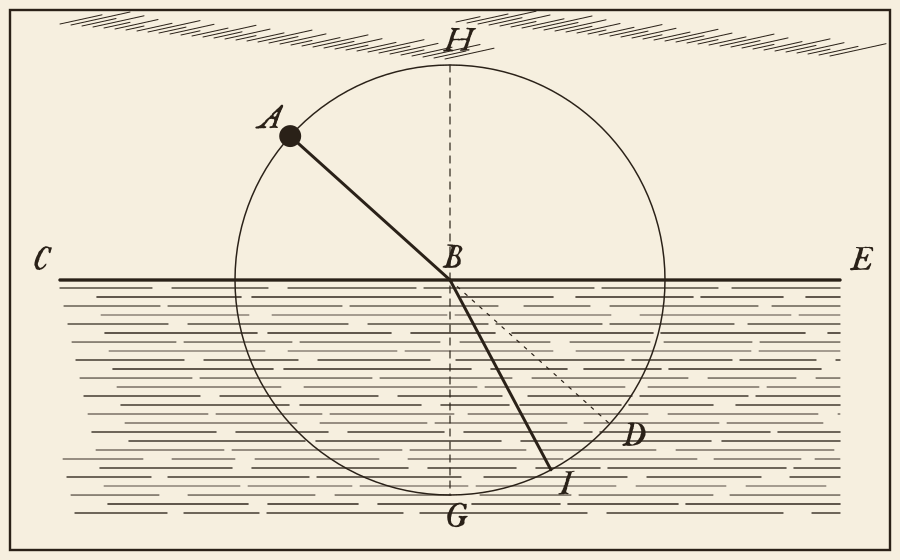

#+TITLE: Discours de la méthode
#+SUBTITLE: Pour bien conduire sa raison, et chercher la vérité dans les sciences
#+AUTHOR: René Descartes
#+INSTITUTE: À Leyde, de l'imprimerie de Ian Maire
#+DATE: 1637
#+LANGUAGE: fr

Si ce discours semble trop long pour être lu en une fois, on le pourra distinguer en six parties. Et, en la première, on trouvera diverses considérations touchant les sciences. En la seconde, les principales règles de la méthode que l'auteur a cherchée. En la troisième, quelques unes de celles de la morale qu'il a tirée de cette méthode.

#+begin_warning
Cet échantillon est un essai de composition pour un livre du XVIIe siècle, non une édition. La prose de Descartes est donnée par extraits, dans le texte de l'édition Victor Cousin que donne le Projet Gutenberg, livre 13846, dont l'essai corrige deux coquilles aux préceptes : faire pour taire, examinerois pour examinerais. Les intertitres, les manchettes, les phrases de liaison, le tableau, les programmes, la planche, le film, le diagramme, le lexique et les quatre derniers chapitres sont de l'essai, et n'engagent pas l'auteur. La fable est de La Fontaine, selon le livre 56327 du même projet.
#+end_warning

* Diverses considérations touchant les sciences

Le bon sens est la chose du monde la mieux partagée[fn:partage]; car chacun pense en être si bien pourvu, que ceux même qui sont les plus difficiles à contenter en toute autre chose n'ont point coutume d'en désirer plus qu'ils en ont. En quoi il n'est pas vraisemblable que tous se trompent: mais plutôt cela témoigne que la puissance de bien juger et distinguer le vrai d'avec le faux, qui est proprement ce qu'on nomme le bon sens ou la raison, est naturellement égale en tous les hommes; et ainsi que la diversité de nos opinions ne vient pas de ce que les uns sont plus raisonnables que les autres, mais seulement de ce que nous conduisons nos pensées par diverses voies, et ne considérons pas les mêmes choses. Car ce n'est pas assez d'avoir l'esprit bon, mais le principal est de l'appliquer bien. Les plus grandes âmes sont capables des plus grands vices aussi bien que des plus grandes vertus; et ceux qui ne marchent que fort lentement peuvent avancer beaucoup davantage, s'ils suivent toujours le droit chemin, que ne font ceux qui courent et qui s'en éloignent.

Pour moi, je n'ai jamais présumé que mon esprit fût en rien plus parfait que ceux du commun; même j'ai souvent souhaité d'avoir la pensée aussi prompte, ou l'imagination aussi nette et distincte, ou la mémoire aussi ample ou aussi présente, que quelques autres. Et je ne sache point de qualités que celles-ci qui servent à la perfection de l'esprit; car pour la raison, ou le sens, d'autant qu'elle est la seule chose qui nous rend hommes et nous distingue des bêtes, je veux croire qu'elle est tout entière en un chacun; et suivre en ceci l'opinion commune des philosophes, qui disent qu'il n'y a du plus et du moins qu'entre les /accidents/, et non point entre les /formes/ ou natures des /individus/ d'une même /espèce/.

Toutefois il se peut faire que je me trompe[fn:cuivre], et ce n'est peut-être qu'un peu de cuivre et de verre que je prends pour de l'or et des diamants. Je sais combien nous sommes sujets à nous méprendre en ce qui nous touche, et combien aussi les jugements de nos amis nous doivent être suspects, lorsqu'ils sont en notre faveur. Mais je serai bien aise de faire voir en ce discours quels sont les chemins que j'ai suivis, et d'y représenter ma vie comme en un tableau, afin que chacun en puisse juger, et qu'apprenant du bruit commun les opinions qu'on en aura, ce soit un nouveau moyen de m'instruire, que j'ajouterai à ceux dont j'ai coutume de me servir.

** Du dessein de l'auteur

Ainsi mon dessein n'est pas d'enseigner ici la méthode que chacun doit suivre pour bien conduire sa raison, mais seulement de faire voir en quelle sorte j'ai tâché de conduire la mienne. Ceux qui se mêlent de donner des préceptes se doivent estimer plus habiles que ceux auxquels ils les donnent; et s'ils manquent en la moindre chose, ils en sont blâmables. Mais, ne proposant cet écrit que comme une histoire[fn:histoire], ou, si vous l'aimez mieux, que comme une fable, en laquelle, parmi quelques exemples qu'on peut imiter, on en trouvera peut-être aussi plusieurs autres qu'on aura raison de ne pas suivre, j'espère qu'il sera utile à quelques uns sans être nuisible à personne, et que tous me sauront gré de ma franchise.

J'ai été nourri aux lettres dès mon enfance; et, pource qu'on me persuadoit que par leur moyen on pouvoit acquérir une connaissance claire et assurée de tout ce qui est utile à la vie, j'avois un extrême désir de les apprendre.

[fn:partage] Le bon sens, également partagé entre tous les hommes.

[fn:cuivre] L'auteur se défie de son propre jugement.

[fn:histoire] Cet écrit n'est qu'une histoire, ou une fable.

* Les principales règles de la méthode

Mais, comme un homme qui marche seul, et dans les ténèbres[fn:tenebres], je me résolus d'aller si lentement et d'user de tant de circonspection en toutes choses, que si je n'avançois que fort peu, je me garderois bien au moins de tomber. Même je ne voulus point commencer à rejeter tout-à-fait aucune des opinions qui s'étoient pu glisser autrefois en ma créance sans y avoir été introduites par la raison, que je n'eusse auparavant employé assez de temps à faire le projet de l'ouvrage que j'entreprenois, et à chercher la vraie méthode pour parvenir à la connoissance de toutes les choses dont mon esprit seroit capable.

** Les quatre préceptes

Et comme la multitude des lois fournit souvent des excuses aux vices, en sorte qu'un état est bien mieux réglé lorsque, n'en ayant que fort peu, elles y sont fort étroitement observées; ainsi, au lieu de ce grand nombre de préceptes dont la logique est composée, je crus que j'aurois assez des quatre suivants, pourvu que je prisse une ferme et constante résolution de ne manquer pas une seule fois à les observer. L'essai les dispose en liste[fn:liste] :

1. Le premier étoit de ne recevoir jamais aucune chose pour vraie que je ne la connusse évidemment être telle; c'est-à-dire, d'éviter soigneusement la précipitation et la prévention, et de ne comprendre rien de plus en mes jugements que ce qui se présenteroit si clairement et si distinctement à mon esprit, que je n'eusse aucune occasion de le mettre en doute.
2. Le second, de diviser chacune des difficultés que j'examinerois, en autant de parcelles qu'il se pourroit, et qu'il seroit requis pour les mieux résoudre.
3. Le troisième, de conduire par ordre mes pensées, en commençant par les objets les plus simples et les plus aisés à connoître, pour monter peu à peu comme par degrés jusques à la connoissance des plus composés, et supposant même de l'ordre entre ceux qui ne se précèdent point naturellement les uns les autres.
4. Et le dernier, de faire partout des dénombrements si entiers et des revues si générales, que je fusse assuré de ne rien omettre.

Le chemin de ces préceptes se dessine ainsi; le dernier ramène au premier, *comme une revue ramène au doute* :

#+CAPTION: Les quatre préceptes, d'après ce chapitre. Schéma de l'essai.
#+begin_src mermaid
flowchart LR
  E["Évidence"] --> D["Division"]
  D --> O["Ordre"]
  O --> R["Dénombrement"]
  R -->|"la revue"| E
#+end_src

*** Par où commencer

Ces longues chaînes de raisons, toutes simples et faciles, dont les géomètres ont coutume de se servir pour parvenir à leurs plus difficiles démonstrations, m'avoient donné occasion de m'imaginer que toutes les choses qui peuvent tomber sous la connoissance des hommes s'entresuivent en même façon, et que, pourvu seulement qu'on s'abstienne d'en recevoir aucune pour vraie qui ne le soit, et qu'on garde toujours l'ordre qu'il faut pour les déduire les unes des autres, il n'y en peut avoir de si éloignées auxquelles enfin on ne parvienne, ni de si cachées qu'on ne découvre[fn:chaines].

**** De la logique

***** Des syllogismes

****** Et de l'art de Lulle

J'avois un peu étudié, étant plus jeune, entre les parties de la philosophie, à la logique, et, entre les mathématiques, à l'analyse des géomètres et à l'algèbre, trois arts ou sciences qui sembloient devoir contribuer quelque chose à mon dessein. Mais, en les examinant, je pris garde que, pour la logique, ses syllogismes et la plupart de ses autres instructions servent plutôt à expliquer à autrui les choses qu'on sait, ou même, comme l'art de Lulle, à parler sans jugement de celles qu'on ignore, qu'à les apprendre.

** La planche et le film

Tout ce qui suit est de l'essai. La /Dioptrique/, qui suivoit le /Discours/ dans le volume de 1637, compare le rayon à une balle poussée vers l'eau; la planche en reprend l'idée, sans en copier la figure.

#+CAPTION: Une balle poussée de A vers B entre dans l'eau et se détourne vers I. Dessin de l'essai.

Un film fait de la même planche s'en approche du point B.

[[file:planche-balle.webm][La même planche, vue de plus près. Film de l'essai.]]

** Un calcul de la Géométrie

Le premier livre de la /Géométrie/ construit la racine de $z^2 = az + b^2$, que l'essai écrit dans la notation d'aujourd'hui[fn:notation] :

$$z = \frac{a}{2} + \sqrt{\frac{a^2}{4} + b^2}$$

et, pour éprouver les grands crochets, l'essai ajoute une somme de son cru, bornée pour $n$ parcelles :

$$\sum_{k=1}^{n} \left[ \left( \frac{k}{n} \right)^{2} + 1 \right] \leq 2n$$

Les œuvres que l'essai cite ici parurent dans l'ordre que voici; le XVIIe siècle les lut en français et en latin :

#+CAPTION: Quelques éditions de Descartes, et l'âge de l'auteur.
| Année | Âge | Ouvrage              | Ville     |
|-------+-----+----------------------+-----------|
|   <r> | <r> |                      |       <r> |
|  1637 |  41 | Discours et Essais   | Leyde     |
|  1641 |  45 | Meditationes         | Paris     |
|  1644 |  48 | Principia            | Amsterdam |
|  1649 |  53 | Passions de l'âme    | Paris     |

*** Le calcul en langage de machine

Le second précepte, en *Python*, où les espaces et les signes restent ceux du programme :

#+begin_src python
# Diviser chaque difficulté en autant de parcelles qu'il se pourra.
def diviser(difficulte, parcelles=2):
    if len(difficulte) <= 1:
        return difficulte
    milieu = len(difficulte) // parcelles
    gauche = diviser(difficulte[:milieu])
    droite = diviser(difficulte[milieu:])
    return sorted(gauche + droite)  # ordre, puis revue

print(diviser([1649, 1637, 1644, 1641]))
#+end_src

La racine de la /Géométrie/, pour qui lit ce texte dans *Emacs* :

#+begin_src emacs-lisp
;; La racine de z² = az + b², selon le premier livre.
(defun racine (a b)
  "Rendre la racine positive de z² = az + b²."
  (+ (/ a 2.0) (sqrt (+ (/ (* a a) 4.0) (* b b)))))

(racine 6 4)  ; => 8.0
#+end_src

Un programme peut aussi s'ouvrir sur une parenthèse, et porter une ligne de quatre-vingts colonnes :

#+begin_src emacs-lisp
(let ((premier 1637) (dernier 1649))
  ;; Cette ligne de commentaire compte exactement quatre-vingts colonnes en tout
  (- dernier premier))
#+end_src

Une accolade, et une ligne plus longue encore, qui se replie :

#+begin_src json
{"preceptes": ["évidence", "division", "ordre", "dénombrement"], "source": "Discours de la méthode, seconde partie."}
#+end_src

Et un texte sans langage, qui s'ouvre sur une parenthèse à son tour :

#+begin_example
(1637) Discours de la méthode
(1649) Passions de l'âme
#+end_example

Trois remarques, sur le mot /méthode/ dans le code ~defun racine~ :

- les noms sont français, et le code reste en caractères droits;
- le long s et les ligatures ne touchent jamais le code;
- les pigments sont ceux de la planche du peintre : vermillon, bleu de Prusse, vert-de-gris et bistre.

*** Reste à faire

Pour cet essai, avant qu'on le montre :

- [X] comparer la prose au texte numérisé;
- [X] dessiner la planche;
- [X] tenir le diagramme dans la marge de la page;
- [ ] confronter le texte à l'édition de 1637, ce que l'essai n'a pas fait.

Le texte se lit en entier à l'adresse https://www.gutenberg.org/cache/epub/13846/pg13846-images.html, dont *le tome premier de Cousin* a servi ici.

*** Lexique de l'essai

- Manchette :: note placée dans la marge, à la hauteur de la ligne qu'elle éclaire.
- Bandeau :: ornement gravé sur bois, qui ouvre un chapitre.
- Cul-de-lampe :: ornement qui le ferme, et qui se termine en pointe.

[fn:tenebres] Aller lentement, pour ne point tomber.

[fn:liste] La mise en liste est de l'essai : le texte court de suite, en alinéas.

[fn:chaines] Les longues chaînes de raisons des géomètres.

[fn:notation] Descartes écrit à sa façon, avec son signe d'égalité; l'essai ne le reproduit pas. Sur la notation d'alors, voir l'édition Adam et Tannery.

* Du premier principe

J'avois dès long-temps remarqué que pour les mœurs il est besoin quelquefois de suivre des opinions qu'on sait être fort incertaines, tout de même que si elles étoient indubitables, ainsi qu'il a été dit ci-dessus: mais pource qu'alors je désirois vaquer seulement à la recherche de la vérité, je pensai qu'il falloit que je fisse tout le contraire, et que je rejetasse comme absolument faux tout ce en quoi je pourrois imaginer le moindre doute, afin de voir s'il ne resteroit point après cela quelque chose en ma créance qui fût entièrement indubitable.

Le passage que tout lecteur attend vient un peu plus loin dans la même partie; c'est l'essai qui le met en bloc, et chaque ligne y porte son guillemet :

#+begin_quote
Mais aussitôt après je pris garde que, pendant que je voulois ainsi penser que tout étoit faux, il falloit nécessairement que moi qui le pensois fusse quelque chose; et remarquant que cette vérité, /je pense, donc je suis/, étoit si ferme et si assurée, que toutes les plus extravagantes suppositions des sceptiques n'étoient pas capables de l'ébranler, je jugeai que je pouvois la recevoir sans scrupule pour le premier principe de la philosophie que je cherchois.
#+end_quote

Puis, examinant avec attention ce que j'étois, et voyant que je pouvois feindre que je n'avois aucun corps, et qu'il n'y avoit aucun monde ni aucun lieu où je fusse; mais que je ne pouvois pas feindre pour cela que je n'étois point; et qu'au contraire de cela même que je pensois à douter de la vérité des autres choses, il suivoit très évidemment et très certainement que j'étois; au lieu que si j'eusse seulement cessé de penser, encore que tout le reste de ce que j'avois jamais imaginé eût été vrai, je n'avois aucune raison de croire que j'eusse été; je connus de là que j'étois une substance dont toute l'essence ou la nature n'est que de penser, et qui pour être n'a besoin d'aucun lieu ni ne dépend d'aucune chose matérielle; en sorte que ce moi, c'est-à-dire l'âme, par laquelle je suis ce que je suis, est entièrement distincte du corps, et même qu'elle est plus aisée à connoître que lui.

#+begin_note
L'essai rapproche ici deux endroits de la quatrième partie; la phrase qui les relie, et cet avis, sont de lui.
#+end_note

* D'une fable du même siècle

Un livre du Grand Siècle se lit aussi en vers; ceux-ci sont de La Fontaine, au premier livre des /Fables/, de 1668 :

#+begin_verse
La cigale, ayant chanté
    Tout l'été,
Se trouva fort dépourvue
Quand la bise fut venue:
Pas un seul petit morceau
De mouche ou de vermisseau.
Elle alla crier famine
Chez la fourmi sa voisine,
La priant de lui prêter
Quelque grain pour subsister
Jusqu'à la saison nouvelle:
Je vous paîrai, lui dit-elle,
Avant l'oût, foi d'animal,
Intérêt et principal.
#+end_verse

* À la première ligne

À la première ligne d'un chapitre, la lettrine perd son accent, parce que la fonte de cet essai n'en a pas : la page montre un A simple, mais le texte que la page conserve garde son accent, et la copie comme la recherche trouvent « À la première ». Le reste du mot passe en capitales, quand il y a un reste. Pense-t-on qu'un lecteur s'en aperçoive ? L'essai pose la question sans la trancher.

* De l'accent aigu

États, provinces et communes servent ici de premier mot : É se montre E dans la lettrine, et le mot garde son accent partout ailleurs dans le texte. L'essai ne prétend pas que tous les imprimeurs du siècle aient fait ainsi; il suit seulement le souhait de son lecteur.

Le s qui précède un trait d'union reste rond, comme dans celles-ci, puis-je, vous-mêmes, très-sage, États-Unis et Jésus-Christ; le long s reprend sa place partout ailleurs dans ces mots. Cette phrase est de l'essai.

* Du guillemet

« Il faut une méthode pour tout », dirait-on. Un alinéa qui s'ouvre sur un guillemet ne reçoit pas de lettrine, faute de signe dans la fonte : il commence en retrait, comme tout autre alinéa. La phrase entre guillemets est de l'essai.

« Il dit : "non", puis il se tut », lit-on ailleurs; un guillemet dans un guillemet s'écrit à l'anglaise, et cette phrase-ci aussi est de l'essai.

* De l'italique

/Parmi/ les ouvertures possibles, voici un premier mot en italique. La lettrine reste droite, car la gravure des initiales n'a pas d'italique, et le reste du mot demeure dans le style que la source lui donne.
