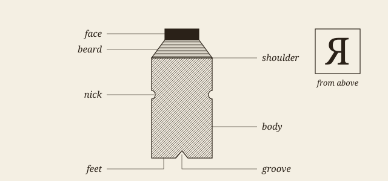
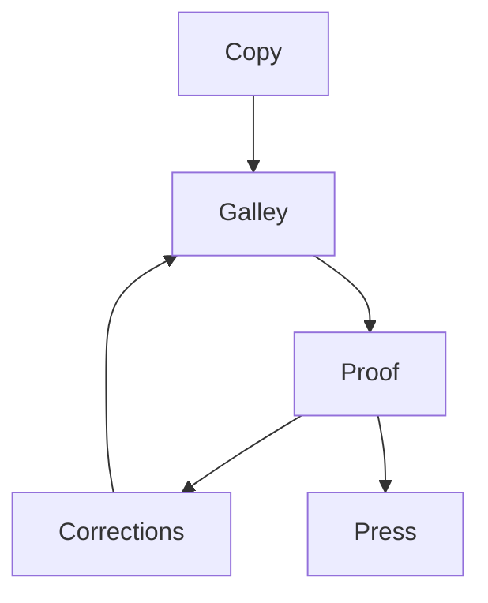

# Of the life that is in books

I deny not, but that it is of greatest concernment in the Church and Commonwealth, to have a vigilant eye how books demean themselves as well as men; and thereafter to confine, imprison, and do sharpest justice on them as malefactors[^1]. For books are not absolutely dead things, but do contain a potency of life in them to be as active as that soul was whose progeny they are; nay, they do preserve as in a vial the purest efficacy and extraction of that living intellect that bred them. I know they are as lively, and as vigorously productive, as those fabulous dragon's teeth; and being sown up and down, may chance to spring up armed men.

And yet, on the other hand, unless wariness be used, as good almost kill a man as kill a good book[^2]. Who kills a man kills a reasonable creature, God's image; but he who destroys a good book, kills reason itself, kills the image of God, as it were in the eye. Many a man lives a burden to the earth; but a good book is the precious life-blood of a master spirit, embalmed and treasured up on purpose to a life beyond life.

> [!NOTE]
> The prose of this sample is Milton's, in the text of Project Gutenberg, ebook 608, which modernises his spelling. Its headings, marginal notes, table, programs, plate, diagram and list were written for this sample.

## The wariness that is needed[^3]

We should be wary therefore what persecution we raise against the living labours of public men, how we spill that seasoned life of man, preserved and stored up in books; since we see a kind of homicide may be thus committed, sometimes a martyrdom, and if it extend to the whole impression, a kind of massacre.

> Lords and Commons of England! consider what nation it is whereof ye are, and whereof ye are the governors: a nation not slow and dull, but of a quick, ingenious and piercing spirit, acute to invent, subtle and sinewy to discourse, not beneath the reach of any point the highest that human capacity can soar to.

### What a browser does with this

A browser breaks each line as it comes. Chromium adjusts the last lines of a paragraph under `text-wrap: pretty`, and it never hyphenates without a dictionary, which is why this skin writes **soft hyphens** into the text, from hyph-utf8's patterns. The full text is free to read at [the address that Project Gutenberg gives it](https://www.gutenberg.org/cache/epub/608/pg608-images.html), or more plainly at https://www.gutenberg.org/ebooks/608 for those who like to see where they are going.

#### What the long s does

Long s and the *ct* and *st* ligatures are features of the font: the stored text keeps its plain letters, so that copying and searching still work.

- the long s takes every place but the end of a word[^5];
- *ct* and *st* tie their letters with a bow;
- code never takes either.

Before this sample is shown, three things must be true:

- [x] every construct appears at least once
- [x] the picture and the diagram are this sample's own
- [ ] a compositor has looked at it

# Of the printer's trade

> [!TIP]
> This chapter is written for this sample, and is not Milton's.

Type was bought by the fount and cast by the founder, and a printer of the century might own only a few sizes. The table gives the sizes that an English shop of the time would name.



Table: The older English names of body sizes, with their usual size in points.

| Name         | Points | Lines per inch |
|:-------------|-------:|---------------:|
| Brevier      |      8 |            9.0 |
| Long Primer  |     10 |            7.2 |
| Pica[^4]     |     12 |            6.0 |
| English      |     14 |            5.1 |
| Great Primer |     18 |            4.0 |

## From copy to sheet

The work passes through a few hands in a fixed order, with one loop in it: a proof comes back until it is clean.



Plate: The stages of the work, from the copy to the press.

### Counting by machine

Counting the characters per line of a page, in *Python*:

```python
# Characters per line of a set page, without its short lines.
def measure(lines, short=0.6):
    longest = max(len(line) for line in lines)
    full = [len(line) for line in lines
            if len(line) > short * longest]
    return sum(full) / len(full)

page = open("page.txt", encoding="utf-8").read()
print(f"{measure(page.splitlines()):.1f} characters")
```

And a rule of French spacing, as a pandoc filter would write it, in *Lua*:

```lua
-- A narrow no-break space before ; ! ? and a no-break one before :
local narrow, plain = "\u{202F}", "\u{A0}"
function Str(word)
  local before, signs = word.text:match("^(.-)([;:!?]+)$")
  if not signs then return nil end
  local space = signs:sub(1, 1) == ":" and plain or narrow
  return pandoc.Str(before .. space .. signs)
end
```

> [!CAUTION]
> A long s in a code block would change the program, so the skin turns every font feature off there.

Lines of type are justified by what lies between the words: for a line of width $L$ and natural width $L_j$ with stretch $Y_j$, the ratio is $r_j = (L - L_j) / Y_j$, and the charge for a break of penalty $\pi_j$ is

$$d_j = \left( 1 + 100 \left| \frac{L - L_j}{Y_j} \right|^{3} + \pi_j \right)^{2}$$

which is why one very loose line costs more than three slightly loose ones.

[^1]: Milton grants the licenser's right before he denies it.

[^2]: The sentence for which the speech is remembered.

[^3]: A note called from a heading, written for this sample: it can have no manchette, so it stays at the end of its section.

[^4]: A note called from a table, written for this sample; it stays at the end of its section too.

[^5]: Rules varied by printer and by decade; this one is this sample's simplification.
