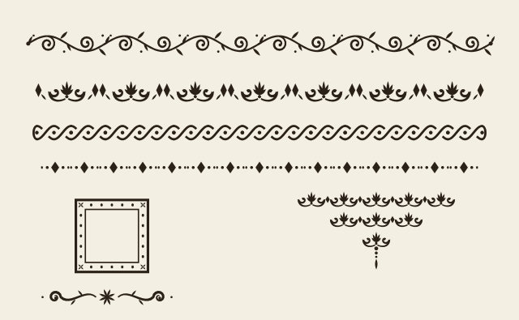

#+TITLE: Candide, ou l'Optimisme
#+SUBTITLE: Traduit de l'allemand de M. le docteur Ralph
#+AUTHOR: Voltaire
#+DATE: 1759
#+LANGUAGE: fr

* Au lecteur
:PROPERTIES:
:UNNUMBERED: t
:END:

#+begin_warning
Cet échantillon est un essai de composition pour un livre du XVIIIe siècle, non une édition. La prose des trois chapitres qui suivent est de Voltaire, dans l'édition de Beuchot (Firmin Didot, 1829), telle que la transcrit le Projet Gutenberg, livre 4650 ; l'essai y rétablit seulement œ là où la transcription écrit oe. Les notes signées B. sont de Beuchot. Les titres de ces chapitres sont de Voltaire. Tout le reste est de l'essai, et n'engage ni l'auteur ni son éditeur.

This eBook is for the use of anyone anywhere in the United States and most other parts of the world at no cost and with almost no restrictions whatsoever. You may copy it, give it away or re-use it under the terms of the Project Gutenberg™ License included with this eBook or online at [[https://www.gutenberg.org/license][www.gutenberg.org]]. If you are not located in the United States, you will have to check the laws of the country where you are located before using this eBook.
#+end_warning

* Comment Candide fut élevé dans un beau château, et comment il fut chassé d'icelui

Il y avait en Vestphalie, dans le château de M. le baron de Thunder-ten-tronckh, un jeune garçon à qui la nature avait donné les mœurs les plus douces. Sa physionomie annonçait son âme. Il avait le jugement assez droit, avec l’esprit le plus simple; c’est, je crois, pour cette raison qu’on le nommait Candide. Les anciens domestiques de la maison soupçonnaient qu’il était fils de la sœur de monsieur le baron et d’un bon et honnête gentilhomme du voisinage, que cette demoiselle ne voulut jamais épouser parce qu’il n’avait pu prouver que soixante et onze quartiers, et que le reste de son arbre généalogique avait été perdu par l’injure du temps.

Monsieur le baron était un des plus puissants seigneurs de la Westphalie, car son château avait une porte et des fenêtres. Sa grande salle même était ornée d’une tapisserie. Tous les chiens de ses basses-cours composaient une meute dans le besoin; ses palefreniers étaient ses piqueurs; le vicaire du village était son grand-aumônier. Ils l’appelaient tous monseigneur, et ils riaient quand il fesait des contes.

Madame la baronne, qui pesait environ trois cent cinquante livres, s’attirait par là une très grande considération, et fesait les honneurs de la maison avec une dignité qui la rendait encore plus respectable. Sa fille Cunégonde, âgée de dix-sept ans, était haute en couleur, fraîche, grasse, appétissante. Le fils du baron paraissait en tout digne de son père. Le précepteur Pangloss[fn:pan] était l’oracle de la maison, et le petit Candide écoutait ses leçons avec toute la bonne foi de son âge et de son caractère.

Pangloss enseignait la métaphysico-théologo-cosmolonigologie. Il prouvait admirablement qu’il n’y a point d’effet sans cause, et que, dans ce meilleur des mondes possibles, le château de monseigneur le baron était le plus beau des châteaux, et madame la meilleure des baronnes possibles.

Il est démontré, disait-il, que les choses ne peuvent être autrement; car tout étant fait pour une fin, tout est nécessairement pour la meilleure fin. Remarquez bien que les nez ont été faits pour porter des lunettes; aussi avons-nous des lunettes[fn:lunettes]. Les jambes sont visiblement instituées pour être chaussées, et nous avons des chausses. Les pierres ont été formées pour être taillées et pour en faire des châteaux; aussi monseigneur a un très beau château: le plus grand baron de la province doit être le mieux logé; et les cochons étant faits pour être mangés, nous mangeons du porc toute l’année: par conséquent, ceux qui ont avancé que tout est bien ont dit une sottise; il fallait dire que tout est au mieux.

Candide écoutait attentivement, et croyait innocemment; car il trouvait mademoiselle Cunégonde extrêmement belle, quoiqu’il ne prît jamais la hardiesse de le lui dire. Il concluait qu’après le bonheur d’être né baron de Thunder-ten-tronckh, le second degré de bonheur était d’être mademoiselle Cunégonde; le troisième, de la voir tous les jours; et le quatrième, d’entendre maître Pangloss, le plus grand philosophe de la province, et par conséquent de toute la terre.

Un jour Cunégonde, en se promenant auprès du château, dans le petit bois qu’on appelait parc, vit entre des broussailles le docteur Pangloss qui donnait une leçon de physique expérimentale à la femme de chambre de sa mère, petite brune très jolie et très docile. Comme mademoiselle Cunégonde avait beaucoup de disposition pour les sciences, elle observa, sans souffler, les expériences réitérées dont elle fut témoin; elle vit clairement la raison suffisante du docteur, les effets et les causes, et s’en retourna tout agitée, toute pensive, toute remplie du désir d’être savante, songeant qu’elle pourrait bien être la raison suffisante du jeune Candide, qui pouvait aussi être la sienne.

Elle rencontra Candide en revenant au château, et rougit: Candide rougit aussi. Elle lui dit bonjour d’une voix entrecoupée; et Candide lui parla sans savoir ce qu’il disait. Le lendemain, après le dîner, comme on sortait de table, Cunégonde et Candide se trouvèrent derrière un paravent; Cunégonde laissa tomber son mouchoir, Candide le ramassa; elle lui prit innocemment la main; le jeune homme baisa innocemment la main de la jeune demoiselle avec une vivacité, une sensibilité, une grâce toute particulière; leurs bouches se rencontrèrent, leurs yeux s’enflammèrent, leurs genoux tremblèrent, leurs mains s’égarèrent. M. le baron de Thunder-ten-tronckh passa auprès du paravent, et voyant cette cause et cet effet, chassa Candide du château à grands coups de pied dans le derrière. Cunégonde s’évanouit: elle fut souffletée par madame la baronne dès qu’elle fut revenue à elle-même; et tout fut consterné dans le plus beau et le plus agréable des châteaux possibles.

[fn:pan] De /pan/, tout, et /glossa/, langue. B.

[fn:lunettes] Voyez tome XXVII, page 528; et dans les /Mélanges/, année 1738, le chapitre XI de la troisième partie des /Éléments de la philosophie de Newton/; et année 1768, le chapitre X des /Singularités de la nature/. B.

* Ce que devint Candide parmi les Bulgares

Candide, chassé du paradis terrestre, marcha longtemps sans savoir où, pleurant, levant les yeux au ciel, les tournant souvent vers le plus beau des châteaux qui renfermait la plus belle des baronnettes; il se coucha sans souper au milieu des champs entre deux sillons; la neige tombait à gros flocons. Candide, tout transi, se traîna le lendemain vers la ville voisine, qui s’appelle /Valdberghoff-trarbk-dikdorff/, n’ayant point d’argent, mourant de faim et de lassitude. Il s’arrêta tristement à la porte d’un cabaret. Deux hommes habillés de bleu le remarquèrent: Camarade, dit l’un, voilà un jeune homme très bien fait, et qui a la taille requise; ils s’avancèrent vers Candide et le prièrent à dîner très civilement.---Messieurs, leur dit Candide avec une modestie charmante, vous me faites beaucoup d’honneur, mais je n’ai pas de quoi payer mon écot.---Ah! monsieur, lui dit un des bleus, les personnes de votre figure et de votre mérite ne paient jamais rien: n’avez-vous pas cinq pieds cinq pouces de haut?---Oui, messieurs, c’est ma taille, dit-il en fesant la révérence.---Ah! monsieur, mettez-vous à table; non seulement nous vous défraierons, mais nous ne souffrirons jamais qu’un homme comme vous manque d’argent; les hommes ne sont faits que pour se secourir les uns les autres.---Vous avez raison, dit Candide; c’est ce que M. Pangloss m’a toujours dit, et je vois bien que tout est au mieux. On le prie d’accepter quelques écus, il les prend et veut faire son billet; on n’en veut point, on se met à table. N’aimez-vous pas tendrement?….---Oh! oui, répond-il, j’aime tendrement mademoiselle Cunégonde.---Non, dit l’un de ces messieurs, nous vous demandons si vous n’aimez pas tendrement le roi des Bulgares?---Point du tout, dit-il, car je ne l’ai jamais vu.---Comment! c’est le plus charmant des rois, et il faut boire à sa santé.---Oh! très volontiers, messieurs. Et il boit. C’en est assez, lui dit-on, vous voilà l’appui, le soutien, le défenseur, le héros des Bulgares; votre fortune est faite, et votre gloire est assurée. On lui met sur-le-champ les fers aux pieds, et on le mène au régiment. On le fait tourner à droite, à gauche, hausser la baguette, remettre la baguette, coucher en joue, tirer, doubler le pas, et on lui donne trente coups de bâton; le lendemain, il fait l’exercice un peu moins mal, et il ne reçoit que vingt coups; le surlendemain, on ne lui en donne que dix, et il est regardé par ses camarades comme un prodige.

Candide, tout stupéfait, ne démêlait pas encore trop bien comment il était un héros. Il s’avisa un beau jour de printemps de s’aller promener, marchant tout droit devant lui, croyant que c’était un privilège de l’espèce humaine, comme de l’espèce animale, de se servir de ses jambes à son plaisir. Il n’eut pas fait deux lieues que voilà quatre autres héros de six pieds qui l’atteignent, qui le lient, qui le mènent dans un cachot. On lui demanda juridiquement ce qu’il aimait le mieux d’être fustigé trente-six fois par tout le régiment, ou de recevoir à-la-fois douze balles de plomb dans la cervelle. Il eut beau dire que les volontés sont libres, et qu’il ne voulait ni l’un ni l’autre, il fallut faire un choix; il se détermina, en vertu du don de Dieu qu’on nomme /liberté/, à passer trente-six fois par les baguettes; il essuya deux promenades. Le régiment était composé de deux mille hommes; cela lui composa quatre mille coups de baguette, qui, depuis la nuque du cou jusqu’au cul, lui découvrirent les muscles et les nerfs. Comme on allait procéder à la troisième course, Candide, n’en pouvant plus, demanda en grâce qu’on voulût bien avoir la bonté de lui casser la tête; il obtint cette faveur; on lui bande les yeux; on le fait mettre à genoux. Le roi des Bulgares passe dans ce moment, s’informe du crime du patient; et comme ce roi avait un grand génie, il comprit, par tout ce qu’il apprit de Candide, que c’était un jeune métaphysicien fort ignorant des choses de ce monde, et il lui accorda sa grâce avec une clémence qui sera louée dans tous les journaux et dans tous les siècles. Un brave chirurgien guérit Candide en trois semaines avec les émollients enseignés par Dioscoride. Il avait déjà un peu de peau et pouvait marcher, quand le roi des Bulgares livra bataille au roi des Abares.

* Comment Candide se sauva d'entre les Bulgares, et ce qu'il devint

Rien n’était si beau, si leste, si brillant, si bien ordonné que les deux armées. Les trompettes, les fifres, les hautbois, les tambours, les canons; formaient une harmonie telle qu’il n’y en eut jamais en enfer. Les canons renversèrent d’abord à peu près six mille hommes de chaque côté; ensuite la mousqueterie ôta du meilleur des mondes environ neuf à dix mille coquins qui en infectaient la surface. La baïonnette fut aussi la raison suffisante de la mort de quelques milliers d’hommes. Le tout pouvait bien se monter à une trentaine de mille âmes. Candide, qui tremblait comme un philosophe, se cacha du mieux qu’il put pendant cette boucherie héroïque.

Enfin, tandis que les deux rois fesaient chanter des /Te Deum/, chacun dans son camp, il prit le parti d’aller raisonner ailleurs des effets et des causes. Il passa par-dessus des tas de morts et de mourants, et gagna d’abord un village voisin; il était en cendres: c’était un village abare que les Bulgares avaient brûlé, selon les lois du droit public. Ici des vieillards criblés de coups regardaient mourir leurs femmes égorgées, qui tenaient leurs enfants à leurs mamelles sanglantes; là des filles éventrées après avoir assouvi les besoins naturels de quelques héros, rendaient les derniers soupirs; d’autres à demi brûlées criaient qu’on achevât de leur donner la mort. Des cervelles étaient répandues sur la terre à côté de bras et de jambes coupés.

Candide s’enfuit au plus vite dans un autre village: il appartenait à des Bulgares, et les héros abares l’avaient traité de même. Candide, toujours marchant sur des membres palpitants ou à travers des ruines, arriva enfin hors du théâtre de la guerre, portant quelques petites provisions dans son bissac, et n’oubliant jamais mademoiselle Cunégonde. Ses provisions lui manquèrent quand il fut en Hollande; mais ayant entendu dire que tout le monde était riche dans ce pays-là, et qu’on y était chrétien, il ne douta pas qu’on ne le traitât aussi bien qu’il l’avait été dans le château de M. le baron, avant qu’il en eût été chassé pour les beaux yeux de mademoiselle Cunégonde.

Il demanda l’aumône à plusieurs graves personnages, qui lui répondirent tous que, s’il continuait à faire ce métier, on l’enfermerait dans une maison de correction pour lui apprendre à vivre.

Il s’adressa ensuite à un homme qui venait de parler tout seul une heure de suite sur la charité dans une grande assemblée. Cet orateur le regardant de travers lui dit: Que venez-vous faire ici? y êtes-vous pour la bonne cause? Il n’y a point d’effet sans cause, répondit modestement Candide; tout est enchaîné nécessairement et arrangé pour le mieux. Il a fallu que je fusse chassé d’auprès de mademoiselle Cunégonde, que j’aie passé par les baguettes, et il faut que je demande mon pain, jusqu’à ce que je puisse en gagner; tout cela ne pouvait être autrement. Mon ami, lui dit l’orateur, croyez-vous que le pape soit l’antechrist? Je ne l’avais pas encore entendu dire, répondit Candide: mais qu’il le soit, ou qu’il ne le soit pas, je manque de pain. Tu ne mérites pas d’en manger, dit l’autre: va, coquin, va, misérable, ne m’approche de ta vie. La femme de l’orateur ayant mis la tête à la fenêtre, et avisant un homme qui doutait que le pape fût antechrist, lui répandit sur le chef un plein….. O ciel! à quel excès se porte le zèle de la religion dans les dames!

Un homme qui n’avait point été baptisé, un bon anabaptiste, nommé Jacques, vit la manière cruelle et ignominieuse dont on traitait ainsi un de ses frères, un être à deux pieds sans plumes, qui avait une âme; il l’amena chez lui, le nettoya, lui donna du pain et de la bière, lui fit présent de deux florins, et voulut même lui apprendre à travailler dans ses manufactures aux étoffes de Perse qu’on fabrique en Hollande. Candide se prosternant presque devant lui, s’écriait: Maître Pangloss me l’avait bien dit que tout est au mieux dans ce monde, car je suis infiniment plus touché de votre extrême générosité que de la dureté de ce monsieur à manteau noir, et de madame son épouse.

Le lendemain, en se promenant, il rencontra un gueux tout couvert de pustules, les yeux morts, le bout du nez rongé, la bouche de travers, les dents noires, et parlant de la gorge, tourmenté d’une toux violente, et crachant une dent à chaque effort.

* Des moyens de cet essai

Ce chapitre et les suivants ne sont plus de Voltaire : ils sont de l'essai, et ne servent qu'à montrer ce que la page compose d'autre que de la prose[fn:essai]. Le XVIIIe siècle n'a connu ni diagramme ni programme ; il faut pourtant qu'ils se lisent ici sans quitter le livre. Quel chemin depuis 1759 ! Le 1er chapitre a donné la mesure de la prose ; celui-ci donne la mesure du reste.

** La mesure des chapitres

Voici, pour commencer, ce que pèsent les trois chapitres qui précèdent[fn:mesure] :

#+CAPTION: Longueur des trois premiers chapitres de /Candide/, comptée par le programme ci-dessous.
| Chapitre     | Mots  | Phrases | Mots par phrase |
|--------------+-------+---------+-----------------|
| <l>          |   <r> |     <r> |             <r> |
| Premier      | 755 | 29 | 26,0 |
| Deuxième     | 734 | 36 | 20,4 |
| Troisième    | 737 | 29 | 25,4 |
| Les trois    | 2 226 | 94 | 23,7 |

*** Le calcul

La longueur moyenne d'une phrase s'écrit $\bar{m} = n^{-1} \sum_{i} m_i$ ; son écart à la moyenne, d'un seul coup :

$$s = \left[ \frac{1}{n - 1} \sum_{i=1}^{n} \left( m_i - \bar{m} \right)^{2} \right]^{\frac{1}{2}}$$

Le tableau se vérifie en quelques lignes de *Python*, où les espaces et les signes restent ceux du programme :

#+begin_src python
# Mots et phrases d'un chapitre, d'après le tableau I.
import re

def mesure(texte):
    mots = re.findall(r"[\w’-]+", texte)
    phrases = re.split(r"[.!?…]+(?:\s|\u2014|$)", texte)
    return len(mots), len([p for p in phrases if p.strip()])

for titre, texte in chapitres.items():  # le long s n'existe pas ici
    print(f"{titre}: {mesure(texte)[0]} mots")
#+end_src

Et de même, pour qui lit ce texte dans *Emacs* :

#+begin_src emacs-lisp
;; La même mesure, en Emacs Lisp.
(defun mots-du-chapitre (debut fin)
  "Compter les mots entre DEBUT et FIN."
  (count-words debut fin))

(mots-du-chapitre (point-min) (point-max))  ; => un nombre
#+end_src

Un programme peut aussi s'ouvrir sur une parenthèse, et porter une ligne de quatre-vingts colonnes :

#+begin_src emacs-lisp
(let ((chapitres 3) (mots 2226))
  ;; Cette ligne de commentaire compte exactement quatre-vingts colonnes en tout
  (/ (float mots) chapitres))
#+end_src

Une accolade, et une ligne plus longue encore, qui se replie :

#+begin_src json
{"chapitres": ["premier", "deuxième", "troisième"], "source": "Projet Gutenberg, livre 4650, édition Beuchot de 1829."}
#+end_src

Et un texte sans langage, qui s'ouvre sur une parenthèse à son tour :

#+begin_example
(a) De pan, tout, et glossa, langue.
(b) Voyez tome XXVII, page 528.
#+end_example

**** Trois remarques

Sur ce calcul, l'essai fait trois remarques :

- le compte des mots suit le programme, et non le dictionnaire;
- le tiret de Beuchot sépare ici les répliques, et clôt donc une phrase;
- les trois chapitres sont de même longueur, à quelques mots près, et la phrase du deuxième est la plus courte.

***** Une liste numérotée

Numérotée à la française, 1°, 2°, 3°, la marche d'une lecture :

1. lire le chapitre premier, puis /le deuxième/;
2. relire, en changeant le corps du texte;
3. juger de l'œil, et non sur la foi d'un chiffre.

****** Un dernier degré

Le sixième et dernier degré de titre se compose en romain, sans rien qui le distingue que sa place.

*** Reste à faire

Pour cet essai, avant qu'on le montre :

- [X] comparer la prose à la transcription numérisée;
- [X] dessiner les vignettes;
- [X] garder le long s en option, et qu'il ne surprenne personne;
- [ ] confronter le texte à l'édition de 1759, ce que l'essai n'a pas fait.

Le texte se lit en entier à l'adresse https://www.gutenberg.org/cache/epub/4650/pg4650-images.html, dont *le premier tome des romans* a servi ici.

** Des vignettes et des planches

L'essai a dessiné ses propres vignettes, qui ne copient pas celles de Fournier le Jeune et n'y prétendent pas.

#+CAPTION: Les bandeaux, le cadre de lettrine, le cul-de-lampe et la vignette de l'essai, agrandis. Dessin de l'essai.

Le livre s'achève sur une réplique que l'on cite encore. Pangloss, au chapitre XXX, disait quelquefois à Candide :

#+begin_quote
Tous les événements sont enchaînés dans le meilleur des mondes possibles; car enfin si vous n’aviez pas été chassé d’un beau château à grands coups de pied dans le derrière pour l’amour de mademoiselle Cunégonde, si vous n’aviez pas été mis à l’inquisition, si vous n’aviez pas couru l’Amérique à pied, si vous n’aviez pas donné un bon coup d’épée au baron, si vous n’aviez pas perdu tous vos moutons du bon pays d’Eldorado, vous ne mangeriez pas ici des cédrats confits et des pistaches. Cela est bien dit, répondit Candide, mais il faut cultiver notre jardin.
#+end_quote

Les guillemets qui courent le long de cette citation sont ceux du temps.

[[file:planche-vignettes.webm][Les mêmes vignettes, parcourues de gauche à droite. Film de l'essai.]]

Et le chemin de Candide dans ces trois chapitres, sous forme de schéma :

#+CAPTION: Le chemin de Candide, du château à la Hollande. Schéma de l'essai.
#+begin_src mermaid
flowchart LR
  C["Le château"] -->|chassé| B("Les Bulgares")
  B --> V["Les baguettes"]
  V -->|grâce| B
  B --> L["La bataille"]
  L --> H("La Hollande")
#+end_src

-----

Quelques termes de ce métier, pour finir :

- alinéa :: le retrait de la première ligne d'un paragraphe; il tient lieu de tout blanc entre deux paragraphes.
- bandeau :: la bande d'ornements qui ouvre un chapitre.
- cul-de-lampe :: l'ornement en triangle qui ferme un livre ou un chapitre.
- lettrine :: la grande capitale qui ouvre un chapitre, ici encadrée sur deux lignes.

[fn:essai] Le long s et les vignettes sont des réglages de la page, non du texte : ni la recherche ni le copier-coller n'y voient autre chose qu'un s. Mme de Graffigny, M. de Voltaire et Mlle Quinault n'ont rien à voir dans ce réglage, sinon pour montrer les lettres supérieures.

[fn:mesure] Chiffres de l'essai, tirés de la transcription du Projet Gutenberg, et non de Voltaire ni de Beuchot.

* De la capitale accentuée

À la première ligne d'un chapitre, la lettrine perd son accent, mais à l'œil seulement : le texte garde sa lettre, et le copier-coller rend un A grave. Le reste du mot passe en petites capitales, quand il y a un reste. Pense-t-on qu'un lecteur s'en aperçoive ? L'essai pose la question sans la trancher.

* De l'accent aigu

États, provinces et communes servent ici de premier mot : É se dresse en E dans le cadre, et le mot garde son accent partout ailleurs, y compris sous la lettrine, où la recherche le retrouve entier.

* De la cédille

Çà et là, une cédille ouvre un chapitre : la lettrine n'en porte pas davantage, et la lettre demeure dans le texte.

* De l'apostrophe

L'apostrophe suit la lettrine sans s'y prendre : le cadre ne tient que la lettre, et le reste du mot, apostrophe comprise, passe en petites capitales.

* Du guillemet

« Il faut cultiver notre jardin », écrit l'auteur. Un alinéa qui s'ouvre sur un guillemet ne reçoit pas de lettrine, faute de lettre à dresser : il commence en retrait, comme tout autre alinéa.

* De l'italique

/Parmi/ les ouvertures possibles, voici un premier mot en italique. La lettrine reste droite, et le reste du mot demeure dans le style que la source lui donne.

* De la réponse courte

Oui.

Un chapitre peut s'ouvrir sur une ligne si courte que le cadre la dépasse. Le paragraphe suivant attend alors le pied du cadre, et garde son alinéa ; sa seconde ligne revient à la marge comme la première.

* De la liste qui suit

Trois cas.

- un paragraphe suit la ligne courte, comme au chapitre précédent;
- une liste la suit, comme ici, et son tiret ne passe pas sous le cadre;
- le cadre ne descend sur aucun des deux, à aucune largeur.
