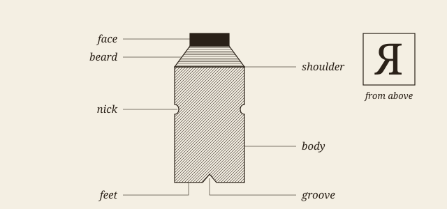
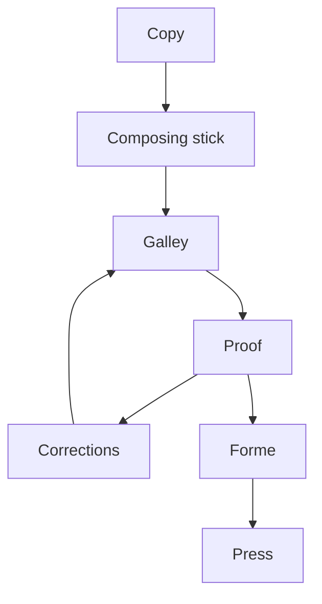

# The writer of dictionaries

It is the fate of those who toil at the lower employments of life, to be rather driven by the fear of evil, than attracted by the prospect of good; to be exposed to censure, without hope of praise; to be disgraced by miscarriage, or punished for neglect, where success would have been without applause, and diligence without reward.

Among these unhappy mortals is the writer of dictionaries; whom mankind have considered, not as the pupil, but the slave of science, the pionier of literature, doomed only to remove rubbish and clear obstructions from the paths through which Learning and Genius press forward to conquest and glory, without bestowing a smile on the humble drudge that facilitates their progress. Every other authour may aspire to praise; the lexicographer can only hope to escape reproach, and even this negative recompense has been yet granted to very few[^1].

> [!NOTE]
> The prose of this first chapter is Samuel Johnson's, as Project Gutenberg gives it in ebook 5430; its heading is this sample's. Everything from the ornament below onwards was written for this sample, apart from the short passage of Moxon, which was checked against Project Gutenberg, ebook 78991.

I have, notwithstanding this discouragement, attempted a dictionary of the English language, which, while it was employed in the cultivation of every species of literature, has itself been hitherto neglected; suffered to spread, under the direction of chance, into wild exuberance; resigned to the tyranny of time and fashion; and exposed to the corruptions of ignorance, and caprices of innovation.

When I took the first survey of my undertaking, I found our speech copious without order, and energetick without rules: wherever I turned my view, there was perplexity to be disentangled, and confusion to be regulated; choice was to be made out of boundless variety, without any established principle of selection; adulterations were to be detected, without a settled test of purity; and modes of expression to be rejected or received, without the suffrages of any writers of classical reputation or acknowledged authority.

Having therefore no assistance but from general grammar, I applied myself to the perusal of our writers; and noting whatever might be of use to ascertain or illustrate any word or phrase, accumulated in time the materials of a dictionary, which, by degrees, I reduced to method, establishing to myself, in the progress of the work, such rules as experience and analogy suggested to me; experience, which practice and observation were continually increasing; and analogy, which, though in some words obscure, was evident in others.

---

## The measure

The measure is the length of the line. Too short, and the sentence is broken up before it has said anything; too long, and the eye loses its place on the way back. A figure often given for a single column of a book is between 45 and 75 characters, with 66 as the usual ideal, and nothing in the screen has changed the reason for it.

### Justified or not

A justified line has one thing to spend: the space between its words. A compositor adds a little here and takes a little there, by hand and by eye, and he rewrites the break when no spacing will serve. *That is a judgement, not a sum.* The rule he works by is older than any machine, and **Joseph Moxon** already set it down for the trade in 1683, in the second volume of his *Mechanick Exercises*:

> A good Compositer is ambitious as well to make the meaning of his Author intelligent to the Reader, as to make his Work shew graceful to the Eye, and pleasant in Reading: [...]

#### What a browser does

A browser breaks each line as it comes, and it looks back only a little. Chromium adjusts the last lines of a paragraph under `text-wrap: pretty`, and neither it nor WebKit hyphenates without a dictionary; the soft hyphens on this page come from a filter that this skin runs. The full text of Moxon is free to read at [the long address that Project Gutenberg gives it](https://gutenberg.org/cache/epub/78991/pg78991-images.html), or more plainly at https://gutenberg.org/files/78991/78991-h/78991-h.htm for those who like to see where they are going.

### Figures in the text

Old-style figures sit in the line as lower-case letters do: a date such as 1755 does not shout, and neither do the numbers in a list.

- the indent marks the paragraph, and white between paragraphs is not needed;
- small capitals are drawn for the job, and do not come from shrinking capitals;
- a band of fleurons opens a chapter, and a plain rule does not.

Before this sample is shown, three things must be true:

- [x] every construct appears at least once
- [x] the picture and the diagram are this sample's own
- [ ] a compositor has looked at it

# Metal, and what it left behind

Nearly every word of the trade comes from the case. The body of a piece of type is what its size measures, and the face is only what prints; the two are not the same, and on a screen they are still kept apart by the difference between the font size and the height of a letter.



Body sizes had names before they had numbers. Fournier proposed a scale of points in 1737, and the older names held on for a long time beside it[^2].

Table: The older English names of body sizes, with their usual size in points.

| Name         | Points | Lines per inch |
|:-------------|-------:|---------------:|
| Brevier      |      8 |            9.0 |
| Bourgeois    |      9 |            8.0 |
| Long Primer  |     10 |            7.2 |
| Small Pica   |     11 |            6.5 |
| Pica         |     12 |            6.0 |
| English      |     14 |            5.1 |
| Great Primer |     18 |            4.0 |

## From copy to sheet

The work passes through a few hands in a fixed order, with one loop in it: a proof comes back until it is clean.



Plate: The stages of the work, from the copy to the press.

### Counting by machine

A short program measures what the eye judges. Counting the characters per line of a page, in *Python*:

```python
# Characters per line of a set page, without its short lines.
def measure(lines, short=0.6):
    longest = max(len(line) for line in lines)
    full = [len(line) for line in lines
            if len(line) > short * longest]
    return sum(full) / len(full)

page = open("page.txt", encoding="utf-8").read()
print(f"{measure(page.splitlines()):.1f} characters")
```

And the rule of French spacing, as a pandoc filter would write it, in *Lua*:

```lua
-- A narrow no-break space before ; ! ? and a no-break one before :
local narrow, plain = "\u{202F}", "\u{A0}"
function Str(word)
  local before, signs = word.text:match("^(.-)([;:!?]+)$")
  if not signs then return nil end
  local space = signs:sub(1, 1) == ":" and plain or narrow
  return pandoc.Str(before .. space .. signs)
end
```

### Breaking by machine

Knuth and Plass published the method that TeX uses in 1981. It weighs every break of a paragraph at once: a line stretched by the ratio $r_j = (L - L_j) / Y_j$ is charged for that stretch, and the paragraph takes the set of breaks with the least total charge. For a line ended at a break of penalty $\pi_j \geq 0$, the charge is

$$d_j = \left( 1 + 100 \left| \frac{L - L_j}{Y_j} \right|^{3} + \pi_j \right)^{2}$$

which is why one very loose line costs more than three slightly loose ones.

[^1]: A note written for this sample: this sentence is the one that everybody quotes, and the rest of the paragraph is rarely read. In this skin notes are called by letters and set at the end of the section.

[^2]: The sizes in the table are the usual modern equivalents, rounded. The lines to the inch are worked out here at 72 points to the inch.
